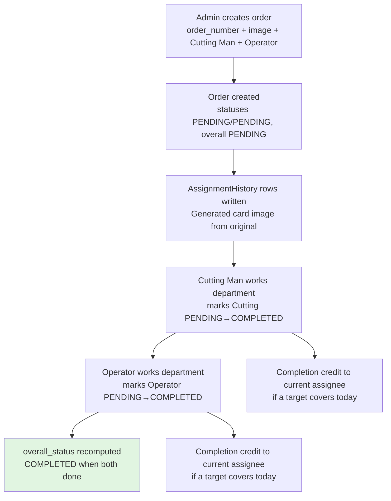
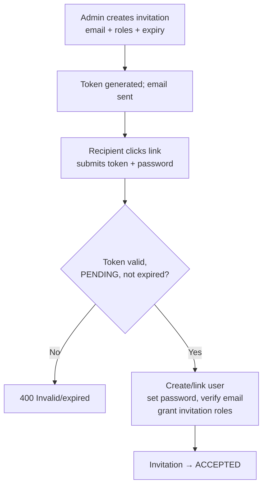
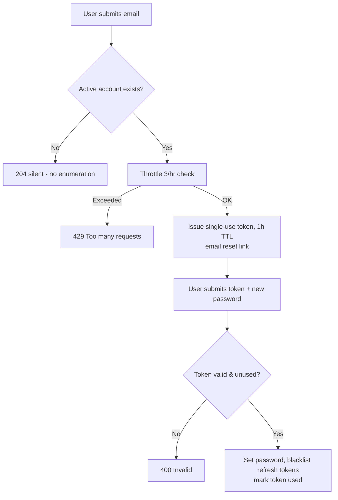

# POMS Business Logic Inventory

**Source of truth:** This document records only business logic **actually implemented** in the POMS Django backend (read-only exploration). No correctness audit, gap analysis, risk assessment, test-coverage analysis, or business-requirement verification is performed. No source code or database was modified.

**Audience:** Non-technical business owner. Plain-language descriptions; every entry cites exact source code.

**Organization:** By Django application, then by business module. Within each module, each discrete business logic item is documented with an 11-point template.

**Module index:**
- [01 Accounts](#accounts) — users, auth, invitations, settings, email
- [02 RBAC](#rbac) — roles, permissions, assignments, scopes, departments
- [03 Orders](#orders) — orders, assignments, images
- [04 Production](#production) — status history, notes, completion credit
- [05 Targets](#targets) — employee targets, completion credits
- [06 Audit](#audit) — immutable security event log
- [07 Reports](#reports) — dashboard and operational reports
- [08 Common](#common) — shared models, image handling, pagination, errors
- [09 Workflow diagrams](#workflows) — Mermaid diagrams for major processes
- [10 Evidence index](#evidence) — file/class/function/line references

---

## Accounts

### A1. User account lifecycle (create, read, update, deactivate, reactivate)

1. **Business Logic Name:** Employee account lifecycle management.
2. **What it does:** Admins can create employee accounts, view the employee list, partially update an employee (name, code, role, email), deactivate an employee (soft-delete: blocks login + revokes all roles + ends department memberships, preserves history), and reactivate an employee (roles are NOT restored — must be re-assigned explicitly). Accounts are never hard-deleted.
3. **Why it exists:** To let an organization onboard staff, keep their profile current, and remove access without destroying order history or audit trails.
4. **Step by step (create):** `EmployeeViewSet.create` → validates `EmployeeCreateSerializer` → `services.create_employee_account` validates password → checks non-OPERATOR role requires `users.manage_users` with `ALL` scope → creates `User` → if email present, sets `requires_email_verification=True` and sends verification email → audits `user.created`. (Deactivate: `deactivate_user` locks the row, refuses self-deactivation / last-superuser, counts active orders, sets `is_active=False`, revokes all `UserRole` and ends `DepartmentMembership`, audits `user.deactivated`.) (Reactivate: `reactivate_user` sets `is_active=True` only, roles not restored, audits `user.reactivated`.)
5. **Trigger:** `POST /api/v1/employees/` (create); `PATCH /api/v1/employees/{id}/` (update); `POST .../deactivate/` and `POST .../reactivate/` actions.
6. **Inputs & conditions:** Create needs username, password (≥8 chars, passes Django validators), full_name, employee_code (unique), optional email/is_active/role. Non-OPERATOR role requires `users.manage_users` + `ALL` scope. Deactivate/refuse: cannot deactivate self; cannot deactivate last active superuser; superuser deactivation requires actor superuser. Role change on an employee with active (uncompleted) Cutting/Operator order assignments is blocked (must reassign orders first).
7. **Outputs / DB changes:** `User` row created/updated; `is_active` flipped; all live `UserRole` rows revoked on deactivate; all live `DepartmentMembership` rows ended on deactivate; audit row written. On email change: `email_verified_at` cleared, `requires_email_verification` set True, verification email sent.
8. **Users/roles:** Admin (via RBAC `users.manage_users`/`employees.*` permissions). Self: `MeView` lets any authenticated active user view/patch own profile (`employees.view_profile`/`edit_profile`, `OWN_PROFILE` or `ALL` scope).
9. **Connections:** Deactivate reads active orders from `orders.Order` (cutting_man/operator not COMPLETED). Role change bridge calls RBAC `sync_legacy_role`. Email verification ties to `accounts` token service.
10. **Concrete example:** Admin creates employee "Rahim" (employee_code E-001, role OPERATOR). Later Rahim is deactivated: his login is blocked, his Cutting_Man/Operator roles are revoked, his department memberships end, but his order history and completion credits remain. Reactivating Rahim restores login but not his old roles.
11. **Source references:** `apps/accounts/views.py:177-274` (EmployeeViewSet); `apps/accounts/services.py:487-548` (create_employee_account); `apps/rbac/services.py:664-732` (deactivate_user/reactivate_user); `apps/accounts/serializers.py:49-126` (EmployeeCreate/UpdateSerializer); `apps/accounts/models.py:50-147` (User).

### A2. Authentication (login, refresh, logout)

1. **Business Logic Name:** JWT-based sign-in / sign-out.
2. **What it does:** A user logs in with email (preferred) or username + password. On success, returns an access token + refresh token. Refresh endpoint exchanges a refresh token for a new access token. Logout blacklists the refresh token. Every failure returns one generic message ("Invalid credentials.") to prevent account enumeration. Login is throttled (5 failures per 15 min per identifier/IP → 15-min lockout).
3. **Why it exists:** Secure, stateless access to the API; prevent brute-force and account enumeration.
4. **Step by step:** `LoginView` → `TokenPairSerializer.validate` → `authenticate_credentials` → `assert_login_allowed` (throttle check) → `resolve_identifier` (email then username) → `check_password` → if inactive or email-unverified-required-and-unverified → record failed attempt → generic failure. On success: record successful attempt, update `last_login`, issue JWT pair. `LogoutView`: blacklist the refresh token via `token_blacklist`.
5. **Trigger:** `POST /api/v1/auth/login/`; `POST /api/v1/auth/refresh/`; `POST /api/v1/auth/logout/`.
6. **Inputs & conditions:** email or username + password. Throttle keyed by identifier + IP. Unverified-email accounts (requires_email_verification && !email_verified_at) cannot log in.
7. **Outputs / DB changes:** Returns `refresh`, `access`, `user`. Writes `LoginAttempt` rows; updates `last_login`. Logout writes `BlacklistedToken`/`OutstandingToken`.
8. **Users/roles:** Any (AllowAny on login/refresh/logout); no RBAC needed.
9. **Connections:** Token contains no authorization claims — permissions are re-resolved from DB per request via `apps.rbac.access`.
10. **Concrete example:** User logs in with email "rahim@factory.com" + password → receives access+refresh tokens. Six wrong attempts within 15 min → 15-minute lockout with generic message.
11. **Source references:** `apps/accounts/views.py:39-76` (Login/Refresh/LogoutView); `apps/accounts/auth.py:75-103` (authenticate_credentials); `apps/accounts/auth.py:56-66` (assert_login_allowed); `apps/accounts/models.py:240-254` (LoginAttempt); `apps/accounts/serializers.py:219-251` (TokenPair/LogoutSerializer).

### A3. Self-service password change

1. **Business Logic Name:** Change own password.
2. **What it does:** Authenticated user replaces their password after proving knowledge of the current password. New password must differ from current and pass Django password validators. Session refresh tokens are blacklisted (force re-login on all devices).
3. **Why it exists:** Let employees rotate credentials without admin help; invalidate old tokens on change.
4. **Step by step:** `ChangePasswordView` → `services.change_password` → verify `current_password` via `check_password` → reject if same as new → `validate_password` → `set_password` → save → blacklist refresh tokens → audit `auth.password_changed`.
5. **Trigger:** `POST /api/v1/auth/change-password/`.
6. **Inputs & conditions:** current_password, new_password (≥8, validators). User must be authenticated & active.
7. **Outputs / DB changes:** `User.password` updated; all `OutstandingToken` for user blacklisted; audit row.
8. **Users/roles:** The authenticated user only.
9. **Connections:** Blacklisting integrates `rest_framework_simplejwt.token_blacklist`.
10. **Concrete example:** Operator changes password from "OldPass1!" to "NewPass2@"; current password verified, new accepted, all refresh tokens invalidated.
11. **Source references:** `apps/accounts/views.py:99-116` (ChangePasswordView); `apps/accounts/services.py:178-259` (change_password/_blacklist_refresh_tokens); `apps/accounts/serializers.py:253-262` (ChangePasswordSerializer).

### A4. Password reset (forgot → email token → reset)

1. **Business Logic Name:** Password reset via single-use time-limited token.
2. **What it does:** User submits email → if an active account exists, a single-use reset token valid 1 hour is issued and emailed (always returns 204, never reveals whether account exists). Throttled to 3 requests/hour per email. User submits token + new password → token consumed (single-use), password set, all refresh tokens blacklisted.
3. **Why it exists:** Let users recover access without admin intervention, without leaking account existence.
4. **Step by step:** `ForgotPasswordView` → `request_password_reset` → throttle check (3/hr) → find active user by email (case-insensitive) → if none, return silently → `_issue_token` invalidates prior unused reset tokens, creates new `OneTimeToken` (hash stored) → email link. `ResetPasswordView` → `reset_password` → `_consume_token` verifies hash/expiry/unused → `set_password` → mark token used → blacklist tokens → audit.
5. **Trigger:** `POST /api/v1/auth/password/forgot/`; `POST /api/v1/auth/password/reset/`.
6. **Inputs & conditions:** email (forgot); token + new_password (reset). Token TTL 1 hour; single-use; prior same-purpose tokens invalidated on new issue.
7. **Outputs / DB changes:** `OneTimeToken` created (hash only); on reset: password changed, token `used_at` set, tokens blacklisted; `LoginAttempt` for throttle; audit rows.
8. **Users/roles:** Public (AllowAny) for both endpoints.
9. **Connections:** Email sending via `services.send_email` (SMTP config or console). Token blacklisting like password change.
10. **Concrete example:** User forgets password → emails "reset" → receives link valid 1 hour → clicks, sets new password → all sessions logged out.
11. **Source references:** `apps/accounts/views.py:119-148` (Forgot/ResetPasswordView); `apps/accounts/services.py:195-248` (request_password_reset/reset_password); `apps/accounts/services.py:63-86` (_issue_token/_consume_token); `apps/accounts/models.py:216-237` (OneTimeToken).

### A5. Email verification

1. **Business Logic Name:** Email address verification.
2. **What it does:** Accounts created with an email are flagged `requires_email_verification=True` and cannot log in until verified. A single-use verification token (valid 3 days) is emailed; clicking verifies `email_verified_at` and clears the requirement. Resend available for unverified accounts. Changing email on profile update clears verification and re-triggers it.
3. **Why it exists:** Ensure email deliverability/ownership before granting login.
4. **Step by step:** `send_email_verification` → `_issue_token` (EMAIL_VERIFICATION, 3 days) → email link. `verify_email` → `_consume_token` → set `email_verified_at`, clear `requires_email_verification` → mark token used → audit. On profile email change (`EmployeeUpdateSerializer.update`/`partial_update`): clear verification, send new verification email.
5. **Trigger:** `POST /api/v1/auth/email/verify/`; `POST /api/v1/auth/email/resend-verification/`; implicitly on account creation / email change.
6. **Inputs & conditions:** token. TTL 3 days, single-use. Configurable system setting `require_email_verification` (default False) gates whether new email accounts require it.
7. **Outputs / DB changes:** `email_verified_at` set; `requires_email_verification` cleared; token `used_at` set; audit row.
8. **Users/roles:** The account owner (public token endpoint; resend requires authenticated active user).
9. **Connections:** Tied to account creation and email-change flows.
10. **Concrete example:** New employee account created with email → cannot log in until clicks verify link (3-day window).
11. **Source references:** `apps/accounts/views.py:151-174` (Verify/ResendVerificationView); `apps/accounts/services.py:264-292` (send_email_verification/verify_email); `apps/accounts/serializers.py:109-126` (EmployeeUpdateSerializer email_changed); `apps/accounts/models.py:75-136` (User verification fields).

### A6. Invitation lifecycle (create, resend, cancel, accept)

1. **Business Logic Name:** Email invitation to join POMS.
2. **What it does:** Admin creates an invitation for an email (+optional roles). A single-use token is generated, expiry snapshotted at creation (invitation_expiry_hours setting, hard max 168h/7 days, default 72h), invitation email sent. Invitation can be resent (new token, expiry unchanged) or cancelled (status CANCELLED). Recipient accepts with token + password → account created (or linked if `user` already set), password set, email verified, roles granted from invitation, status ACCEPTED.
3. **Why it exists:** Controlled onboarding of new employees with pre-assigned roles.
4. **Step by step:** `InvitationViewSet.create` → `create_invitation` → validate email unique (no existing account, no pending invitation) → generate token → create `Invitation` (hash stored, expires_at snapped) → assign roles → email link → audit `invitation.created`. `resend` → new token, bump send_count → audit `invitation.resent`. `cancel` → status CANCELLED → audit `invitation.cancelled`. `accept` → `_consume_token` → if expired, persist EXPIRED then reject → `_accept_locked` → create/link user, set password, verify email, grant roles (skip already-active assignments), mark ACCEPTED → audit `invitation.accepted`.
5. **Trigger:** `POST /api/v1/invitations/`; `POST .../{id}/resend/`; `POST .../{id}/cancel/`; `POST /api/v1/invitations/accept/` (public).
6. **Inputs & conditions:** email, full_name, employee_code, role_ids. Expiry = now + invitation_expiry_hours (capped at 168). Only PENDING invitations can be resent/cancelled. Expired ones are marked EXPIRED.
7. **Outputs / DB changes:** `Invitation` row (token_hash, expires_at); on accept: `User` created, `UserRole` rows, `Invitation.user/status/accepted_at`; audit rows. Raw token never stored.
8. **Users/roles:** Admin (invitations.create/resend/cancel/invitations.manage_settings). Public recipient (accept).
9. **Connections:** Grants `rbac.UserRole` rows; email via `send_email`; expiry setting shared with SystemSettingsView.
10. **Concrete example:** Admin invites "tanveer@factory.com" with Cutting_Man role, 48h expiry → Tanveer accepts with token + password → account created, Cutting_Man role assigned, email auto-verified.
11. **Source references:** `apps/accounts/views.py:285-388` (InvitationViewSet/AcceptInvitationView); `apps/accounts/services.py:308-481` (create/resend/cancel/accept_invitation/_accept_locked); `apps/accounts/models.py:157-208` (Invitation); `apps/accounts/serializers.py:285-342`.

### A7. System settings management

1. **Business Logic Name:** Configure invitation expiry and email-verification policy.
2. **What it does:** Superuser reads/updates `invitation_expiry_hours` (1–168) and `require_email_verification` (bool). Stored as `SystemSetting` key/value JSON. Every change audited with before/after.
3. **Why it exists:** Let operations tune onboarding policy without code changes.
4. **Step by step:** `SystemSettingsView` → `set_setting` → `update_or_create` on `SystemSetting` → audit `system_setting.updated` (before/after values).
5. **Trigger:** `GET/PATCH /api/v1/system/settings/`.
6. **Inputs & conditions:** invitation_expiry_hours (int 1-168), require_email_verification (bool). Requires `system.manage_settings` permission.
7. **Outputs / DB changes:** `SystemSetting` row upserted; audit row.
8. **Users/roles:** Superuser (system.manage_settings).
9. **Connections:** `invitation_expiry_hours()` used by invitation creation; `require_email_verification()` referenced in account creation flow.
10. **Concrete example:** Admin sets invitation expiry to 24h → new invitations expire in 24h (hard cap 168 still applies).
11. **Source references:** `apps/accounts/views.py:467-501` (SystemSettingsView); `apps/accounts/services.py:92-126` (get_setting/set_setting/invitation_expiry_hours); `apps/accounts/models.py:257-271` (SystemSetting).

### A8. Email configuration management + test

1. **Business Logic Name:** SMTP email transport configuration and test.
2. **What it does:** Superuser configures host/port/username/from_email/TLS/SSL/password_env_var/is_active (singleton `EmailConfiguration`). SMTP password is NEVER stored — read from the environment variable named by `password_env_var` at send time. `EmailTestView` sends a test email and reports success/failure.
3. **Why it exists:** Centralized, secret-safe email transport for invites/resets/verification.
4. **Step by step:** `EmailConfigurationView.get`/`patch` → serialize singleton (`load()` via get_or_create) → save with `updated_by` → audit `system.email_config_updated`. `EmailTestView.post` → `send_email` using active config + env password → report outcome (502 on failure).
5. **Trigger:** `GET/PATCH /api/v1/system/email/`; `POST /api/v1/system/email/test/`.
6. **Inputs & conditions:** SMTP fields. `system.manage_email_config` permission. Password from `os.environ[password_env_var]`.
7. **Outputs / DB changes:** `EmailConfiguration` singleton row updated; audit row. No secrets persisted.
8. **Users/roles:** Superuser (system.manage_email_config).
9. **Connections:** Used by all email-sending in `accounts.services`.
10. **Concrete example:** Admin sets SMTP host/port and points `password_env_var=SMTP_PASS`; test email sent successfully using env secret.
11. **Source references:** `apps/accounts/views.py:391-464` (EmailConfiguration/EmailTestView); `apps/accounts/models.py:274-306` (EmailConfiguration.load); `apps/accounts/services.py:132-160` (email_connection/send_email); `apps/accounts/serializers.py:345-384`.

### A9. Legacy role bridge (User.role ↔ RBAC)

1. **Business Logic Name:** Transitional legacy-role synchronization.
2. **What it does:** `User.role` (ADMIN/CUTTING_MAN/OPERATOR, legacy, not used for authorization) is mirrored onto equivalent system RBAC roles and department memberships via post-save signal / `sync_legacy_role`. So legacy clients sending `role` keep working while authorization is permission-based.
3. **Why it exists:** Backwards compatibility during migration from fixed roles to dynamic RBAC.
4. **Step by step:** `User.save` → `sync_legacy_role` → revokes other live system roles → creates/ensures the matching system `UserRole` → sets `DepartmentMembership` (CUTTING/OPERATOR) per `SYSTEM_ROLES[legacy].departments`, primary flag managed.
5. **Trigger:** On `User.save` (create/update of role field).
6. **Inputs & conditions:** `User.role` value. Only if catalogue seeded.
7. **Outputs / DB changes:** `UserRole` rows (revoke old/create new); `DepartmentMembership` rows (end/create, set primary).
8. **Users/roles:** All users (transparent bridge).
9. **Connections:** Feeds RBAC effective access (department memberships used by scope filtering).
10. **Concrete example:** User.role set to CUTTING_MAN → system role CUTTING_MAN assigned + primary department membership in CUTTING department.
11. **Source references:** `apps/accounts/models.py:144-147` (User.save); `apps/rbac/services.py:131-196` (sync_legacy_role); `apps/rbac/constants.py:126-145` (SYSTEM_ROLES/SYSTEM_DEPARTMENTS).

---

## RBAC

### R1. Dynamic role management

1. **Business Logic Name:** Create, update, activate, deactivate, delete business roles.
2. **What it does:** Roles are data (code, name, description, is_active, is_system). Admins create non-system roles; update name/description/code (system roles can't be recoded/deleted); activate/deactivate (refused if it would leave no managing account); delete (refused if system role or still assigned to users). Every change audited.
3. **Why it exists:** Flexible, permission-driven authorization instead of hardcoded roles.
4. **Step by step:** `RoleViewSet` → `services.create_role/update_role/set_role_active/delete_role` → validation (reserved system codes, uniqueness, is_system guards) → row lock (`select_for_update`) → mutate → safeguard checks (`_has_manager`) → audit.
5. **Trigger:** `POST/PUT/PATCH/DELETE /api/v1/rbac/roles/` and activate/deactivate actions.
6. **Inputs & conditions:** code/name/description. `roles.manage_roles` permission. System roles (`ADMIN`/`CUTTING_MAN`/`OPERATOR`) cannot be deleted or recoded.
7. **Outputs / DB changes:** `Role` row; `RolePermission` links unaffected by role update (replaced via R3); audit row.
8. **Users/roles:** Admin (roles.manage_roles).
9. **Connections:** Roles hold `RolePermission` links (R3); assigned to users (R5).
10. **Concrete example:** Admin creates role "Floor Supervisor" with orders.edit_order at DEPARTMENT scope.
11. **Source references:** `apps/rbac/views.py:47-135` (RoleViewSet); `apps/rbac/services.py:202-313` (create/update/set_active/delete_role); `apps/rbac/models.py:110-138` (Role); `apps/rbac/constants.py:126-145` (SYSTEM_ROLES).

### R2. Permission catalogue management

1. **Business Logic Name:** Create, update, activate, deactivate, delete permissions.
2. **What it does:** Permissions are catalogue entries (`module.action` key, name, description, supported_scopes, is_active, is_system). Admins create non-system permissions; system permissions (`system.*`) cannot be created by admins, cannot be deleted (deactivate only), cannot be granted to business roles. Deletion refused if referenced by a role or user restriction. Changes audited.
3. **Why it exists:** Extensible capability registry driving all authorization.
4. **Step by step:** `PermissionViewSet` → serializer validation (key format, module in SCOPE_MODULES, no system prefix, supported_scopes valid, no removal of in-use scopes) → create/update/deactivate/delete → audit.
5. **Trigger:** `POST/PATCH/DELETE /api/v1/rbac/permissions/` and activate/deactivate actions.
6. **Inputs & conditions:** key (module.action), name, supported_scopes. `permissions.manage_permissions`. System permission keys reserved.
7. **Outputs / DB changes:** `Permission` row; audit row.
8. **Users/roles:** Admin (permissions.manage_permissions).
9. **Connections:** Permissions linked to roles (R3) and used in every access check.
10. **Concrete example:** Admin creates permission "reports.view_targets" with ALL/DEPARTMENT/OWN_PROFILE scopes.
11. **Source references:** `apps/rbac/views.py:138-257` (PermissionViewSet); `apps/rbac/models.py:57-107` (Permission); `apps/rbac/serializers.py:24-93`; `apps/rbac/constants.py:19-78` (PERMISSION_CATALOGUE).

### R3. Role–permission assignment (grant scope)

1. **Business Logic Name:** Assign permissions to roles with data scope.
2. **What it does:** Replaces a role's permission set with entries `{permission, scope, options}`. Validates permission exists, active, non-system, scope supported, options is object. If actor holds the role being modified, safeguards ensure actor retains a management permission. Audited with before/after snapshots.
3. **Why it exists:** Precise, scope-controlled delegation of capabilities.
4. **Step by step:** `RoleViewSet.permissions` (PUT) → `services.set_role_permissions` → resolve entries → delete old links not in set → upsert links → actor-management safeguard → audit `role.permissions_updated`.
5. **Trigger:** `PUT /api/v1/rbac/roles/{id}/permissions/`.
6. **Inputs & conditions:** permission key + scope + options. `roles.manage_roles`. Scope must be in permission.supported_scopes.
7. **Outputs / DB changes:** `RolePermission` rows; audit row.
8. **Users/roles:** Admin (roles.manage_roles).
9. **Connections:** Drives `EffectiveAccess.grants()` and queryset filtering (S9/S10).
10. **Concrete example:** Role "Cutting Man" granted orders.view_order with scope ASSIGNED + options {assignment_types: [CUTTING]}.
11. **Source references:** `apps/rbac/views.py:114-127` (RoleViewSet.permissions); `apps/rbac/services.py:315-383` (set_role_permissions); `apps/rbac/models.py:141-173` (RolePermission); `apps/rbac/constants.py:100-145` (ADMIN_PERMISSIONS/SYSTEM_ROLES).

### R4. User–role assignment (grant/revoke)

1. **Business Logic Name:** Assign and revoke roles on users.
2. **What it does:** Assign an active role to a user (creates `UserRole`); revoke (sets `revoked_at`, never deletes). Refused if role inactive, already assigned, already revoked, or superuser target modified by non-superuser. Safeguards: actor cannot strip own last management permission; revoking from another cannot leave zero managing accounts. Audited.
3. **Why it exists:** Controlled membership of users in business roles; history preserved.
4. **Step by step:** `UserRolesView.post`/`UserRoleDetailView.delete` → `services.assign_role/revoke_role` → `select_for_update` on user → validate → create/update `revoked_at`/`revoked_by` → safeguard checks → audit `user_role.assigned`/`revoked`.
5. **Trigger:** `POST /api/v1/rbac/users/{id}/roles/`; `DELETE .../roles/{assignment_id}/`.
6. **Inputs & conditions:** role UUID. `users.manage_users`. Superuser rows require superuser actor.
7. **Outputs / DB changes:** `UserRole` row (created or revoked_at set); audit row.
8. **Users/roles:** Admin (users.manage_users).
9. **Connections:** Effective permissions derived from active assignments (S9).
10. **Concrete example:** Admin assigns role "Operator" to user E-002 → E-002 gains operator-scoped order permissions.
11. **Source references:** `apps/rbac/views.py:401-443` (UserRolesView/UserRoleDetailView); `apps/rbac/services.py:389-441` (assign_role/revoke_role); `apps/rbac/models.py:201-244` (UserRole).

### R5. User scope restrictions (restrict-only)

1. **Business Logic Name:** Per-user, per-permission scope narrowing.
2. **Business Logic Name:** (duplicate heading removed) — User scope restrictions.
2. **What it does:** Admin sets an additional AND-filter scope for one user on one permission (cannot expand beyond role-granted scope). System-level permissions cannot be restricted. Set or delete. Audited.
3. **Why it exists:** Fine-grained narrowing of a specific user's data access without changing roles.
4. **Step by step:** `UserScopeRestrictionsView.put`/`delete` → `services.set_user_scope_restriction/delete_user_scope_restriction` → validate scope supported → update_or_create/delete → audit.
5. **Trigger:** `PUT /api/v1/rbac/users/{id}/scope-restrictions/`; `DELETE .../scope-restrictions/`.
6. **Inputs & conditions:** permission key + scope + options. `scopes.manage_user_restrictions`. Non-system permission only.
7. **Outputs / DB changes:** `UserScopeRestriction` row; audit row.
8. **Users/roles:** Admin (scopes.manage_user_restrictions).
9. **Connections:** Applied as extra AND filter in `EffectiveAccess.filter_queryset` (S10).
10. **Concrete example:** Restrict a manager to view orders only in their department, even though their role grants ALL.
11. **Source references:** `apps/rbac/views.py:476-521` (UserScopeRestrictionsView); `apps/rbac/services.py:447-498` (set/delete_user_scope_restriction); `apps/rbac/models.py:247-281` (UserScopeRestriction).

### R6. Department management

1. **Business Logic Name:** Create, update, delete departments; manage members.
2. **What it does:** Departments (code, name, is_production, is_active). Admins create/update/deactivate; delete refused if active members exist. Members: add user (primary flag; only one primary at a time), end membership (never delete), set primary. All audited.
3. **Why it exists:** Business units for data scoping (department-scoped permissions) and production assignment grouping.
4. **Step by step:** `DepartmentViewSet` → `services.create_department/update_department/delete_department/add_department_member/end_department_membership/set_primary_department` → validation (unique code, active department for membership, unique live membership) → mutate → audit.
5. **Trigger:** `POST/PATCH/DELETE /api/v1/rbac/departments/`; members actions under `.../members/`.
6. **Inputs & conditions:** code (uppercased, unique), name, is_production. `departments.manage_departments`/`manage_members`.
7. **Outputs / DB changes:** `Department` row; `DepartmentMembership` row(s); audit row.
8. **Users/roles:** Admin (departments.manage_departments/manage_members).
9. **Connections:** Department memberships drive `employees_department`/`targets_department`/`orders_department` scope filtering (S10) and production department membership (S7).
10. **Concrete example:** Department CUTTING created; operator E-003 added as member; primary department set.
11. **Source references:** `apps/rbac/views.py:260-395` (DepartmentViewSet); `apps/rbac/services.py:504-657` (department services); `apps/rbac/models.py:32-55` (Department), `298-340` (DepartmentMembership); `apps/rbac/constants.py:148-151` (SYSTEM_DEPARTMENTS).

### R7. Superuser management

1. **Business Logic Name:** Toggle superuser privileges.
2. **What it does:** Superuser enables/disables `is_superuser` (and `is_staff` when enabling) on another user. Always at least one active superuser must remain (row-locked check). Demoting self blocked. Audited.
3. **Why it exists:** Emergency/operational elevation with lockout protection.
4. **Step by step:** `UserSuperuserView.post` → `services.set_superuser` → actor must be superuser → lock all active superusers → if demoting, ensure another active superuser remains → flip flags → audit `user.superuser_changed`.
5. **Trigger:** `POST /api/v1/rbac/users/{id}/superuser/`.
6. **Inputs & conditions:** enabled (bool). `system.manage_superusers`; actor superuser.
7. **Outputs / DB changes:** `User.is_superuser`/`is_staff`; audit row.
8. **Users/roles:** Superuser only.
9. **Connections:** Superusers bypass all RBAC checks (`EffectiveAccess.is_superuser`).
10. **Concrete example:** Admin promotes E-004 to superuser; cannot demote the only remaining superuser.
11. **Source references:** `apps/rbac/views.py:524-543` (UserSuperuserView); `apps/rbac/services.py:735-776` (set_superuser).

### R8. Effective access resolution (authorization engine)

1. **Business Logic Name:** Resolve a user's effective permissions + scopes per request.
2. **What it does:** On each request, `EffectiveAccess` loads grants from active `RolePermission` links (via active `UserRole`) plus `UserScopeRestriction`s. Superuser = all access. `has_permission`, `has_scope`, `filter_queryset`, `has_object_permission`. No caching across requests; nothing in JWT. Changes take effect on next request.
3. **Why it exists:** Single authority for authorization; immediate effect of RBAC changes.
4. **Step by step:** `get_access(request)` memoizes per request → loads grants/restrictions from DB → permission/scope checks; `filter_queryset` unions role scopes, then ANDs user restrictions (never expands); unknown scope → empty set (fail closed).
5. **Trigger:** Every DRF request via `RBACPermission.has_permission/has_object_permission` and view-level `get_access()`.
6. **Inputs & conditions:** request.user (authenticated, active).
7. **Outputs / DB changes:** Read-only; no writes.
8. **Users/roles:** All authenticated users (enforced server-side).
9. **Connections:** Used by every view (orders, production, targets, employees, reports, rbac, audit).
10. **Concrete example:** User with orders.view_order at ASSIGNED/CUTTING sees only orders where they are current cutting_man.
11. **Source references:** `apps/rbac/access.py:18-184` (EffectiveAccess/get_access); `apps/rbac/permissions.py:29-51` (RBACPermission).

### R9. Scope → queryset filter registry

1. **Business Logic Name:** Compile RBAC scopes to SQL filters per module.
2. **What it does:** `build_scope_q(module, scope, options, user)` returns a `Q` (or None = no restriction) for orders/production/employees/targets/departments/reports/rbac/invitations/audit/system. Unknown module/scope → empty Q (fail closed). E.g. orders_assigned filters `cutting_man_id=user` or `operator_id=user`; orders_department filters by members of user's departments.
3. **Why it exists:** Enforce data scoping in SQL before pagination/`get_object()`.
4. **Step by step:** Look up `SCOPE_BUILDERS[module][scope]` → call builder(user, options) → wrap exceptions → return Q or empty.
5. **Trigger:** Inside `EffectiveAccess.filter_queryset` (R8).
6. **Inputs & conditions:** module, scope, options, user.
7. **Outputs / DB changes:** `Q` object (read-only query construction).
8. **Users/roles:** Internal (applies to all users per their scopes).
9. **Connections:** Consumed by R8; builders reference `DepartmentMembership` and order fields.
10. **Concrete example:** `orders_department` for a CUTTING-department member returns orders assigned to any member of CUTTING.
11. **Source references:** `apps/rbac/scopes.py:1-201` (build_scope_q/SCOPE_BUILDERS); `apps/rbac/constants.py:10-14` (scope type constants).

### R10. System catalogue seeding

1. **Business Logic Name:** Seed permissions, system roles, departments on migration.
2. **What it does:** `seed_catalogue` (idempotent) creates `CUTTING`/`OPERATOR` departments, all `PERMISSION_CATALOGUE` permissions (is_system=True), and the three system roles (ADMIN = all non-system perms at ALL; CUTTING_MAN/OPERATOR = department-scoped production perms at ASSIGNED + OWN_PROFILE self perms). Runs via data migration and `post_migrate` receiver (survives `flush`).
3. **Why it exists:** Guarantee a working authorization baseline after every migration/flush.
4. **Step by step:** `post_migrate` → `seed_catalogue` → get_or_create departments/permissions/roles/RolePermissions (catch OperationalError on first pass).
5. **Trigger:** After migrations (post_migrate signal) and initial data migration.
6. **Inputs & conditions:** `PERMISSION_CATALOGUE`, `SYSTEM_ROLES`, `SYSTEM_DEPARTMENTS` constants.
7. **Outputs / DB changes:** Department/Permission/Role/RolePermission rows (idempotent).
8. **Users/roles:** System (no actor).
9. **Connections:** Populates the tables read by R1–R8.
10. **Concrete example:** Fresh `migrate` → CUTTING_MAN role can view/update only its own cutting orders at ASSIGNED scope.
11. **Source references:** `apps/rbac/seed.py:1-72`; `apps/rbac/constants.py:19-151`; `apps/rbac/migrations/0002_seed_catalogue.py`.

---

## Orders

### O1. Order creation

1. **Business Logic Name:** Create a production order with initial assignment and card image.
2. **What it does:** Admin supplies unique `order_number`, original order-card image, Cutting Man, Operator. Both assignees validated (correct role for department, active). Order created with `cutting_status=operator_status=PENDING`; `overall_status` derived (PENDING). Two immutable `AssignmentHistory` rows written (previous=None). Generated order-card image produced from original. All atomic.
3. **Why it exists:** Standard intake of a production job with its two-department assignment and visual card.
4. **Step by step:** `OrderViewSet.create` → `create_order` → `resolve_assignee` for cutting (Role.CUTTING_MAN) and operator (Role.OPERATOR) → `Order.save()` derives overall_status → `AssignmentHistory` ×2 → `_generate_and_attach_image` → return order.
5. **Trigger:** `POST /api/v1/orders/`.
6. **Inputs & conditions:** order_number (unique), original_image (validated image), cutting_man + operator (valid users), created_by. `orders.create_order` permission.
7. **Outputs / DB changes:** `Order` row; 2 `AssignmentHistory` rows; `generated_image` file; audit? (no explicit audit in create_order; image generation). 
8. **Users/roles:** Admin (orders.create_order).
9. **Connections:** Calls production image generation (O4); assignment history (O2); overall status derivation (O3).
10. **Concrete example:** Admin creates Order #ORD-1001 with image, Cutting Man Rahim, Operator Tanveer → statuses PENDING/PENDING, overall PENDING, card image generated.
11. **Source references:** `apps/orders/views.py:92-109` (OrderViewSet.create); `apps/orders/services.py:72-110` (create_order); `apps/orders/models.py:43-141` (Order); `apps/orders/images.py:195-229` (generate_order_card_image).

### O2. Order assignment / reassignment

1. **Business Logic Name:** Assign or reassign an employee to a department on an order.
2. **What it does:** Admin sets the Cutting Man or Operator on an order. New employee validated (role matches department, active). Cannot reassign to the same employee already holding it. Writes immutable `AssignmentHistory` (previous, new, assigned_by), updates current pointer, regenerates card image. Reassignment never changes status and never transfers completion credit. Atomic.
3. **Why it exists:** Allow reallocation of work while preserving a full assignment audit trail.
4. **Step by step:** `OrderViewSet.assign` → `assign_employee` → `resolve_assignee` → check previous != new → `AssignmentHistory.create` → set field → `order.save(update_fields=[field, updated_at])` → `_generate_and_attach_image`.
5. **Trigger:** `PATCH /api/v1/orders/{id}/assign/`.
6. **Inputs & conditions:** department (CUTTING/OPERATOR), employee_id. `orders.assign_order`. Employee active + correct role; not already assigned to that dept.
7. **Outputs / DB changes:** `Order.cutting_man`/`operator` updated; `AssignmentHistory` row; regenerated `generated_image`; overall_status recomputed on save.
8. **Users/roles:** Admin (orders.assign_order).
9. **Connections:** Image regen (O4); status/history (production); completion credit preservation (P3).
10. **Concrete example:** Reassign Order #ORD-1001 Cutting Man from Rahim to Karim → history row (Rahim→Karim), card regenerated, status unchanged, Karim gets no credit for Rahim's completed work.
11. **Source references:** `apps/orders/views.py:129-144` (OrderViewSet.assign); `apps/orders/services.py:114-143` (assign_employee); `apps/orders/models.py:144-179` (AssignmentHistory).

### O3. Overall status derivation (server-side)

1. **Business Logic Name:** Derive overall order status from two department statuses.
2. **What it does:** `overall_status` is computed from `cutting_status` + `operator_status` (PENDING/PENDING→PENDING; Completed/Pending→IN_PROGRESS; Pending/Completed→IN_PROGRESS; Completed/Completed→COMPLETED). `Order.save()` always recomputes (clients cannot set it). A database `CHECK` constraint (`chk_order_overall_status_consistent`) enforces consistency even for bypasses.
3. **Why it exists:** Single source of truth for order completion; clients cannot forge completion.
4. **Step by step:** `Order.save` → `compute_overall_status(cutting_status, operator_status)` → set `overall_status` → super().save(). Any status update (`update_department_status`) triggers `Order.save()` → recompute.
5. **Trigger:** Every `Order.save()` (create, status update, image change).
6. **Inputs & conditions:** cutting_status, operator_status.
7. **Outputs / DB changes:** `Order.overall_status` field.
8. **Users/roles:** Internal (read-only derived field).
9. **Connections:** Read by reports (dashboard/production); gating for deactivation (active orders) and role-change compatibility.
10. **Concrete example:** Cutting=Completed, Operator=Pending → overall=IN_PROGRESS; both Completed → COMPLETED.
11. **Source references:** `apps/orders/models.py:9-29` (compute_overall_status); `apps/orders/models.py:132-137` (Order.save); `apps/orders/migrations/0002_...chk_order_overall_status_consistent.py`.

### O4. Order-card image generation

1. **Business Logic Name:** Generate the generated order-card image from the original.
2. **What it does:** Reads the original uploaded image, overlays Cutting Man's name (top-center) and Operator's name (bottom-center) as configurable text overlays (font/size/color/position scale with dimensions), returns PNG bytes. Original is never modified. Generation always starts from original (never from a generated image). Dimension/pixel caps enforced (decompression-bomb safe).
3. **Why it exists:** Produce a printable/visual order card showing current assignees; regenerated on every assignment/original change.
4. **Step by step:** `generate_order_card_image(original, cutting_name, operator_name)` → open image → `ImageLimits.check_dimensions` → convert RGBA → draw overlays (`_draw_overlay` with font fitting/wrapping) → alpha composite → save PNG bytes.
5. **Trigger:** Called by `create_order`, `assign_employee`, and `OrderViewSet.partial_update` (when original_image changed).
6. **Inputs & conditions:** original image file, cutting_name, operator_name. Limits from settings (max bytes/pixels/dimension, allowed extensions/content types).
7. **Outputs / DB changes:** `Order.generated_image` file (PNG). No original modification.
8. **Users/roles:** Internal (triggered by admin actions).
9. **Connections:** Invoked by O1/O2/O update; limits shared with upload validation (C3).
10. **Concrete example:** Order with Cutting Man "Rahim" and Operator "Tanveer" → card PNG with both names overlaid at configured positions.
11. **Source references:** `apps/orders/images.py:195-229` (generate_order_card_image); `apps/orders/images.py:63-106` (ImageLimits); `apps/orders/services.py:54-68` (_generate_and_attach_image).

### O5. Secure order image delivery

1. **Business Logic Name:** Stream original/generated order images to authorized requesters.
2. **What it does:** Authenticated + object-scoped access (admin or currently-assigned employee via `get_object()`). Streams file from storage (never builds a filesystem path from client input — no path traversal). Content-Disposition inline, `Cache-Control: private, no-store`. Media is never served statically.
3. **Why it exists:** Protect order-card images (potentially sensitive production data) behind authorization.
4. **Step by step:** `original_image`/`generated_image` actions → `get_object()` (RBAC-scoped) → `_serve_order_image(field_file)` → open via storage → guess MIME → FileResponse with headers.
5. **Trigger:** `GET /api/v1/orders/{id}/original-image/`; `GET .../generated-image/`.
6. **Inputs & conditions:** order PK (scoped by `orders.view_media`; `get_object` enforces admin/assignee).
7. **Outputs / DB changes:** None (file stream); no writes.
8. **Users/roles:** Admin or currently assigned employee (orders.view_media, ALL/ASSIGNED/DEPARTMENT).
9. **Connections:** Reads `Order.original_image`/`generated_image` produced by O1/O2/O4.
10. **Concrete example:** Cutting Man Rahim views the card image for an order he is assigned to; an unassigned employee gets 403/404.
11. **Source references:** `apps/orders/views.py:161-195` (_serve_order_image/original_image/generated_image actions).

### O6. Order list/retrieve filtering

1. **Business Logic Name:** Scope order visibility by RBAC scope.
2. **What it does:** List/retrieve orders filtered by `orders.view_order` scope: ALL (every order), ASSIGNED (current assignee), CREATED_BY_ME (orders user created), DEPARTMENT (orders assigned to members of user's departments). Applied in SQL via `EffectiveAccess.filter_queryset`; user restrictions AND-narrow. `get_object()` enforces same scope.
3. **Why it exists:** Employees see only relevant orders; admins see all.
4. **Step by step:** `OrderViewSet.get_queryset` → `orders_for_user(user)` → `EffectiveAccess(user).filter_queryset("orders.view_order", base)` → paginated/filtered response.
5. **Trigger:** `GET /api/v1/orders/` (list); `GET /api/v1/orders/{id}/` (retrieve).
6. **Inputs & conditions:** user's `orders.view_order` grants + restrictions.
7. **Outputs / DB changes:** Read-only queryset.
8. **Users/roles:** Per scope (ALL/admin; ASSIGNED/DEPARTMENT/CREATED_BY_ME employees).
9. **Connections:** Uses R8/R9 scope machinery; order statuses (O3).
10. **Concrete example:** Operator with ASSIGNED/CUTTING sees only orders where they are current cutting_man.
11. **Source references:** `apps/orders/views.py:79-83` (get_queryset); `apps/orders/selectors.py:9-22` (orders_for_user); `apps/rbac/access.py:104-136` (filter_queryset).

---

## Production

### P1. Department status update

1. **Business Logic Name:** Update a department's production status (PENDING ↔ COMPLETED).
2. **What it does:** The currently-assigned employee for a department (or an admin with ALL scope) sets that department's status. Real transitions write `ProductionStatusHistory`; on a genuine move *into* COMPLETED, completion credit is recorded for the employee currently assigned at that moment (never the actor). Request with status == current status is a no-op (no history, no credit). Row-locked (`select_for_update`) to serialize concurrent updates; object-level re-verified after lock. Admin with ALL scope must specify department; employees are limited to departments they're assigned to on that order.
3. **Why it exists:** Track production progress per department and attribute completion credit to the person who did the work.
4. **Step by step:** `OrderViewSet.order_status` → resolve department (ALL-scope admin must specify; employee restricted to assigned depts) → `update_department_status` → validate status → `_authorize_department` (permission + scope + assignee check) → `select_for_update` → re-verify assignee → if previous==new_status return no-op → set field + `save()` (recomputes overall) → `ProductionStatusHistory.create` → if new_status==COMPLETED: `_record_completion` → `record_completion_credits`.
5. **Trigger:** `PATCH /api/v1/orders/{id}/status/`.
6. **Inputs & conditions:** department, status (PENDING/COMPLETED), optional note. `production.update_status`. Must be assigned to that dept on that order (unless ALL scope).
7. **Outputs / DB changes:** Order status field + overall_status; `ProductionStatusHistory` row; `CompletionCredit` rows (on →COMPLETED). Audit? (no direct audit row here, but credit recorded).
8. **Users/roles:** Assigned employee (ASSIGNED/DEPARTMENT scope) or admin (ALL).
9. **Connections:** Completion credit (P2/C4); status history (P2); overall status (O3); targets (C4).
10. **Concrete example:** Cutting Man marks Cutting=Completed on Order #ORD-1001 → history row PENDING→COMPLETED → credit recorded for Rahim if a CUTTING target covers today. Operator still Pending → overall IN_PROGRESS.
11. **Source references:** `apps/orders/views.py:202-239` (order_status); `apps/production/services.py:107-156` (update_department_status/_authorize_department); `apps/production/models.py:10-36` (ProductionStatusHistory); `apps/production/services.py:159-169` (_record_completion).

### P2. Production status history

1. **Business Logic Name:** Immutable log of every department status change.
2. **What it does:** Each real status transition appends a `ProductionStatusHistory` row (order, employee, department, previous_status, new_status, note, created_at). Never updated/deleted. Viewable per order (`history` action) scoped by `orders.view_history`.
3. **Why it exists:** Auditable production progress trail.
4. **Step by step:** Written inside `update_department_status` (P1). Read via `order_status_history` selector → `GET /api/v1/orders/{id}/history/`.
5. **Trigger:** On every real status transition (P1); read on `GET .../history/`.
6. **Inputs & conditions:** order; `production.view_status_history`.
7. **Outputs / DB changes:** `ProductionStatusHistory` rows (append-only).
8. **Users/roles:** Per `orders.view_history` scope (ALL/ASSIGNED/DEPARTMENT).
9. **Connections:** Written by P1; read by reports (orders_completed_today uses status_history).
10. **Concrete example:** Order #ORD-1001 history: Cutting PENDING→COMPLETED (Rahim, 10:00), Operator PENDING→COMPLETED (Tanveer, 11:00).
11. **Source references:** `apps/production/services.py:144-151` (history create); `apps/production/selectors.py:3-5` (order_status_history); `apps/orders/views.py:243-251` (history action); `apps/production/models.py:10-36`.

### P3. Completion credit attribution (Rule A / Rule B)

1. **Business Logic Name:** Attribute completion credit to the currently-assigned employee on a genuine →COMPLETED transition.
2. **What it does:** When a department moves into COMPLETED (and it was a real change), `record_completion_credits` is called for the employee holding that department *at that moment*. The actor (even an admin) never receives credit unless they are the assignee. Reassignment after completion preserves status and transfers no credit. To re-earn, admin reopens (COMPLETED→PENDING) then a new genuine →COMPLETED credits the then-current assignee.
3. **Why it exists:** Fair, tamper-resistant attribution of production output to the person who performed it.
4. **Step by step:** `_record_completion(order, department)` → assignee = order.cutting_man or order.operator → `record_completion_credits(order, employee, department, credit_date=today)` → finds targets for (employee, department) containing today → `get_or_create` `CompletionCredit` per target (UNIQUE(employee,order,target) dedup).
5. **Trigger:** Inside `update_department_status` when new_status==COMPLETED and previous != COMPLETED.
6. **Inputs & conditions:** order, department, employee (current assignee), credit_date (local date).
7. **Outputs / DB changes:** `CompletionCredit` row(s) (one per matching target, deduped).
8. **Users/roles:** The assigned employee receives credit (not the actor).
9. **Connections:** Targets (C4); read by reports (TargetsReport/EmployeePerformance); deactivation counts active orders.
10. **Concrete example:** Rahim (cutting_man) completes Cutting today; a weekly CUTTING target covering today exists → 1 credit. If Karim is later assigned, Karim gets no credit for Rahim's completion.
11. **Source references:** `apps/production/services.py:159-169` (_record_completion); `apps/targets/services.py:63-88` (record_completion_credits); `apps/targets/models.py:59-101` (CompletionCredit).

### P4. Order notes

1. **Business Logic Name:** Add free-form notes to an order, scoped to a department.
2. **What it does:** Authenticated user with `orders.create_note` adds a note (body, department GENERAL/CUTTING/OPERATOR) to an order. Non-ALL-scope users may only note GENERAL or their own departments. Empty body rejected. Notes are readable per order (`notes` action) scoped by `orders.view_notes`.
3. **Why it exists:** Capture department-specific comments/problems on an order.
4. **Step by step:** `OrderViewSet.notes` (POST) → `add_order_note` → strip body (reject empty) → `EffectiveAccess` check `orders.create_note` + scope (ALL or department in {GENERAL} ∪ user's departments) → `OrderNote.create`.
5. **Trigger:** `POST /api/v1/orders/{id}/notes/`; read `GET .../notes/`.
6. **Inputs & conditions:** body (non-empty), department. `orders.create_note`.
7. **Outputs / DB changes:** `OrderNote` row.
8. **Users/roles:** Per `orders.create_note`/`view_notes` scopes.
9. **Connections:** Order-scoped; department-scoped visibility like orders.
10. **Concrete example:** Cutting Man adds a "Cutting problem" note (department=CUTTING) to an order they're assigned to.
11. **Source references:** `apps/orders/views.py:258-281` (notes action); `apps/production/services.py:172-193` (add_order_note); `apps/production/models.py:39-57` (OrderNote).

---

## Targets

### C1. Target creation (with overlap prevention)

1. **Business Logic Name:** Create an employee production target for a period.
2. **What it does:** Admin creates an `EmployeeTarget` (employee, department, period_type DAILY/WEEKLY/MONTHLY, start_date, end_date, target_count). Validates department membership (employee belongs to that active department), end≥start, target_count>0. Prevents overlapping targets for the same (employee, period_type): takes a row lock on the `User` row (mutex) inside `transaction.atomic`, then checks for overlapping ranges; DB exclusion constraint (`btree_gist`) is the backstop. Concurrent overlapping creates → IntegrityError → 400.
3. **Why it exists:** Set production goals per employee per period; prevent conflicting target definitions.
4. **Step by step:** `EmployeeTargetViewSet.create` → `transaction.atomic()` → serializer validate → `EmployeeTarget.objects.create` → `target.achieved_count=0` → response. Overlap check `validate_no_overlap` is available in services (used by tests); the view relies on atomic create + IntegrityError catch + DB constraint.
5. **Trigger:** `POST /api/v1/targets/`.
6. **Inputs & conditions:** employee, department (employee must be member), period_type, start_date, end_date, target_count>0. `targets.manage_targets`. No overlap for same (employee, period_type).
7. **Outputs / DB changes:** `EmployeeTarget` row; `achieved_count` annotated (0).
8. **Users/roles:** Admin (targets.manage_targets).
9. **Connections:** Completion credits (C4) attach to targets; reports (TargetsReport) reads targets.
10. **Concrete example:** Weekly target for Rahim, CUTTING, 03/02–03/08, count 50 → created; a second weekly target for Rahim overlapping that week → rejected.
11. **Source references:** `apps/targets/views.py:59-85` (create); `apps/targets/services.py:36-60` (validate_no_overlap); `apps/targets/models.py:11-57` (EmployeeTarget); `apps/targets/migrations/0002_target_overlap_exclusion.py`.

### C2. Target update

1. **Business Logic Name:** Update an employee target.
2. **What it does:** Admin partially updates a target (department/period/dates/count/employee). Runs in `transaction.atomic()`; saves; overlapping targets rejected via IntegrityError/DB constraint (400). Note: the credit-attributing fields (employee, department, period_type, start_date, end_date) are NOT explicitly frozen here in code (documented as immutable in business-rules.md once credits exist, but the code path shown does not enforce that freeze) — implement behavior as observed: fields are set and saved; overlap checked via DB constraint.
3. **Why it exists:** Adjust targets; keep credit attribution stable.
4. **Step by step:** `EmployeeTargetViewSet.partial_update` → `transaction.atomic()` → set fields → `target.save()` → re-fetch with `achieved_count` annotation → response; IntegrityError → 400 overlap.
5. **Trigger:** `PATCH /api/v1/targets/{id}/`.
6. **Inputs & conditions:** any target fields. `targets.manage_targets`. No overlap.
7. **Outputs / DB changes:** `EmployeeTarget` row updated.
8. **Users/roles:** Admin (targets.manage_targets).
9. **Connections:** Credits derived from targets (C4).
10. **Concrete example:** Change a weekly target's count from 50 to 60 → saved; achieved_count recomputed.
11. **Source references:** `apps/targets/views.py:87-109` (partial_update); `apps/targets/models.py:47-52` (EmployeeTarget.clean validation).

### C3. Period bounds calculation

1. **Business Logic Name:** Calendar period boundaries for targets/reporting.
2. **What it does:** `period_bounds(period_type, on_date)` returns inclusive (start, end): DAILY = the day; WEEKLY = Monday–Sunday of that calendar week; MONTHLY = first–last day of that month.
3. **Why it exists:** Define target period windows consistently (used conceptually for credit eligibility; `record_completion_credits` filters targets by credit_date within [start,end]).
4. **Step by step:** Pure function: DAILY→(d,d); WEEKLY→(Monday, Sunday); MONTHLY→(1st, last_day).
5. **Trigger:** Called by reporting/target logic (imported in common/utils/date_ranges.py; referenced as a helper; direct callers not found in views/services — it is a documented utility).
6. **Inputs & conditions:** period_type (DAILY/WEEKLY/MONTHLY), date.
7. **Outputs / DB changes:** None (returns tuple).
8. **Users/roles:** Internal utility.
9. **Connections:** Supports target-period semantics.
10. **Concrete example:** period_bounds(WEEKLY, 2026-03-05) → (2026-03-02, 2026-03-08).
11. **Source references:** `apps/common/utils/date_ranges.py:14-30` (period_bounds).

### C4. Completion credit recording (deduplicated)

1. **Business Logic Name:** Record completion credits for an employee's order completion.
2. **What it does:** Called when a department completes. Finds all `EmployeeTarget` for (employee, department) whose date range contains `credit_date`; records one `CompletionCredit` per target via `get_or_create` (UNIQUE(employee, order, target) → idempotent). Reopen/re-complete in same period creates no extra credit. Order can earn max one credit per employee+department+target even across reopen/re-complete cycles.
3. **Why it exists:** Measure target achievement; prevent double-counting.
4. **Step by step:** `record_completion_credits(order, employee, department, credit_date)` → filter targets by date range → for each, `get_or_create` CompletionCredit → return created list.
5. **Trigger:** `_record_completion` (P1) on genuine →COMPLETED.
6. **Inputs & conditions:** order, employee, department, credit_date.
7. **Outputs / DB changes:** `CompletionCredit` row(s).
8. **Users/roles:** Internal (credited to employee).
9. **Connections:** Written by production status update (P3); read by reports; protected by PROTECT FK (cannot delete target with credits).
10. **Concrete example:** Rahim completes Cutting today; two targets (weekly + monthly) cover today → 2 credits (one per target), same order.
11. **Source references:** `apps/targets/services.py:63-88` (record_completion_credits); `apps/targets/models.py:59-101` (CompletionCredit); `apps/production/services.py:159-169` (_record_completion).

---

## Audit

### V1. Immutable audit recording

1. **Business Logic Name:** Append-only security event log.
2. **What it does:** Every security-sensitive mutation funnels through `record()` → creates an `AuditLog` row (actor, actor_label, action, target_type/target_id, before/after, metadata, request_id, ip, method, path). Sensitive keys (password, token, etc.) redacted. Rows refuse update/delete at the ORM layer (`save` on existing raises; `delete` raises). Not registered in Django Admin. Single source/funnel for the audit trail.
3. **Why it exists:** Tamper-evident security trail for compliance/review.
4. **Step by step:** `record(actor, action, target=..., before=..., after=..., request=..., **metadata)` → derive target_type/target_id from model → build actor_label (employee_code/username/pk) → extract request method/path/ip/request_id → redact sensitive keys → `AuditLog.objects.create`.
5. **Trigger:** Invoked by all mutating services/views (account, RBAC, orders, etc.) wherever `record` is called.
6. **Inputs & conditions:** actor, action string, optional target/before/after/request/metadata.
7. **Outputs / DB changes:** `AuditLog` row (insert-only).
8. **Users/roles:** Read via `audit-logs` API (`audit_logs.view_logs`); writes internal only.
9. **Connections:** Consumed by RBAC role/permission history views; system setting/email config changes.
10. **Concrete example:** `invitation.created` row with actor employee_code, before/after JSON, IP, request_id.
11. **Source references:** `apps/audit/services.py:59-117` (record); `apps/audit/models.py:15-53` (AuditLog); `apps/audit/views.py:10-27` (AuditLogViewSet); `apps/audit/urls.py:1-9`.

---

## Reports

### R1. Dashboard

1. **Business Logic Name:** High-level operational dashboard statistics.
2. **What it does:** Aggregates: orders_total, orders_by_status, orders_completed_today (orders with COMPLETED overall and a status_history COMPLETED event today), active_employees (active production-department members), employees_by_role (live UserRole counts), employees_by_department (active membership counts), targets_total, completion_credits_total, recent_orders (latest 5 serialized). All gated by `reports.view_reports`.
3. **Why it exists:** Management overview of production health.
4. **Step by step:** `DashboardView.get` → aggregate Order counts by status; count completed today via status_history date filter; DepartmentMembership counts; UserRole counts; CompletionCredit/EmployeeTarget counts; serialize recent 5 orders.
5. **Trigger:** `GET /api/v1/reports/dashboard/`.
6. **Inputs & conditions:** `reports.view_reports`. limit/offset not applied here.
7. **Outputs / DB changes:** Read-only response; no writes.
8. **Users/roles:** `reports.view_reports` (ALL/DEPARTMENT).
9. **Connections:** Reads Order, DepartmentMembership, UserRole, EmployeeTarget, CompletionCredit.
10. **Concrete example:** Dashboard shows 120 orders, 45 COMPLETED, 8 completed today, 15 active employees, 20 targets, 130 credits.
11. **Source references:** `apps/reports/views.py:72-123` (DashboardView); `apps/reports/urls.py:14-15`.

### R2. Employee performance

1. **Business Logic Name:** Per-employee assignment load and completion credits.
2. **What it does:** Lists production employees (active members of active production departments) with counts of cutting-assigned orders, operator-assigned orders, and completion credits. Paginated via limit/offset (max 500).
3. **Why it exists:** Supervisor view of individual workload and achievement.
4. **Step by step:** `EmployeePerformanceView.get` → `_production_employees()` → annotate counts (cutting_orders, operator_orders, completion_credits distinct) → `_apply_limit` → serialize list.
5. **Trigger:** `GET /api/v1/reports/employees/`.
6. **Inputs & conditions:** `reports.view_reports`; limit/offset query params.
7. **Outputs / DB changes:** Read-only response.
8. **Users/roles:** `reports.view_reports`.
9. **Connections:** Reads Order (cutting_orders/operator_orders reverse FKs), CompletionCredit.
10. **Concrete example:** Rahim: 3 cutting orders, 2 operator orders, 7 credits.
11. **Source references:** `apps/reports/views.py:126-156` (EmployeePerformanceView); `apps/reports/urls.py:16-17`.

### R3. Production report

1. **Business Logic Name:** Production status distribution and completion rate.
2. **What it does:** Aggregates orders by cutting_status and by operator_status; total orders; completed orders; completion_rate_percent.
3. **Why it exists:** Throughput and status visibility for production management.
4. **Step by step:** `ProductionReportView.get` → Order.objects.values(cutting_status).annotate(count); same for operator_status; completed = overall_status=COMPLETED count; rate = completed/total*100.
5. **Trigger:** `GET /api/v1/reports/production/`.
6. **Inputs & conditions:** `reports.view_reports`.
7. **Outputs / DB changes:** Read-only response.
8. **Users/roles:** `reports.view_reports`.
9. **Connections:** Reads Order.
10. **Concrete example:** 100 orders; cutting: 20 PENDING/80 COMPLETED; operator: 30/70; 70 completed; 70.00%.
11. **Source references:** `apps/reports/views.py:159-182` (ProductionReportView); `apps/reports/urls.py:17-18`.

### R4. Targets report

1. **Business Logic Name:** Target achievement across all configured targets.
2. **What it does:** Lists each EmployeeTarget with employee, department, period, dates, target_count, achieved (credit count), achievement_percent (capped at 100).
3. **Why it exists:** Track target attainment vs goals.
4. **Step by step:** `TargetsReportView.get` → EmployeeTarget.annotate(achieved=Count(credits)) → `_apply_limit` → serialize with achievement_percent = min(achieved,target_count)/target_count*100.
5. **Trigger:** `GET /api/v1/reports/targets/`.
6. **Inputs & conditions:** `reports.view_reports`; limit/offset.
7. **Outputs / DB changes:** Read-only response.
8. **Users/roles:** `reports.view_reports`.
9. **Connections:** Reads EmployeeTarget + CompletionCredit.
10. **Concrete example:** Weekly target count 50, achieved 42 → 84.00%.
11. **Source references:** `apps/reports/views.py:185-217` (TargetsReportView); `apps/reports/urls.py:18-19`.

---

## Common

### M1. TimeStampedUUID base model

1. **Business Logic Name:** UUID primary key + timestamps base.
2. **What it does:** Abstract model giving every entity a UUID primary key (no sequential-id enumeration) plus `created_at`/`updated_at`.
3. **Why it exists:** Consistent identity and audit timestamps across all domain models; security through unguessable IDs.
4. **Step by step:** Inherited by User, Invitation, OneTimeToken, Department, Role, Permission, Order, EmployeeTarget, CompletionCredit, OrderNote, etc.
5. **Trigger:** Model definition time (Django).
6. **Inputs & conditions:** None.
7. **Outputs / DB changes:** Schema: id UUID PK, created_at, updated_at.
8. **Users/roles:** Internal.
9. **Connections:** Base for all domain models.
10. **Concrete example:** Order.id is a UUID, not an auto-increment integer.
11. **Source references:** `apps/common/models.py:1-19`.

### M2. Image upload validation

1. **Business Logic Name:** Validate order-card image uploads.
2. **What it does:** `validate_image_file` checks: non-empty, size ≤ max_bytes, content type allowed, extension allowed, real decodable image (Pillow), dimensions ≤ caps, no decompression bomb. File pointer reset after. Header-only dimension check (no full decode).
3. **Why it exists:** Reject unsafe/oversized/non-image files before storage or processing.
4. **Step by step:** `validate_image_file(uploaded_file)` → size → content_type → extension → `Image.open` + `check_dimensions` + `verify()` → seek(0).
5. **Trigger:** During order creation/update image upload (serializer validation).
6. **Inputs & conditions:** uploaded file. Limits from `ImageLimits.from_settings()`.
7. **Outputs / DB changes:** None; raises ValidationError on failure.
8. **Users/roles:** Internal (upload path).
9. **Connections:** Shares `ImageLimits` with generation (O4); settings from base.py (MAX_ORDER_IMAGE_*).
10. **Concrete example:** 15MB JPG rejected (max 10MB); renamed .exe with image bytes rejected by verify().
11. **Source references:** `apps/common/utils/file_validation.py:21-75`; `apps/orders/images.py:63-106` (ImageLimits); `config/settings/base.py:293-301`.

### M3. Image card generation

1. **Business Logic Name:** Generate order-card overlay image (see O4).
2. **What it does:** Same as O4 — listed once under Orders. (Common shares ImageLimits config.)
3. **Source references:** `apps/orders/images.py`.

### M4. Pagination

1. **Business Logic Name:** Standard paginated list responses.
2. **What it does:** Page-number pagination, default 20, client-tunable `?page_size=` capped at 200.
3. **Source references:** `apps/common/pagination.py:1-13`; `config/settings/base.py:197`.

### M5. Error envelope

1. **Business Logic Name:** Consistent API error response shape.
2. **What it does:** `poms_exception_handler` wraps DRF exceptions into `{detail, errors?, code?}`; `ProtectedError` → 409 (cannot delete referenced record); `BusinessRuleError` → 400 with field errors.
3. **Source references:** `apps/common/exceptions.py:1-68`.

### M6. Health check

1. **Business Logic Name:** Database connectivity probe.
2. **What it does:** Public (AllowAny) endpoint verifying `SELECT 1`; returns healthy 200 or unhealthy 503.
3. **Source references:** `apps/common/health.py:1-45`; `config/api_urls.py:41`.

---

## Workflow diagrams

### W1. Order lifecycle (create → assign → work → complete)



### W2. Status update & completion credit

```mermaid
flowchart TD
    A[Employee requests status change<br/>department + status] --> B{Has permission?}
    B -->|No| C[403 Business rule error]
    B -->|Yes| D{Is assigned to dept on order?<br/>(or ALL-scope admin)}
    D -->|No| C
    D -->|Yes| E[Row lock on order<br/>re-verify assignee]
    E --> F{new_status == current?}
    F -->|Yes| G[No-op: no history, no credit]
    F -->|No| H[Update status<br/>write ProductionStatusHistory]
    H --> I{new_status == COMPLETED?}
    I -->|No| J[Done; overall recomputed]
    I -->|Yes| K[Record completion credit<br/>to CURRENT assignee<br/>deduped per (employee,order,target)]
```

### W3. Invitation acceptance



### W4. Password reset



### W5. RBAC authorization (per request)

```mermaid
flowchart TD
    A[Incoming API request] --> B[Authenticated & active?]
    B -->|No| C[401/403]
    B -->|Yes| D[RBACPermission: required key?]
    D -->|No key| E[Allow]
    D -->|Yes| F[EffectiveAccess: grants + restrictions<br/>from DB (no cache, not in JWT)]
    F --> G{has_permission?}
    G -->|No| C
    G -->|Yes| H{object-level? filter_queryset}
    H --> I[Apply scope Q (ALL/ASSIGNED/DEPT/etc)<br/>AND user restrictions - never expand]
    I --> J[Execute scoped query]
```

### W6. Target creation with overlap prevention

```mermaid
flowchart TD
    A[Admin creates target<br/>employee+department+period+dates] --> B[transaction.atomic() begin]
    B --> C[Row lock on User row<br/>mutex for concurrency]
    C --> D[Check overlapping targets<br/>same employee+period_type]
    D -->|Overlap| E[400 Overlapping target]
    D -->|None| F[Create EmployeeTarget<br/>DB exclusion constraint backstop]
    F --> G[Commit]
    style E fill:#fdd
```

---

## Evidence index

| Logic | File | Lines | Symbol |
|---|---|---|---|
| Accounts user lifecycle | `apps/accounts/views.py` | 177-274 | `EmployeeViewSet` |
| Accounts services | `apps/accounts/services.py` | 487-548 | `create_employee_account` |
| Accounts deactivate/reactivate | `apps/rbac/services.py` | 664-732 | `deactivate_user`, `reactivate_user` |
| Auth login/refresh/logout | `apps/accounts/views.py` | 39-76 | `LoginView`, `RefreshView`, `LogoutView` |
| Auth credentials | `apps/accounts/auth.py` | 75-103 | `authenticate_credentials` |
| Login throttling | `apps/accounts/auth.py` | 56-66 | `assert_login_allowed` |
| Password change | `apps/accounts/services.py` | 178-259 | `change_password` |
| Password reset | `apps/accounts/services.py` | 195-248 | `request_password_reset`, `reset_password` |
| Email verification | `apps/accounts/services.py` | 264-292 | `send_email_verification`, `verify_email` |
| Invitations | `apps/accounts/services.py` | 308-481 | `create_invitation`, ...`accept_invitation` |
| Invitation views | `apps/accounts/views.py` | 285-388 | `InvitationViewSet`, `AcceptInvitationView` |
| System settings | `apps/accounts/services.py` | 92-126 | `set_setting`, `invitation_expiry_hours` |
| Email config | `apps/accounts/services.py` | 132-160 | `email_connection`, `send_email` |
| Legacy role bridge | `apps/rbac/services.py` | 131-196 | `sync_legacy_role` |
| RBAC models | `apps/rbac/models.py` | 1-340 | Role, Permission, UserRole, Dept, etc. |
| RBAC access engine | `apps/rbac/access.py` | 18-184 | `EffectiveAccess`, `get_access` |
| RBAC permissions | `apps/rbac/permissions.py` | 29-51 | `RBACPermission` |
| RBAC scope registry | `apps/rbac/scopes.py` | 1-201 | `build_scope_q`, `SCOPE_BUILDERS` |
| RBAC constants | `apps/rbac/constants.py` | 1-156 | `PERMISSION_CATALOGUE`, `SYSTEM_ROLES` |
| RBAC seeding | `apps/rbac/seed.py` | 1-72 | `seed_catalogue` |
| RBAC services | `apps/rbac/services.py` | 202-776 | role/perm/assignment/dept/superuser services |
| Order creation | `apps/orders/services.py` | 72-110 | `create_order` |
| Order assign | `apps/orders/services.py` | 114-143 | `assign_employee` |
| Order model + overall status | `apps/orders/models.py` | 9-141 | `compute_overall_status`, `Order` |
| Image generation | `apps/orders/images.py` | 195-229 | `generate_order_card_image` |
| Image limits | `apps/orders/images.py` | 63-106 | `ImageLimits` |
| Image validation | `apps/common/utils/file_validation.py` | 21-75 | `validate_image_file` |
| Image delivery | `apps/orders/views.py` | 161-195 | `_serve_order_image` |
| Order views | `apps/orders/views.py` | 42-281 | `OrderViewSet` |
| Order selectors | `apps/orders/selectors.py` | 1-29 | `orders_for_user` |
| Production status | `apps/production/services.py` | 107-156 | `update_department_status` |
| Completion record | `apps/production/services.py` | 159-169 | `_record_completion` |
| Production history | `apps/production/models.py` | 10-36 | `ProductionStatusHistory` |
| Order notes | `apps/production/services.py` | 172-193 | `add_order_note` |
| Production selectors | `apps/production/selectors.py` | 1-9 | `order_status_history`, `order_notes` |
| Targets model | `apps/targets/models.py` | 1-101 | `EmployeeTarget`, `CompletionCredit` |
| Targets services | `apps/targets/services.py` | 15-88 | `validate_no_overlap`, `record_completion_credits` |
| Targets views | `apps/targets/views.py` | 22-109 | `EmployeeTargetViewSet` |
| Date ranges | `apps/common/utils/date_ranges.py` | 14-30 | `period_bounds` |
| Audit service | `apps/audit/services.py` | 59-117 | `record` |
| Audit model | `apps/audit/models.py` | 15-53 | `AuditLog` |
| Audit view | `apps/audit/views.py` | 10-27 | `AuditLogViewSet` |
| Reports views | `apps/reports/views.py` | 67-217 | Dashboard/EmployeePerformance/Production/Targets |
| Common base model | `apps/common/models.py` | 1-19 | `TimeStampedUUIDModel` |
| Common exceptions | `apps/common/exceptions.py` | 1-68 | `BusinessRuleError`, `poms_exception_handler` |
| Common pagination | `apps/common/pagination.py` | 1-13 | `StandardResultsSetPagination` |
| Health check | `apps/common/health.py` | 1-45 | `HealthCheckView` |
| Settings | `config/settings/base.py` | 1-339 | DRF, JWT, image limits, email |
| URLs | `config/api_urls.py` | 1-47 | API v1 route aggregation |

---

## Notes on scope

- This inventory documents **implemented behavior only**, traced from source. Where a business-rules document (`docs/business-rules.md`) states a rule not visibly enforced in code (e.g., target field immutability after credits), it is noted as observed behavior rather than assumed.
- Nothing here classifies functionality as missing, incorrect, or risky. No test coverage or correctness claims are made.
- All mutating logic runs inside `transaction.atomic` and is audited via `apps.audit.services.record`.
- Authorization is permission-based (RBAC), resolved from the database on every request; the legacy `User.role` field is a compatibility bridge only.
