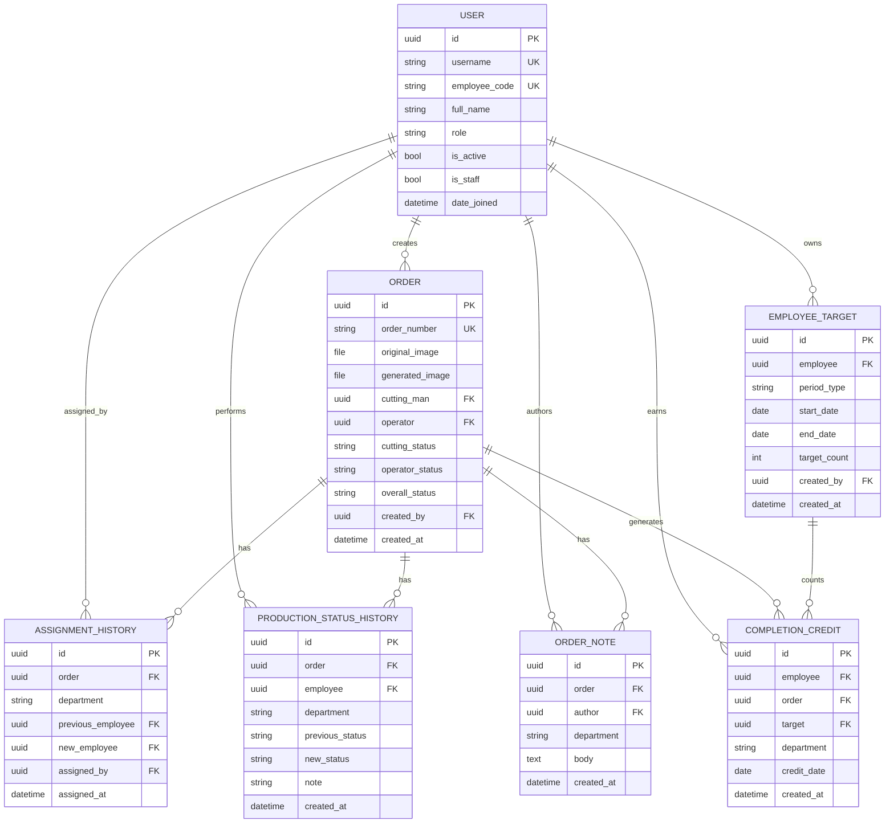

# Database Design

PostgreSQL is the primary database. The schema is normalized, UUID-keyed, and
designed to **preserve history** (soft deactivation, immutable history tables).

## ER Diagram

## Model summary

### User (`accounts.User`)
Custom user extending `AbstractUser`, UUID PK. Fields: `full_name`,
`employee_code` (unique), `role` ∈ {ADMIN, CUTTING_MAN, OPERATOR}. Employees are
**deactivated** (`is_active=False`), never hard-deleted, to preserve history.

### Order (`orders.Order`)
- `order_number` — unique, admin-supplied.
- `original_image` — uploaded order card (never modified).
- `generated_image` — derived overlay image (null until generated).
- `cutting_man`, `operator` — current assignees (FK → User, role-validated).
- `cutting_status`, `operator_status` — PENDING / COMPLETED.
- `overall_status` — **derived**, never set by clients.
- `created_by` — FK → User.

### AssignmentHistory (`orders.AssignmentHistory`)
Immutable log of every assignment/reassignment: order, department,
previous/new employee, assigned_by, timestamp. Written only by the service layer.

### ProductionStatusHistory (`production.ProductionStatusHistory`)
Immutable log of every department status change: order, employee, department,
previous/new status, note, timestamp.

### OrderNote (`production.OrderNote`)
Free-form notes tied to an order and author, scoped to a department
(GENERAL / CUTTING / OPERATOR).

### EmployeeTarget (`targets.EmployeeTarget`)
A production target: employee, period_type (DAILY/WEEKLY/MONTHLY),
start/end date, target_count, created_by.

### CompletionCredit (`targets.CompletionCredit`)
Immutable, **deduplicated** credit row created when an employee completes a
department on an order within a target period. `UNIQUE(employee, order, target)`
guarantees an order is counted at most once per target period even across
reopen/re-complete cycles.

## Integrity & performance

- **Foreign keys** with `on_delete=PROTECT` for history/credit (prevent deleting
  referenced users/orders) and `CASCADE` only for owned child notes where safe.
- **Unique constraints:** `order_number`, `employee_code`, `UNIQUE(employee,
  order, target)` on completion credit.
- **Check constraints / validation:** role must match department on assignment;
  only PENDING/COMPLETED statuses.
- **Indexes:** on `order`, `employee`, `department`, `created_at`, statuses, and
  `(role, is_active)` for fast employee lookups.
- **Soft deletion:** employees deactivated; orders retained.
- **Concurrency:** writes to current assignment + history + credit happen inside
  `transaction.atomic()`; completion credit uniqueness prevents double counting
  under concurrent requests.
- **N+1 avoidance:** list endpoints use `select_related`/`prefetch_related` in
  selector functions.