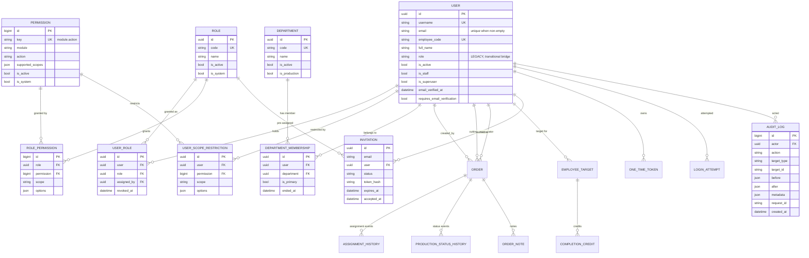
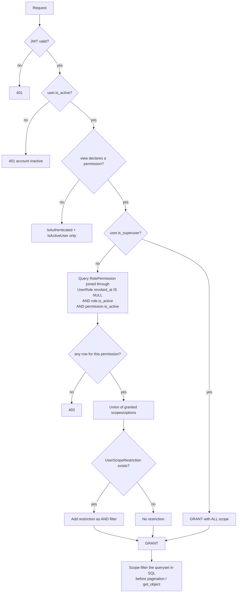

# Phase 2 — Final RBAC Architecture

**Project:** POMS (Production Order Management System)
**Status:** Design baseline for Phases 4–8. Implementation follows this document; deviations are
recorded in §11 (Decisions) with their reason.

---

## 1. Design in one paragraph

Authorization becomes a **two-dimensional** decision: a **permission** (`module.action`, database
row) decides *whether* an action is allowed, and a **scope** attached to that permission decides
*which rows* the action may touch. Permissions are never stored on users — they are reached through
**roles**, a user may hold **many roles**, and effective permissions are the **union** across all
*active* roles. Scopes are per `(role, permission)` and are configured from a fixed, code-owned
vocabulary (`ALL`, `ASSIGNED`, `CREATED_BY_ME`, `DEPARTMENT`, `OWN_PROFILE`). A **user-level
restriction** may only narrow the result: it is applied as an additional `AND` filter, never as an
`OR`, so it cannot expand access by construction. Everything is resolved from the database on every
request (no permission caching, no authorization claims in the JWT), which makes permission changes
effective immediately. Every mutating security operation is transactional, concurrency-guarded, and
recorded in an append-only `AuditLog`.

---

## 2. Component map

```
apps/rbac/                     ← new: authorization core
  constants.py                 scope vocabulary, permission catalogue spec, system role seeds
  models.py                    Permission, Role, RolePermission, UserRole,
                               UserScopeRestriction, Department, DepartmentMembership
  scopes.py                    scope → queryset filter registry (SQL-level)
  access.py                    EffectiveAccess: resolve, has_permission, filter_queryset
  permissions.py               HasPermission / HasAnyPermission DRF classes
  services.py                  role & permission lifecycle, assignment, departments,
                               self-lockout & last-superuser guards
  serializers.py / views.py / urls.py / admin.py

apps/audit/                    ← new: append-only audit trail
  models.py                    AuditLog (immutable)
  services.py                  record(...) with actor + request context + request id
  views.py / urls.py           read-only, filtered, permission-gated

apps/accounts/                 ← extended
  models.py                    User (+email_verified_at, requires_email_verification),
                               Invitation, OneTimeToken, LoginAttempt,
                               EmailConfiguration, SystemSetting
  auth.py                      identifier resolution (email or username), login throttle
  services.py                  password change/reset, verification, invitations,
                               user lifecycle (deactivate/reactivate), superuser guard
  views.py / urls.py           + change-password, forgot/reset, verify, invitations

apps/orders|production|targets|reports
                               ← rewired: permission + scope checks replace `role ==` checks
```

---

## 3. Data model (ERD)



### 3.1 Constraint summary

| Table | Constraint | Purpose |
|---|---|---|
| `rbac_permission` | `UNIQUE(key)` | stable catalogue identity |
| `rbac_role` | `UNIQUE(code)` | stable role identity |
| `rbac_rolepermission` | `UNIQUE(role, permission)` | one scope per permission per role |
| `rbac_userrole` | `UNIQUE(user, role) WHERE revoked_at IS NULL` | no duplicate live grants, full history retained |
| `rbac_userscoperestriction` | `UNIQUE(user, permission)` | one restriction per permission per user |
| `rbac_department` | `UNIQUE(code)` | stable department identity |
| `rbac_departmentmembership` | `UNIQUE(user, department) WHERE ended_at IS NULL` | one live membership per pair |
| `accounts_user` | `UNIQUE(LOWER(email)) WHERE email <> ''` | unique email for login-capable users |
| `accounts_invitation` | `UNIQUE(token_hash)` | single-use lookup |
| `accounts_onetimetoken` | `UNIQUE(token_hash)` | single-use lookup |

Indexes: `(role, permission)` on rolepermission (implicit via unique), `(user, revoked_at)` on
userrole, `(permission)` on userscoperestriction, `(user, department, ended_at)` on membership,
`(created_at)` and `(action, created_at)` and `(target_type, target_id)` on auditlog.

FK deletion policy: `RolePermission` and `UserScopeRestriction` cascade with their parent
(pure association rows). `UserRole` → `PROTECT` on both sides so an assignment can never be
silently destroyed; revocation is explicit. `DepartmentMembership` → `PROTECT` on department,
`CASCADE` on user only through explicit service code (users are never hard-deleted). `AuditLog`
→ `SET_NULL` on actor plus an `actor_label` snapshot, so the trail survives account removal.

---

## 4. Authorization evaluation

### 4.1 Permission resolution flow



Properties that follow directly from this flow:

- **Union, not intersection**, across roles — one role granting a permission is enough.
- **No DENY grants** exist; absence of a grant is the only denial.
- **Deactivated role** (`is_active=False`) contributes nothing (`role.is_active` in the JOIN).
- **Deactivated permission** contributes nothing (`permission.is_active`).
- **Revoked assignment** (`revoked_at` set) contributes nothing and is retained as history.
- **Deactivated user** never reaches step D (`IsActiveUser` is a global default permission class).
- **Superuser** is the only identity-based bypass; it is a system plane, not a business role.

### 4.2 Scope evaluation flow

Scopes are compiled to `Q` objects and ANDed onto the queryset, so filtering happens in SQL:

```
rows(user, permission) =
    all_rows.filter( OR over role grants of their Q )      # union
              .filter( AND over user restrictions Q )      # narrowing only
```

Because the restriction is appended with `.filter()` (AND) and never ORed, *no configuration can
expand the role-derived row set*. That property is enforced structurally, not by a validation rule.

Scope builders (registry in `apps/rbac/scopes.py`):

| Resource | `ALL` | `ASSIGNED` | `CREATED_BY_ME` | `DEPARTMENT` | `OWN_PROFILE` |
|---|---|---|---|---|---|
| `orders` | all | `cutting_man=u OR operator=u` (optionally limited to `options.assignment_types`) | `created_by=u` | orders where current assignee belongs to one of *my* departments | n/a |
| `employees` | all | n/a | n/a | users with a live membership in one of *my* departments | `pk=u.pk` |
| `targets` | all | n/a | n/a | targets whose employee is in one of *my* departments | `employee=u` |
| `departments` | all | n/a | n/a | departments I belong to | n/a |
| `audit` / `rbac` / `invitations` | all | n/a | n/a | n/a | n/a |

"A scope that is not applicable to a resource" is **rejected at write time**
(`RolePermission`/`UserScopeRestriction` validation against `Permission.supported_scopes`) and at
**evaluation time treated as no rows** (fail closed), never as `ALL`.

### 4.3 Object-level authorization

Object access goes through `get_object()` on the **scope-filtered** queryset. Consequently an
out-of-scope object is a **404**, not a 403 — this preserves the existing (and correct)
non-disclosure behaviour of the order API and keeps every history/media sub-resource BOLA-safe
without special cases.

Services that act on an object (status transitions, notes, assignment) re-check object access via
`EffectiveAccess.has_object_permission(user, permission, obj)` — implemented as
`filter_queryset(...).filter(pk=obj.pk).exists()` — under the existing `select_for_update()` lock.

---

## 5. Permission catalogue (system-seeded)

Keys are stable; `module` selects the scope registry; `supported_scopes` is validated on write.

| Key | Module | Supported scopes |
|---|---|---|
| `orders.view_order` | orders | ALL, ASSIGNED, DEPARTMENT, CREATED_BY_ME |
| `orders.create_order` | orders | ALL |
| `orders.edit_order` | orders | ALL, ASSIGNED, DEPARTMENT |
| `orders.delete_order` | orders | ALL |
| `orders.assign_order` | orders | ALL, DEPARTMENT |
| `orders.view_notes` | orders | ALL, ASSIGNED, DEPARTMENT |
| `orders.create_note` | orders | ALL, ASSIGNED, DEPARTMENT |
| `orders.view_history` | orders | ALL, ASSIGNED, DEPARTMENT |
| `orders.view_assignments` | orders | ALL, ASSIGNED, DEPARTMENT |
| `orders.view_media` | orders | ALL, ASSIGNED, DEPARTMENT |
| `production.update_status` | production | ALL, ASSIGNED, DEPARTMENT |
| `production.view_status_history` | production | ALL, ASSIGNED, DEPARTMENT |
| `employees.view_employee` | employees | ALL, DEPARTMENT, OWN_PROFILE |
| `employees.create_employee` | employees | ALL |
| `employees.edit_employee` | employees | ALL, DEPARTMENT |
| `employees.deactivate_employee` | employees | ALL |
| `employees.view_profile` | employees | OWN_PROFILE, ALL |
| `employees.edit_profile` | employees | OWN_PROFILE, ALL |
| `users.manage_users` | employees | ALL |
| `users.view_role_history` | employees | ALL, OWN_PROFILE |
| `users.view_effective_permissions` | employees | ALL, OWN_PROFILE |
| `targets.view_targets` | targets | ALL, DEPARTMENT, OWN_PROFILE |
| `targets.manage_targets` | targets | ALL, DEPARTMENT |
| `reports.view_reports` | reports | ALL, DEPARTMENT |
| `roles.view_roles` | rbac | ALL |
| `roles.manage_roles` | rbac | ALL |
| `permissions.view_permissions` | rbac | ALL |
| `permissions.manage_permissions` | rbac | ALL |
| `permissions.view_change_history` | rbac | ALL |
| `departments.view_departments` | departments | ALL, DEPARTMENT |
| `departments.manage_departments` | departments | ALL |
| `departments.manage_members` | departments | ALL, DEPARTMENT |
| `scopes.manage_user_restrictions` | rbac | ALL |
| `invitations.create_invitation` | invitations | ALL |
| `invitations.resend_invitation` | invitations | ALL |
| `invitations.cancel_invitation` | invitations | ALL |
| `invitations.view_invitation` | invitations | ALL |
| `invitations.manage_settings` | invitations | ALL |
| `audit_logs.view_logs` | audit | ALL |
| `system.manage_email_config` | system | ALL |
| `system.manage_settings` | system | ALL |
| `system.manage_superusers` | system | ALL |

**`system.*` keys are not assignable to any business role.** `RolePermission` validation rejects
them for non-superuser actors, and the seeding of the `ADMIN` role deliberately excludes them.
They are reachable only by `is_superuser` (system plane). This is the mechanism that keeps
"business permission must never grant superuser privileges" true even if an admin owns
`roles.manage_roles`.

**Custom permission keys:** `POST /rbac/permissions/` accepts a key only if its `module` is a
registered scope registry **and** its `action` is in the code-owned allow-list for that module.
A key that no code path checks can therefore exist as metadata but grants nothing — enforcement is
always a code-level `HasPermission("…")` declaration, never a dynamic lookup of arbitrary strings.

---

## 6. System roles (migration seeds)

| Role code | Name | Granted permissions (scope) |
|---|---|---|
| `ADMIN` | Admin | all non-`system.*` permissions at `ALL` (orders view at `ALL`, employees at `ALL`, targets/reports `ALL`) |
| `CUTTING_MAN` | Cutting Man | `orders.view_order` ASSIGNED(`assignment_types=["CUTTING"]`), `orders.view_notes/create_note/view_history/view_assignments/view_media` ASSIGNED(CUTTING), `production.update_status` ASSIGNED, `production.view_status_history` ASSIGNED, `targets.view_targets` OWN_PROFILE, `employees.view_profile`/`edit_profile` OWN_PROFILE, `users.view_effective_permissions` OWN_PROFILE |
| `OPERATOR` | Operator | same as Cutting Man with `assignment_types=["OPERATOR"]` |

These are **data**, created by migration. They are `is_system=True` (cannot be deleted or
renamed) but their permission sets are editable by an authorised admin, and an admin may create any
number of additional roles. No source file compares a role code.

---

## 7. API design

All endpoints are under `/api/v1/`. Authorization column = permission required (scope applies to
row visibility).

### 7.1 Authentication (`/auth/`)

| Method | Path | Auth | Notes |
|---|---|---|---|
| POST | `login/` | public, throttled | body `{email|username, password}`; generic 401; 429 after repeated failures |
| POST | `refresh/` | public | rotation + blacklist (unchanged) |
| POST | `logout/` | authenticated | blacklists the presented refresh token |
| GET/PATCH | `me/` | `employees.view_profile` / `employees.edit_profile` (OWN_PROFILE) | self only; `role` remains read-only |
| POST | `change-password/` | authenticated | requires current password; runs all validators; keeps session usable |
| POST | `password/forgot/` | public, throttled | always 204 (no account enumeration) |
| POST | `password/reset/` | public, throttled | token + new password; single-use |
| POST | `email/verify/` | public | token → sets `email_verified_at` |
| POST | `email/resend-verification/` | authenticated | rate-limited per user |

### 7.2 Roles & permissions (`/rbac/`)

| Method | Path | Permission |
|---|---|---|
| GET/POST | `roles/` | `roles.view_roles` / `roles.manage_roles` |
| GET/PATCH | `roles/{id}/` | `roles.view_roles` / `roles.manage_roles` |
| POST | `roles/{id}/activate/`, `roles/{id}/deactivate/` | `roles.manage_roles` |
| DELETE | `roles/{id}/` | `roles.manage_roles` (system roles refused; safe delete only) |
| GET/PUT | `roles/{id}/permissions/` | `roles.view_roles` / `roles.manage_roles` |
| GET | `roles/{id}/history/` | `permissions.view_change_history` |
| GET/POST | `permissions/` | `permissions.view_permissions` / `permissions.manage_permissions` |
| GET/PATCH/DELETE | `permissions/{id}/` | same |
| POST | `permissions/{id}/activate/`, `deactivate/` | `permissions.manage_permissions` |
| GET | `permissions/{id}/history/` | `permissions.view_change_history` |

### 7.3 User role & scope management

| Method | Path | Permission |
|---|---|---|
| GET/POST | `users/{id}/roles/` | `users.manage_users` |
| DELETE | `users/{id}/roles/{user_role_id}/` | `users.manage_users` |
| GET | `users/{id}/effective-permissions/` | `users.view_effective_permissions` |
| GET/PUT/DELETE | `users/{id}/scope-restrictions/` | `scopes.manage_user_restrictions` |
| POST | `users/{id}/deactivate/`, `reactivate/` | `employees.deactivate_employee` |
| DELETE | `users/{id}/` | refused (405) — accounts are never hard-deleted |
| POST | `users/{id}/superuser/` | superuser only (`system.manage_superusers`) |

### 7.4 Departments

| Method | Path | Permission |
|---|---|---|
| GET/POST | `departments/` | `departments.view_departments` / `departments.manage_departments` |
| GET/PATCH/DELETE | `departments/{id}/` | same (delete refused while members/orders exist) |
| GET/POST | `departments/{id}/members/` | `departments.manage_members` |
| DELETE | `departments/{id}/members/{membership_id}/` | `departments.manage_members` |
| POST | `departments/{id}/members/{membership_id}/primary/` | `departments.manage_members` |

### 7.5 Invitations (`/invitations/`)

| Method | Path | Permission |
|---|---|---|
| GET/POST | `invitations/` | `invitations.view_invitation` / `invitations.create_invitation` |
| POST | `invitations/{id}/resend/` | `invitations.resend_invitation` |
| POST | `invitations/{id}/cancel/` | `invitations.cancel_invitation` |
| GET/PATCH | `invitations/settings/` | `invitations.manage_settings` (Admin-grantable) |
| POST | `invitations/accept/` | public (token + password) |

### 7.6 System configuration

| Method | Path | Permission |
|---|---|---|
| GET/PATCH | `system/email/` | superuser only |
| POST | `system/email/test/` | superuser only |
| GET/PATCH | `system/invitations/` | `system.manage_settings` (superuser only) |

### 7.7 Audit

| Method | Path | Permission |
|---|---|---|
| GET | `audit-logs/` | `audit_logs.view_logs` (read-only; filters: `action`, `target_type`, `actor`, `created_after`) |

---

## 8. Security boundaries

| Boundary | Mechanism |
|---|---|
| Anonymous → API | `IsAuthenticated` global default |
| Inactive user → API | `IsActiveUser` global default; login/refresh explicit checks |
| User → business action | permission key on the view/service |
| User → rows | scope filters compiled to SQL, applied before pagination |
| User-level override → privilege | restriction is AND-only; cannot add a permission that no role grants |
| Admin → superuser | `system.manage_superusers` excluded from every role; guard service checks `is_superuser` |
| Admin → system email config | `system.*` keys excluded from roles; endpoint requires `is_superuser` |
| Admin → own lockout | transactional check of post-change effective permissions across all active roles |
| Admin → last admin | post-change check that ≥1 active, non-deactivated account retains the management permissions |
| Any → last superuser | `SELECT … FOR UPDATE` over active superusers inside the transaction |
| Django Admin → API rules | staff fields (`role`, `is_active`, `is_superuser`, `is_staff`, groups) read-only; no add/delete; superusers use the API |
| Audit trail → tampering | model refuses `save()` on existing rows and refuses `delete()`; not registered in Django Admin |
| Secrets → responses | SMTP credential never stored in DB, never serialised; API returns `has_password` only |
| Tokens → logs | only SHA-256 hashes stored; raw token appears only in the outbound email body |
| Error responses | generic messages; no permission/scope internals disclosed; 404 for out-of-scope objects |

---

## 9. Email & secret handling (constraint-driven decision)

`cryptography` is not installed and adding a dependency is out of scope (Phase 1 §11). Rather than
hand-roll encryption, the SMTP **password stays out of the database entirely**:

- `EmailConfiguration` stores only non-secret transport settings (`host`, `port`, `username`,
  `from_email`, `use_tls`, `use_ssl`, `timeout`, `is_active`).
- The credential is read from the environment variable named by `EmailConfiguration.password_env_var`
  (default `EMAIL_HOST_PASSWORD`) — i.e. from the deployment secret store.
- `GET /system/email/` returns settings plus `has_password: bool` and **never** the value.
- `PATCH` with a password field returns `400` explaining that credentials must be set through the
  secret store, so no plaintext secret is ever written to a database row, backup, or dump.

Documented as **PENDING DECISION (PD-1)** in §11 with its security rationale.

Invitation expiry configuration (`invitation_expiry_hours`) lives in `SystemSetting` and is
**snapshotted** into `Invitation.expires_at` at creation time, with a hard system maximum of 168 h
enforced in the service — so changing the setting never alters an existing invitation.

---

## 10. Migration strategy (summary; details in Phase 3)

1. Additive schema only: new `rbac` and `audit` apps, new nullable/defaulted columns on `User`.
2. Seed catalogue + system roles + departments in a data migration (idempotent, `get_or_create`).
3. Backfill `UserRole` and `DepartmentMembership` from the legacy `role` column.
4. Keep `User.role` as a **transitional compatibility field**: it stays in the API and drives an
   *explicit* bridge service that assigns the corresponding system role and department; it is
   **never read by authorization code**. This is what allows the 164 existing tests and the existing
   mobile client contract to keep working while authorization itself becomes permission-based.
5. Swap every `role ==` authorization check for a permission check (Phases 4–8), one module at a
   time, keeping the full suite green after each module.
6. Phase 9 documents the deprecation path for `User.role` (remove after clients migrate).

---

## 11. Decisions, assumptions, and open items

### Decisions taken (with rationale)

| ID | Decision | Why |
|---|---|---|
| D-1 | Keep `User.role` as a transitional field, bridged to system roles; authorization never reads it | Removing it would break 164 tests and the documented `role` API contract in the same release; the bridge is reversible and explicitly non-authoritative |
| D-2 | `USERNAME_FIELD` stays `username`; email login is implemented by identifier resolution | Changing the field re-keys every existing account, breaks `create_user(username=…)` across the suite, and would require a destructive data migration — not migration-safe |
| D-3 | Scopes union across roles; user restriction applied as AND | Makes "restriction can never expand access" structurally true rather than validator-dependent |
| D-4 | Out-of-scope objects return 404 | Preserves existing BOLA non-disclosure behaviour and existing test expectations |
| D-5 | No permission caching | Immediate-effect requirement (Phase 14 of the brief) is guaranteed by construction; one indexed query per request is acceptable at this scale |
| D-6 | JWT custom claims (`role`, `employee_code`, `full_name`) removed from the token | They were stale-by-design; removing them eliminates the risk that a client authorizes on them. The `user` object in the login response keeps the client contract |
| D-7 | `system.*` permissions are never assignable to roles | Hard separation of superuser/system plane from business plane, enforced in the model validator |
| D-8 | SMTP password lives in the environment, not the DB | No vetted AEAD library available; env/secret-store is the secure option and avoids plaintext secrets in backups |
| D-9 | Department membership is historical (`ended_at`), never deleted | Preserves auditability of department scope over time |
| D-10 | Audit log is append-only at the model layer | Application-level immutability is the only option without DB triggers across two engines; documented as defence-in-depth, not tamper-proof against a DB superuser |

### Assumptions

- A single production department per employee is the common case; multiple memberships are supported
  and unioned for `DEPARTMENT` scope.
- `ProductionStatus`/`OverallStatus`/`Department` business vocabularies remain code-owned enums;
  only *authorization* becomes data-driven (per the brief's "hybrid scope" principle).
- Existing `AssignmentHistory` rows are the source of truth for "currently assigned" via the
  `Order.cutting_man`/`operator` pointers — no new assignment table is introduced.

### PENDING DECISION

- **PD-1 — SMTP credential storage.** Implemented as environment-only (D-8). If the deployment
  requires in-app credential rotation, add `cryptography` and store a Fernet-encrypted value with a
  key from `POMS_FIELD_ENCRYPTION_KEY`. Security implication of today's choice: credential rotation
  is a deployment operation, not an API call. The safest reversible implementation (env-only, masked
  in API) is what ships.
- **PD-2 — Email verification enforcement.** Accounts created through an invitation are verified by
  construction. Accounts created directly by an admin with an email are flagged
  `requires_email_verification=True` and cannot log in until verified; accounts with no email
  (service/legacy accounts) are unaffected. If the business wants verification mandatory for *all*
  accounts, flip `SystemSetting.require_email_verification` — the enforcement point already exists.
- **PD-3 — Admin-to-admin policy.** Chosen conservative policy: an admin may change another admin's
  roles, but the change is refused (409) if it would leave that admin with none of
  `roles.manage_roles` / `permissions.manage_permissions` **and** no other active account holds
  them. Refusal is consistent across role assignment, deactivation, and role deletion.
