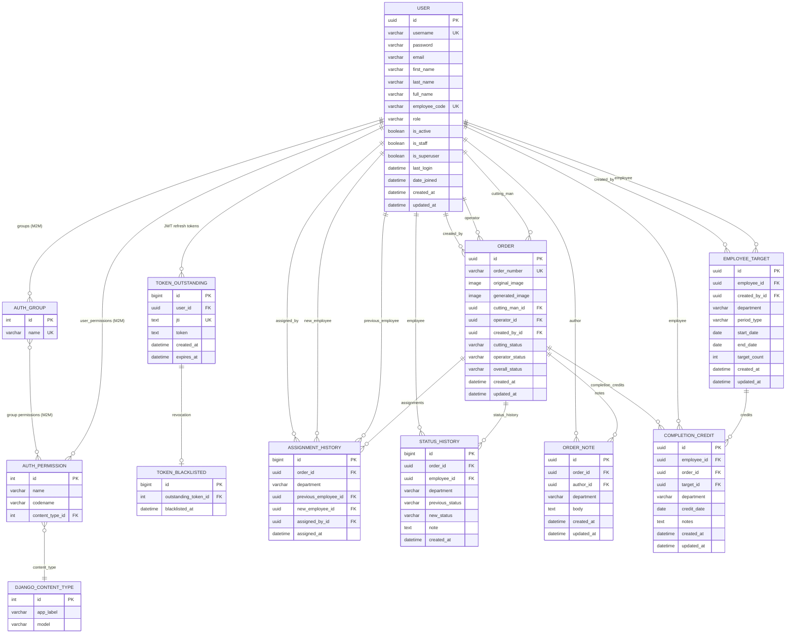

# POMS — User, Authentication, Roles & Permissions Audit Report

**Document:** `urap_plan.md`
**System:** Production Order Management System (POMS) backend
**Stack:** Django 5.2.x, Django REST Framework 3.16.x, djangorestframework-simplejwt 5.5.x, PostgreSQL, drf-spectacular
**Audit type:** Read-only source-code audit (no source, migration, configuration, or database changes made)
**Audit date:** 2026-11-27
**Scope:** Entire `backend/` codebase — accounts, orders, production, targets, reports, common, config, and tests
**Method:** Static reading of every non-generated Python file in the backend, model/migration introspection, permission-class tracing, URL/route enumeration, targeted dependency search, and an attempted test run.

> **Read-only statement.** No application source file, migration, environment variable, package, setting, or database record was modified. The only artifact created by this audit is this report (plus an empty `docx/` directory created to hold it). No RBAC implementation was designed or recommended as part of this task.

---

## Section 1: Executive Summary

The POMS backend has a **small, coherent, custom authentication and authorization baseline**. It is built on a custom `User` model (UUID primary key, extending `AbstractUser`), JWT-only API authentication via `djangorestframework-simplejwt`, a **single hardcoded business role field** with three values (`ADMIN`, `CUTTING_MAN`, `OPERATOR`), and four custom DRF permission classes, only two of which are actually used. There is no database role table, no permission table, no role-permission matrix, no Django Group-based business authorization, and no multi-role support. Business authorization is enforced through a combination of DRF permission classes, queryset scoping, and service-layer business rules.

The implementation is **materially better than a typical small Django project** in several areas that matter for this audit:

- JWTs are the only API authentication mechanism; inactive users are rejected at login, at token refresh, and on every authenticated request by SimpleJWT's default active-user check (`CHECK_USER_IS_ACTIVE`), so deactivation revokes practical access immediately even though tokens are stateless.
- Order visibility is scoped in one selector (`orders_for_user`) so employees only see orders they are currently assigned to; admin-only endpoints are consistently gated with `IsAdmin`; all object-driven custom actions call `get_object()` against the scoped queryset, and IDOR probing in the existing tests returns 404.
- Order-card images are **not** served from `/media/`; they are streamed through authenticated, object-scoped order actions, with `Cache-Control: private, no-store`.
- Sensitive business transitions (assignment, department status, completion credits) are transactional and re-verify object-level authorization under a row lock.
- Login failures use SimpleJWT's generic "No active account found with the given credentials" message, which avoids trivial username enumeration.

However, the system is **not an enterprise RBAC implementation**, and several gaps are significant enough to affect a production security review:

1. **The authentication lifecycle is incomplete.** There is no password-change, password-reset, forgot-password, or email-verification flow. A user cannot rotate their own password, and an administrator cannot trigger a reset through the API. Passwords can only be changed in Django admin or by direct shell/DB work.
2. **Password policy is bypassed for API-created employees.** `AUTH_PASSWORD_VALIDATORS` is configured, but `EmployeeCreateSerializer` only enforces `min_length=8` and calls `create_user()` without `validate_password()`, so common, numeric, and user-similarity passwords are accepted for every API-created account.
3. **Django admin is a second, largely unguarded RBAC write path.** The custom `UserAdmin` allows editing `role`, `is_active`, `is_staff`, `is_superuser`, `groups`, and `user_permissions`, and permits deleting users. None of the API's role-change safeguards (active-assignment compatibility) are applied there, and user deletion contradicts the documented "deactivate, never delete" policy.
4. **Administrative blast radius is unbounded.** Any user with role `ADMIN` can create other `ADMIN`s, change any user's role (including their own), deactivate any user (including other admins and superusers), and deactivate themselves. There is no last-admin guard, no self-action guard, and no separation between "manage employees" and "manage administrators."
5. **Two disconnected privilege planes.** Django superuser/staff status and POMS business role are independent. A `createsuperuser` account is created with the default business role `OPERATOR` and therefore has **no** API business privileges; conversely, an `ADMIN` role user has **no** Django admin access unless separately marked `is_staff` (and still needs model permissions). `createsuperuser` also leaves `full_name` and `employee_code` blank (verified), and because `employee_code` is unique, a second such superuser collides on the empty string.
6. **No audit trail for authentication or authorization changes.** There are no signals, no auth-event logging, and no model recording who changed a role, deactivated an account, or granted Django permissions. Django admin's `LogEntry` covers only admin-site edits.
7. **The local PostgreSQL data directory is committed to git.** `backend/pgdata` contains 1,276 tracked files (~65 MB) including the live local cluster, which can include `accounts_user` rows and password hashes. This is a repository-level sensitive-data exposure independent of the API.
8. **No brute-force protection.** There is no DRF throttling, no login rate limit, no account lockout, and no failed-login logging. The only protection is password strength (weakened by finding 2) and the 60-minute access / 7-day refresh token lifetimes.

**Overall verdict:** a sound, deliberately minimal baseline suitable for a single-tenant production shop with a handful of trusted administrators. It has good defense-in-depth around order data and media, and its business-rule enforcement is thoughtful. It is **not** suitable, as-is, for a regulated or multi-tenant environment, for delegated administration, for custom or multiple roles, or for any requirement that users manage their own credentials or that privilege changes be auditable. No CRITICAL exploitable authorization bypass was found in the HTTP API; the highest-risk items are the missing credential lifecycle, the unguarded Django admin write path, unbounded admin authority, and the committed database cluster.

### Severity summary

| ID | Severity | Finding |
|---|---|---|
| H-01 | HIGH | No password change / reset / forgot-password capability anywhere in the API |
| H-02 | HIGH | Employee creation bypasses Django password validators |
| H-03 | HIGH | Django admin bypasses business-role safeguards and allows user deletion |
| H-04 | HIGH | Any ADMIN can create/demote/deactivate other admins and themselves; no last-admin guard |
| H-05 | HIGH | Local PostgreSQL cluster (`backend/pgdata`) committed to the repository |
| M-01 | MEDIUM | No login throttling, lockout, or failed-authentication audit |
| M-02 | MEDIUM | `createsuperuser` yields blank identity, role `OPERATOR`, no API access; unique `employee_code` blocks a second |
| M-03 | MEDIUM | Role values are application-only choices with no DB CHECK constraint |
| M-04 | MEDIUM | Role changes do not reconcile targets/credits; target department is only validated at write time |
| M-05 | MEDIUM | Deactivation does not address current assignments; orders can be stranded |
| M-06 | MEDIUM | Superuser and business-admin planes are disconnected |
| M-07 | MEDIUM | JWT claim copy of mutable user state goes stale; clients may trust it |
| M-08 | MEDIUM | No audit trail for auth and role/permission changes |
| M-09 | MEDIUM | Contradictory delete semantics between API and Django admin |
| M-10 | MEDIUM | Role→department mapping duplicated in three service modules |
| M-11 | MEDIUM | Role-change and assignment operations are not serialized against each other |
| M-12 | MEDIUM | Reports include inactive employees; email is non-unique, unverified, self-editable |
| L-01 | LOW | Unused permission classes, unused serializer, dead imports |
| L-02 | LOW | Redundant `employee_code` uniqueness declarations |
| L-03 | LOW | Logout blacklists only the supplied refresh token; no session-wide logout |
| L-04 | LOW | Access/refresh tokens remain valid after role changes (authorization reads DB, so not privilege escalation) |
| L-05 | LOW | Production hasher list makes PBKDF2, not Argon2, the active hasher |
| L-06 | LOW | Login/refresh endpoints inherit JWT authentication classes |
| L-07 | LOW | Schema, Swagger, ReDoc, and browsable API are publicly reachable |
| L-08 | LOW | CORS defaults to allow-all in base settings |
| L-09 | LOW | Authored but never exercised: `LoginSerializer`, `authenticate` import, `governance` empty modules |
| I-01 | INFO | Positive controls: inactive-user rejection, scoped querysets, private media, generic login error |
| I-02 | INFO | Roles are not Django Groups; groups/permissions exist but are unused by business logic |
| I-03 | INFO | No signals or background tasks touch users, roles, or permissions |

---

## Section 2: Project Structure

### 2.1 Repository layout (relevant parts)

```
.
├── README.md
├── docs/                                  # pre-existing design/audit documents (not modified)
│   ├── architecture.md
│   ├── database-design.md
│   ├── rbac-phase2-architecture-plan*.md
│   ├── rbac-audit-phase1-report.md
│   └── ...
├── docx/
│   └── urap_plan.md                       # THIS REPORT (only new artifact)
└── backend/
    ├── manage.py                          # DJANGO_SETTINGS_MODULE default: development
    ├── conftest.py                        # shared pytest fixtures (admin/cutting/operator/order)
    ├── pytest.ini options in pyproject.toml (testpaths=apps)
    ├── requirements.txt                   # Django 5.2, DRF 3.16, SimpleJWT 5.5
    ├── .env / .env.example                # not read for secret values
    ├── pgdata/                            # committed local PostgreSQL cluster (1,276 files)
    ├── media/
    │   ├── originals/
    │   ├── generated/
    │   └── temp/
    ├── common/                            # shared code (NOT a Django app)
    │   ├── models.py                      # TimeStampedUUIDModel
    │   ├── enums.py                       # Department, ProductionStatus, OverallStatus, PeriodType, NoteDepartment
    │   ├── exceptions.py                  # BusinessRuleError + POMS error envelope
    │   ├── pagination.py
    │   └── utils/{file_validation.py,date_ranges.py}
    ├── config/
    │   ├── settings/{base.py,development.py,production.py}
    │   ├── urls.py                        # root: /admin/, /api/v1/, /api/schema/, /api/docs/, /api/redoc/
    │   └── api_urls.py                    # /api/v1/ router + auth/reports/health mounts
    └── apps/
        ├── accounts/                      # users, roles, auth, employee admin, permissions
        │   ├── models.py                  # Role (TextChoices), User(AbstractUser, TimeStampedUUIDModel)
        │   ├── permissions.py             # IsAdmin, IsEmployee, IsAdminOrReadOnly, IsActiveUser
        │   ├── serializers.py             # User/Employee/Profile/Token/Logout/Login serializers
        │   ├── views.py                   # Login/Refresh/Logout/Me + EmployeeViewSet
        │   ├── urls.py                    # /auth/{login,refresh,logout,me}/
        │   ├── admin.py                   # custom UserAdmin
        │   ├── migrations/0001_initial.py
        │   ├── tests.py                   # 5 model tests
        │   └── test_api.py                # 31 API tests
        ├── orders/
        │   ├── models.py                  # Order, AssignmentHistory
        │   ├── selectors.py               # orders_for_user, order_assignments
        │   ├── services.py                # resolve_assignee, create_order, assign_employee
        │   ├── serializers.py             # Order + assignment serializers
        │   ├── views.py                   # OrderViewSet + custom actions
        │   ├── admin.py
        │   ├── urls.py                    # EMPTY (router is in config/api_urls.py)
        │   ├── migrations/{0001,0002}     # 0002 adds overall-status CHECK constraint
        │   └── tests.py / test_api.py     # 49 tests
        ├── production/
        │   ├── models.py                  # ProductionStatusHistory, OrderNote
        │   ├── services.py                # update_department_status, add_order_note
        │   ├── selectors.py
        │   ├── serializers.py
        │   ├── views.py                   # EMPTY (actions live on OrderViewSet)
        │   ├── urls.py                    # EMPTY
        │   ├── migrations/0001_initial.py
        │   └── tests.py / test_api.py     # 33 tests
        ├── targets/
        │   ├── models.py                  # EmployeeTarget, CompletionCredit
        │   ├── services.py                # validate_target_department, validate_no_overlap, credits
        │   ├── serializers.py
        │   ├── views.py                   # EmployeeTargetViewSet (admin only)
        │   ├── urls.py                    # EMPTY (router is in config/api_urls.py)
        │   ├── migrations/{0001,0002,0003} # 0002 adds btree_gist exclusion constraint
        │   └── tests.py / test_services.py / test_api.py  # 41 tests
        ├── reports/
        │   ├── views.py                   # 4 admin-only report APIViews
        │   ├── urls.py                    # /reports/{dashboard,employees,production,targets}/
        │   ├── models.py / serializers.py # EMPTY
        │   └── migrations/                # EMPTY (no models)
        └── common/
            ├── health.py                  # public health probe
            └── test_health.py             # 2 tests
```

### 2.2 Route composition

| Layer | File | Effect |
|---|---|---|
| Root URLconf | `backend/config/urls.py` | `/admin/`, `/api/v1/`, `/api/schema/`, `/api/docs/`, `/api/redoc/`; static (not media) served only when `DEBUG` |
| API v1 | `backend/config/api_urls.py` | `DefaultRouter`: `employees`, `orders`, `targets`; includes `auth/`, `reports/`, `health/` |
| Auth routes | `backend/apps/accounts/urls.py` | `login/`, `refresh/`, `logout/`, `me/` |
| Reports | `backend/apps/reports/urls.py` | 4 read-only endpoints |
| Orders/production/targets routes | empty `urls.py` files | No-op files; all routing comes from the router and `OrderViewSet` actions |

### 2.3 Notable structural observations

- `common/` is **not** an installed Django app. `AUTH_USER_MODEL` and `INSTALLED_APPS` reference only `apps.*` packages.
- `apps/production/views.py` and `apps/production/urls.py` are zero-byte files. Production status/history/notes are implemented as custom actions on `OrderViewSet` in `apps/orders/views.py`, with business logic in `apps/production/services.py`.
- Business role vocabulary lives in `apps/accounts/models.py` (`Role`), while department/status vocabulary lives in `common/enums.py` (`Department`, `ProductionStatus`, ...). Role and department are represented by two independent enums with a hand-maintained mapping in three service modules.
- There is no `signals.py`, no `ready()` hook, no Celery/background task module, and no custom authentication backend anywhere in the backend.
- `backend/apps/accounts/management/commands/` exists but contains only `__init__.py` — there are no custom management commands (no seed/bootstrap command).
---

## Section 3: Current User Model

### 3.1 Definition and inheritance

**File:** `backend/apps/accounts/models.py`

```python
class Role(models.TextChoices):                 # line 20
    ADMIN = "ADMIN", _("Admin")
    CUTTING_MAN = "CUTTING_MAN", _("Cutting Man")
    OPERATOR = "OPERATOR", _("Operator")

class User(AbstractUser, TimeStampedUUIDModel):  # line 26
    full_name = models.CharField(max_length=150)
    employee_code = models.CharField(max_length=40, unique=True, ...)
    role = models.CharField(max_length=20, choices=Role.choices,
                            default=Role.OPERATOR, db_index=True)
```

The resolved MRO (verified by introspection; `Model` and `AltersData` follow) is:

```
User → AbstractUser → AbstractBaseUser → PermissionsMixin → TimeStampedUUIDModel → Model → AltersData
```

Consequences of this exact ordering:

- `AbstractUser` supplies `username`, `password`, `email`, `first_name`, `last_name`, `is_staff`, `is_active`, `date_joined`, `last_login`, and `PermissionsMixin` supplies `is_superuser`, `groups`, and `user_permissions`.
- `TimeStampedUUIDModel` (`backend/common/models.py`) supplies the **UUID primary key** (`id`, `uuid4`), `created_at` (`auto_now_add`, indexed), and `updated_at` (`auto_now`). It overrides Django's implicit integer `id`; the migration confirms `id = UUIDField(primary_key=True, default=uuid.uuid4, editable=False)`.
- `User._meta.pk` is `accounts.User.id` (UUIDField) — verified at runtime.
- There is **no custom model manager**. The migration records `managers=[('objects', django.contrib.auth.models.UserManager())]`. `User.objects.create_user()` / `create_superuser()` are Django's stock implementations.

### 3.2 Field-level facts

| Field | Type | Constraints / behavior | Notes |
|---|---|---|---|
| `id` | UUID | PK, `uuid4`, not editable | Non-enumerable public identifier |
| `username` | varchar(150) | `unique=True`, `UnicodeUsernameValidator` | `USERNAME_FIELD`; uniqueness is **case-sensitive at DB level** |
| `password` | varchar(128) | Django password hash | No custom hashing on the model |
| `email` | email(254) | **not unique**, blank allowed | Not `REQUIRED_FIELDS` value uniqueness; no verification |
| `first_name`, `last_name` | varchar(150) | blank allowed | Unused by POMS UI/API |
| `full_name` | varchar(150) | **required, no default, blank not allowed** | Used everywhere as the display name |
| `employee_code` | varchar(40) | `unique=True` **and** a duplicate `UniqueConstraint` | Uppercased in `save()`/`clean()` |
| `role` | varchar(20) | `choices=Role.choices`, default `OPERATOR`, `db_index=True` | Choices are **not** a DB constraint |
| `is_active` | bool | default `True` | The only account-state flag |
| `is_staff` | bool | default `False` | Django admin access; never set by the API |
| `is_superuser` | bool | default `False` | Django admin bypass; never set by the API |
| `date_joined`, `last_login` | datetime | stock | `last_login` updated by SimpleJWT (`UPDATE_LAST_LOGIN=True`) |
| `created_at`, `updated_at` | datetime | `auto_now_add`, `auto_now` | Inherited from `TimeStampedUUIDModel` |
| `groups`, `user_permissions` | M2M | stock `PermissionsMixin` | Present in DB/API-less; used only by Django admin |

**Unique/constraint definitions** (`User.Meta`, lines 42–56):

```python
ordering = ["full_name", "username"]
constraints = [UniqueConstraint(fields=["employee_code"], name="uniq_user_employee_code")]
indexes = [Index(fields=["role", "is_active"])]
```

This is redundant: `employee_code` already has `unique=True`, which creates a unique index; the named `UniqueConstraint` adds a second equivalent unique index. The effective DB objects are:

- unique index on `username` (implicit),
- unique index on `employee_code` (from `unique=True`),
- unique constraint `uniq_user_employee_code` (explicit),
- composite index `accounts_us_role_2b136f_idx` on `(role, is_active)`.

There is **no** index on `email`, and no case-insensitive unique index on `username` or `employee_code`.

### 3.3 `USERNAME_FIELD` and `REQUIRED_FIELDS` (verified)

| Attribute | Runtime value |
|---|---|
| `USERNAME_FIELD` | `"username"` |
| `REQUIRED_FIELDS` | `["email"]` (inherited from `AbstractUser`) |
| `EMAIL_FIELD` | `"email"` |

`full_name` and `employee_code` are **mandatory non-null model fields but are absent from `REQUIRED_FIELDS`**. Verified behavior:

```python
>>> User(username="x").full_name, User(username="x").employee_code, User(username="x").role
('', '', Role.OPERATOR)
```

Therefore `python manage.py createsuperuser` prompts only for username, email, and password. Django fills missing `CharField`s with `""`, producing a superuser with:

- `full_name = ""` (renders as `" ()"` through `__str__`),
- `employee_code = ""`,
- `role = "OPERATOR"` (the field default),
- `is_staff = True`, `is_superuser = True`.

The first such account succeeds. A **second** `createsuperuser` attempt fails on the unique `employee_code` (`""` already exists). This is finding M-02.

### 3.4 Account creation paths

There are exactly three ways a `User` can be created in the current codebase:

1. **`EmployeeViewSet.create`** → `EmployeeCreateSerializer.create` (`backend/apps/accounts/serializers.py:63`):
   ```python
   password = validated_data.pop("password")
   return User.objects.create_user(password=password, **validated_data)
   ```
   Fields accepted: `username`, `password`, `full_name`, `employee_code`, `role`, `email`, `is_active`. `is_staff`/`is_superuser` are **not** accepted (good: no mass assignment of Django privileges).
2. **Django admin** (`UserAdmin.add_fieldsets`) → username, full_name, employee_code, role, email, password1/password2.
3. **`manage.py createsuperuser`** or direct shell/ORM `create_user` / `create_superuser`.

There is **no public registration endpoint**. `apps/accounts/urls.py` exposes only `login`, `refresh`, `logout`, and `me`.

### 3.5 `clean()` and `save()`

```python
def clean(self):                       # line 79
    super().clean()
    if self.employee_code:
        self.employee_code = self.employee_code.strip().upper()

def save(self, *args, **kwargs):       # line 85
    if self.employee_code:
        self.employee_code = self.employee_code.strip().upper()
    super().save(*args, **kwargs)
```

- Normalization is done in `save()`, so any save path (API, admin, shell) uppercases the code.
- `clean()` exists but is **not called automatically**; serializers do their own `strip().upper()` in `validate_employee_code`. There is no `full_clean()` in serializers. Uniqueness of `employee_code` is protected by the DB even when the serializer's pre-check races.
- No password validation is invoked in the model or in `create_user()` by default (Django's `UserManager` does not validate passwords).

### 3.6 States: active, inactive, suspended, deleted

Only **one** state dimension exists: the boolean `is_active`.

| State | Representation | Who can set it | Behavior |
|---|---|---|---|
| Active | `is_active=True` (default) | Admin create/patch; Django admin | Can log in and use the API |
| Inactive | `is_active=False` | `POST /employees/{id}/deactivate/`; admin PATCH; Django admin | Login returns 401; refresh returns 401; existing access token rejected on next request by `CHECK_USER_IS_ACTIVE`; data retained |
| Suspended | **does not exist** | — | No `suspended_until`, no reason, no status enum |
| Deleted | Hard delete only via Django admin/shell | Django admin (not API) | API returns 405 for DELETE; FKs are `PROTECT`, so deletion fails for users with business history |
| Soft-deleted | **does not exist** | — | No `deleted_at`, `deactivated_by`, or deactivation reason |

Deactivation is one-way through the dedicated action (no `reactivate` action), but an admin can re-activate with `PATCH /employees/{id}/ {"is_active": true}` because `is_active` is writable in `EmployeeUpdateSerializer`.

### 3.7 Model relationships

`User` is referenced by every business entity:

| Model | Field | `on_delete` | `related_name` |
|---|---|---|---|
| `Order` | `cutting_man` | `PROTECT` | `cutting_orders` |
| `Order` | `operator` | `PROTECT` | `operator_orders` |
| `Order` | `created_by` | `PROTECT` | `created_orders` |
| `AssignmentHistory` | `previous_employee` | `PROTECT` | `assignment_previously` |
| `AssignmentHistory` | `new_employee` | `PROTECT` | `assignment_assigned` |
| `AssignmentHistory` | `assigned_by` | `PROTECT` | `assignment_events` |
| `ProductionStatusHistory` | `employee` | `PROTECT` | `status_events` |
| `OrderNote` | `author` | `PROTECT` | `order_notes` |
| `EmployeeTarget` | `employee` | `PROTECT` | `targets` |
| `EmployeeTarget` | `created_by` | `PROTECT` | `created_targets` |
| `CompletionCredit` | `employee` | `PROTECT` | `completion_credits` |

All user references are `PROTECT`, so deleting a user with any order/assignment/status/note/target/credit history raises `ProtectedError` (mapped to HTTP 409 by `common/exceptions.py`). This is the technical basis for the "deactivate, never delete" policy — but only for users with history. A freshly created user with no business rows **can** be deleted in Django admin (finding M-09).

### 3.8 Signals, managers, hooks

- **No signals** are registered (`apps/accounts/apps.py` has a bare `AppConfig`; no `ready()` override; no `signals.py` anywhere).
- **No custom manager**; no `create_superuser` override to populate `full_name`/`employee_code`.
- No `pre_save`/`post_save` side effects, no automatic role assignment beyond the field default, no automatic deactivation on role change, no token blacklisting on deactivation/role change.
- `__str__` returns `f"{full_name} ({employee_code})"`, so blank bootstrap accounts render as `" ()"`.

### 3.9 How the User model works internally (summary)

A POMS user is a single row in `accounts_user` with a UUID identity, a Django-hashed password, a unique login name, a unique human-readable employee code, a free-text display name, and exactly **one** business role. Django's stock permission machinery (`groups`, `user_permissions`, `is_staff`, `is_superuser`) is present because `AbstractUser` supplies it, but the POMS API never consults it: API authorization reads only `role` and `is_active`. The model carries no lifecycle metadata beyond `is_active`, no role history, no deactivation reason, and no link to an external identity provider.

---

## Section 4: Current Authentication Flow

### 4.1 Configuration

**File:** `backend/config/settings/base.py`

| Setting | Value | Line |
|---|---|---|
| `AUTH_USER_MODEL` | `"accounts.User"` | 150 |
| `AUTH_PASSWORD_VALIDATORS` | UserAttributeSimilarity, MinimumLength, CommonPassword, NumericPassword | 153–158 |
| `DEFAULT_AUTHENTICATION_CLASSES` | `rest_framework_simplejwt.authentication.JWTAuthentication` **only** | 186–188 |
| `DEFAULT_PERMISSION_CLASSES` | `rest_framework.permissions.IsAuthenticated` | 189–191 |
| `DEFAULT_THROTTLE_CLASSES` / rates | **absent** | — |
| `EXCEPTION_HANDLER` | `common.exceptions.poms_exception_handler` | — |
| `DEFAULT_RENDERER_CLASSES` | JSON + BrowsableAPIRenderer | — |

**SimpleJWT configuration** (lines 211–226):

```python
SIMPLE_JWT = {
    "ACCESS_TOKEN_LIFETIME":  timedelta(minutes=ACCESS_TOKEN_MINUTES default 60),
    "REFRESH_TOKEN_LIFETIME": timedelta(days=REFRESH_TOKEN_DAYS default 7),
    "ROTATE_REFRESH_TOKENS": True,
    "BLACKLIST_AFTER_ROTATION": True,
    "UPDATE_LAST_LOGIN": True,
    "AUTH_HEADER_TYPES": ("Bearer",),
    "USER_ID_FIELD": "id",
    "USER_ID_CLAIM": "user_id",
    "TOKEN_TYPE_CLAIM": "token_type",
    "AUTH_TOKEN_CLASSES": ("rest_framework_simplejwt.tokens.AccessToken",),
}
```

Implications:

- HS256 signing with `SECRET_KEY` by default (no explicit `ALGORITHM`, `SIGNING_KEY`, `AUDIENCE`, or `ISSUER`).
- Access tokens are accepted as Bearer tokens; refresh tokens cannot be used as bearer tokens (`AUTH_TOKEN_CLASSES` restricts to `AccessToken`).
- `rest_framework_simplejwt.token_blacklist` is installed (`INSTALLED_APPS`), so rotation + logout actually persist revocation.
- `CHECK_USER_IS_ACTIVE` is not overridden, so it remains `True` (default). Verified in the installed SimpleJWT source (`authentication.py:138`): `if api_settings.CHECK_USER_IS_ACTIVE and not user.is_active: raise AuthenticationFailed`.
- `USER_AUTHENTICATION_RULE` is not overridden: default is `user is not None and user.is_active`.

**Middleware:** the stock Django chain — CORS, `SecurityMiddleware`, sessions, common, CSRF, `AuthenticationMiddleware`, messages, clickjacking. DRF authentication is per-request via `JWTAuthentication`; Django session auth is **not** enabled for the API, so CSRF does not apply to API calls but does apply to `/admin/`.

**Settings modules:** `manage.py` defaults to `config.settings.development` (DEBUG=True, MD5 hasher first, console email). `production.py` forces `DEBUG=False`, requires a strong `DJANGO_SECRET_KEY` and non-empty `ALLOWED_HOSTS`, enables SSL redirect/HSTS/secure cookies, and restricts CORS. The API's auth behavior is otherwise identical across environments.

### 4.2 Components

| Component | File / class | Responsibility |
|---|---|---|
| Login view | `accounts/views.py::LoginView` (line 24) | Subclass of `TokenObtainPairView`; `AllowAny`; uses `TokenPairSerializer` |
| Login serializer | `accounts/serializers.py::TokenPairSerializer` (line 152) | Adds `role`, `employee_code`, `full_name` claims; embeds `user` payload in response |
| Refresh view | `accounts/views.py::RefreshView` (line 31) | Stock `TokenRefreshView`; `AllowAny`; rotation + blacklist |
| Logout view | `accounts/views.py::LogoutView` (line 37) | Requires access token; blacklists the supplied refresh; returns 204 |
| Logout serializer | `accounts/serializers.py::LogoutSerializer` (line 175) | `refresh` CharField |
| Profile view | `accounts/views.py::MeView` (line 60) | `IsAuthenticated + IsActiveUser`; GET/PATCH own profile |
| Profile serializer | `accounts/serializers.py::ProfileSerializer` (line 123) | `full_name` and `email` writable; `role`, `is_active`, `username`, `employee_code` read-only |
| "Login documentation" serializer | `accounts/serializers.py::LoginSerializer` (line 179) | **Unused**; never referenced by a view |
| JWT authenticator | `rest_framework_simplejwt.authentication.JWTAuthentication` | Decodes/validates bearer token, loads `User`, checks `is_active` |
| Token blacklist app | `rest_framework_simplejwt.token_blacklist` | `OutstandingToken` / `BlacklistedToken` tables |

### 4.3 Login endpoint contract

`POST /api/v1/auth/login/`

Request:
```json
{ "username": "admin1", "password": "..." }
```
Response `200`:
```json
{
  "refresh": "<jwt>",
  "access": "<jwt>",
  "user": {
    "id": "<uuid>", "username": "admin1", "full_name": "Admin One",
    "employee_code": "ADM-001", "role": "ADMIN", "role_display": "Admin",
    "email": "", "is_active": true, "date_joined": "..."
  }
}
```

Behavior:

- `TokenObtainSerializer.validate` calls `django.contrib.auth.authenticate` (default `ModelBackend`), then applies `USER_AUTHENTICATION_RULE`.
- Invalid credentials **and** inactive accounts both return `401` with the same generic message (`"No active account found with the given credentials"`), so login does not disclose whether a username exists or is disabled.
- `TokenPairSerializer.get_token` adds three custom claims:
  ```python
  token["role"] = user.role
  token["employee_code"] = user.employee_code
  token["full_name"] = user.full_name
  ```
  These claims are **not consulted** by any server-side authorization code; authorization reads `request.user.role` from the database.
- `UPDATE_LAST_LOGIN=True` updates `last_login` on successful login.
- No throttling is applied. No audit log entry is written.
- Because `LoginView` does not set `authentication_classes = []`, a malformed/expired `Authorization` header on the login request is processed by `JWTAuthentication` first and can return `401` before credentials are evaluated (finding L-06).

### 4.4 Refresh endpoint contract

`POST /api/v1/auth/refresh/` with `{"refresh": "<jwt>"}`.

- Validates signature/expiry/token type/blacklist.
- Looks up the user by `user_id` claim and applies `USER_AUTHENTICATION_RULE`, so an **inactive** user's refresh token is rejected (`AuthenticationFailed`, HTTP 401) even if the token is not blacklisted. Verified in the installed serializer source (`serializers.py:112–125`).
- With `ROTATE_REFRESH_TOKENS=True` and `BLACKLIST_AFTER_ROTATION=True`, the submitted refresh token is blacklisted, a new `jti`/`exp`/`iat` is set, and a new refresh + access pair is returned.
- The custom claims are not **recomputed** on refresh: `TokenPairSerializer.get_token` runs only at login. However, SimpleJWT's `RefreshToken.access_token` copies every non-`no_copy` claim from the refresh token into the new access token, and rotation (`set_jti`/`set_exp`/`set_iat`) preserves the rest of the refresh payload (verified in the installed `tokens.py:393–413`). Consequently, refreshed access tokens **retain the same custom claims issued at login** — the staleness problem described in M-07, not a missing-claim problem.
- No throttling.

### 4.5 Logout endpoint contract

`POST /api/v1/auth/logout/` with `{"refresh": "<jwt>"}`, authenticated by a valid access token.

- Parses `RefreshToken(refresh)`, calls `.blacklist()`, returns `204 No Content`.
- Returns `400 {"detail": "Invalid or expired refresh token."}` on `TokenError`.
- It does **not** verify that the refresh token belongs to the requesting user. In practice, possessing the token is sufficient to revoke it; an attacker who already has it gains nothing, but a user can revoke a colleague's session if they obtain the token.
- It blacklists only the one supplied refresh token. Other devices/sessions remain active (finding L-03).
- No `logout-all`, no server-side session registry, no "token version" mechanism.

### 4.6 `me` endpoint contract

- `GET /api/v1/auth/me/` → own `ProfileSerializer` representation.
- `PATCH /api/v1/auth/me/` → updates `full_name` and/or `email` only.
- `role`, `is_active`, `username`, `employee_code`, `date_joined`, `id` are read-only; a PATCH attempting to change them silently ignores those keys and returns `200` with unchanged values (existing test asserts this).
- No password field here, and no password-change route exists (H-01).

### 4.7 Complete authentication lifecycle (as implemented)

```
1. ACCOUNT CREATION
   Admin (role=ADMIN) → POST /api/v1/employees/
     EmployeeCreateSerializer: min_length=8 only (validators NOT run)
     → User.objects.create_user(password=..., role=..., ...)
     → is_active=True (default), is_staff=False, is_superuser=False
   OR Django admin add form (runs admin form validation, not DRF serializer)
   OR manage.py createsuperuser (blank full_name/employee_code, role=OPERATOR)

2. LOGIN
   POST /api/v1/auth/login/ {username, password}
     → authenticate() (ModelBackend: username + password + is_active)
     → USER_AUTHENTICATION_RULE (user not None and is_active)
     → RefreshToken.for_user(user)
         + custom claims role / employee_code / full_name
     → response {refresh, access, user{...}}
     → last_login updated

3. AUTHENTICATED API REQUEST
   Authorization: Bearer <access>
     → JWTAuthentication.decode (signature, exp, token_type=access)
     → user lookup by user_id (UUID)
     → CHECK_USER_IS_ACTIVE (reject inactive)
     → request.user = DB user (role read live from DB)
     → DRF default permission IsAuthenticated
     → view-specific permission classes (IsAdmin, IsActiveUser)
     → view get_queryset() scoping (orders_for_user)
     → get_object() → 404 if outside scope
     → service-layer business authorization (role→department, current assignee)

4. TOKEN REFRESH
   POST /api/v1/auth/refresh/ {refresh}
     → validate signature/exp/type/blacklist
     → user lookup + USER_AUTHENTICATION_RULE (inactive rejected)
     → old refresh blacklisted; new refresh + access returned
     → new access copies claims from the refresh payload (stale custom claims persist)

5. LOGOUT
   POST /api/v1/auth/logout/ {refresh}  (valid access required)
     → RefreshToken(refresh).blacklist()
     → 204
     → current access token remains valid until expiry (stateless)
```

### 4.8 Password handling

- Hashing: Django defaults in `base` (PBKDF2); development overrides to MD5-first; production lists PBKDF2, PBKDF2SHA1, then Argon2 (so Argon2 is verification-only unless changed).
- `set_password`/password hashing is delegated to Django's `create_user`; there is no custom hashing.
- **No password change endpoint, no password reset endpoint, no reset-token model, no email sending for credentials, no forced first-login change.** `EMAIL_BACKEND` is explicitly configured (console) only in development; base/production define no `EMAIL_BACKEND`, `EMAIL_HOST`, or `DEFAULT_FROM_EMAIL`, so Django's default SMTP backend would apply without a configured sender.
- `AUTH_PASSWORD_VALIDATORS` is configured but only applied by Django forms (`createsuperuser`, admin `UserCreationForm`/`SetPasswordForm`), **not** by the DRF employee create path.
- Password length checked only as `min_length=8` in `EmployeeCreateSerializer`; no maximum, no complexity, no common-password check, no similarity check, no numeric-only check on that path.
- There is no way to invalidate all sessions on password change (no change flow, and `CHECK_REVOKE_TOKEN` is not enabled).

### 4.9 Anonymous and authenticated request handling

- Anonymous requests to any API endpoint with the default `IsAuthenticated` permission receive `401` from `JWTAuthentication` (`WWW-Authenticate: Bearer`) rather than `403`.
- `AllowAny` endpoints: login, refresh, health, and (by drf-spectacular default) schema/docs.
- `IsActiveUser` is explicitly applied only on `MeView`; everywhere else, inactive-user rejection is provided by SimpleJWT. If DRF `force_authenticate` (tests) or a future non-JWT authentication class is used, `IsActiveUser` would **not** run, and an inactive user could pass `IsAdmin` if they retained role `ADMIN` (finding L-04/M-06 note).
- No session authentication for API means browser sessions cannot call the API; Django admin remains session-authenticated and CSRF-protected.

### 4.10 Authentication weaknesses and missing functionality

| Gap | Impact |
|---|---|
| No password change/reset/forgot-password | Users cannot rotate compromised credentials; support burden falls on admins/shell |
| Password validators bypassed on employee creation | Weak credentials accepted despite configured policy |
| No login/refresh throttling or lockout | Unlimited online password guessing |
| No failed-login/audit logging | No detection of credential attacks |
| No MFA/SSO | Password-only authentication |
| No email verification / uniqueness | Email cannot be trusted as identity or recovery channel |
| Custom claims not refreshed | Client-side role display can be stale; claims duplicate DB state |
| No token revocation on role change | Old tokens carry old role claim (server authz is still correct) |
| No global logout | Stolen refresh token remains valid until expiry (7 days) unless revoked |
| No `CHECK_REVOKE_TOKEN` | Password changes (via admin) do not invalidate existing tokens |
| No `AUDIENCE`/`ISSUER` | Tokens are accepted from any service sharing the signing key |
| Public schema/docs/browsable API | Endpoint inventory exposed |
---

## Section 5: Current Roles Architecture

### 5.1 Implementation type (verified, not assumed)

| Candidate mechanism | Present? | Evidence |
|---|---|---|
| Hardcoded in application | **YES** | `Role(models.TextChoices)` in `accounts/models.py:20`; `choices=Role.choices` on `User.role` |
| Dynamic roles stored in a DB table | **NO** | No `Role` model, no role table in `apps.get_models()` |
| Django Groups | **NO** (for business authorization) | `groups` M2M exists via `PermissionsMixin`, but no POMS code reads/writes it for business rules |
| Custom `Role` model with FK/M2M | **NO** | `role` is a `CharField` on `User`, not a relation |
| Other | — | A single string per user; role vocabulary is codified in an enum and in the migration's `choices` list |

**Conclusion:** roles are **hardcoded enumerated values stored as a string column on the user row**. There is exactly one role per user, no role entity, no role metadata (description, permissions, hierarchy), no role CRUD API, and no role assignment table.

### 5.2 Role vocabulary

| Value | Display | Semantics in code |
|---|---|---|
| `ADMIN` | Admin | Full operational access: employee management, order create/update/assign, any department status update, targets, reports |
| `CUTTING_MAN` | Cutting Man | Production employee for the `CUTTING` department; can update cutting status only while assigned |
| `OPERATOR` | Operator | Production employee for the `OPERATOR` department; can update operator status only while assigned |

- Default role: `OPERATOR` (model default and serializer default).
- `User.is_admin`, `is_cutting_man`, `is_operator`, `is_employee` are Python properties computed from `role` (lines 62–77). `is_employee` is true only for `CUTTING_MAN`/`OPERATOR`, not `ADMIN`.
- `role_display` is exposed read-only by `UserSerializer` and `ProfileSerializer` via `get_role_display`.
- The role value is stored in a `varchar(20)` with a `db_index=True`. The index is standalone on `role` plus a composite `(role, is_active)` index; there is no index dedicated to filtering by role alone beyond the leading column of the composite.

### 5.3 Role creation, modification, deletion

- **Creation:** no API. Adding a new role requires editing `Role` (code), updating `Department`/mappings and every role branch, and creating a migration (the migration embeds the choices list). Deploy-time change only.
- **Modification:** no API to rename/describe/configure a role. Changing a role's meaning is a code change.
- **Deletion:** impossible without a code change; there is no role record to delete.
- **Assignment to users:** the only writable path is `role` in `EmployeeCreateSerializer` and `EmployeeUpdateSerializer`, both behind `EmployeeViewSet` (`IsAdmin`). Django admin can also edit it.
- **Multiple roles:** **not supported.** One `role` string per user. A user cannot be both a Cutting Man and an Operator, nor an Admin plus a production role.
- **Validation:** `role` must be one of the three choices at the serializer/model-form level. At the database level there is **no CHECK constraint**, so a raw ORM `.update(role="SUPERADMIN")` or SQL write can persist an arbitrary string (finding M-03).
- **Default assignment:** `OPERATOR` on the model; the create serializer also declares `"role": {"default": Role.OPERATOR}`.
- **Role-related signals/business logic:** none. Role changes are not logged, do not revoke tokens, do not reassign orders, do not update targets, and do not change `is_staff`/`is_superuser`.

### 5.4 Role-change safeguards that do exist

`EmployeeUpdateSerializer.validate()` (lines 85–121) guards one specific consistency problem:

- If `role` changes and the user is currently the `cutting_man` on any order whose `overall_status != COMPLETED`, the new role must remain `CUTTING_MAN`.
- If the user is currently the `operator` on any non-completed order, the new role must remain `OPERATOR`.
- Otherwise the role change is allowed, including `CUTTING_MAN ↔ OPERATOR` with no active assignments, and `→ ADMIN` / `ADMIN →` any role.

Limitations of this guard:

- It only inspects **current** assignments on **non-completed** orders, not future targets, not `CompletionCredit`, not notes/status history (which are historical and correctly preserved).
- It is a serializer-level check with no transaction/lock spanning the subsequent `save()`; a concurrent assignment can interleave (M-11).
- It is **not applied in Django admin**, where `role` is directly editable (H-03).
- It does not prevent demoting the last admin, self-demotion, or changing another admin's role (H-04).

### 5.5 Role→department coupling

Production permissions are derived from role at request time, not stored:

| Mapping | Location |
|---|---|
| `CUTTING` → `CUTTING_MAN`, `OPERATOR` → `OPERATOR` | `apps/orders/services.py` `_ROLE_FOR_DEPARTMENT` |
| `CUTTING_MAN` → `CUTTING`, `OPERATOR` → `OPERATOR` | `apps/production/services.py` `_DEPARTMENT_FOR_ROLE` |
| same mapping again | `apps/targets/services.py` `_DEPARTMENT_FOR_ROLE` |

`department_for_role(role)` in `production/services.py:34` returns `None` for `ADMIN` and any unknown value, which is how employees are prevented from choosing a department. This mapping being duplicated in three modules is finding M-10.

### 5.6 Role lifecycle in practice

1. An admin creates a user with `role=OPERATOR` (default) or `CUTTING_MAN`/`ADMIN`.
2. The user logs in; `role` is read from DB on every request.
3. If assigned to an order, the user's role gates which department's status they may change and which notes they may write.
4. An admin may later change the role, subject to the active-assignment guard; existing tokens keep working but server-side authorization immediately uses the new role.
5. Deactivation sets `is_active=False`; role remains for historical reporting.

There is no notion of "role expiry", "temporary elevation", "department-scoped admin", "supervisor", or "read-only auditor".

---

## Section 6: Current Permissions Architecture

### 6.1 Permission mechanisms in use

POMS uses **four** authorization mechanisms, layered:

1. **DRF global default:** `IsAuthenticated` for every view unless overridden.
2. **Custom DRF permission classes** (`apps/accounts/permissions.py`):
   - `IsAdmin` — `user.is_authenticated and user.role == Role.ADMIN` (used widely).
   - `IsActiveUser` — `user.is_authenticated and user.is_active` (used only on `MeView`).
   - `IsEmployee` — non-admin production employee (defined, **never used**).
   - `IsAdminOrReadOnly` — admins write, authenticated users read (defined, **never used**).
3. **Queryset scoping** (`apps/orders/selectors.py::orders_for_user`) plus `get_object()` — this is the de facto object-level permission for orders and all order sub-resources (history, notes, assignments, images).
4. **Service-layer business authorization** (`apps/orders/services.py`, `apps/production/services.py`, `apps/targets/services.py`) — role/department/assignee/immutability rules.

**Not used for API authorization:**

- Django model permissions (`has_perm`, `ModelBackend`, `DjangoModelPermissions`) — no API view references them.
- Django Groups — no POMS code adds users to groups or checks group membership.
- DRF `DjangoObjectPermissions` / `DjangoModelPermissionsOrAnonReadOnly` — absent.
- Object-level permission classes (`has_object_permission`) — **none exist**. Object scoping is done entirely in querysets.
- Permission decorators (`@permission_required`, `@user_passes_test`) — absent from API code.
- `is_staff` / `is_superuser` — never checked in API code.

### 6.2 Custom permission classes in detail

```python
class IsAdmin(BasePermission):                      # line 12
    message = "Administrator role required."
    def has_permission(self, request, view):
        user = request.user
        return bool(user and user.is_authenticated and user.role == Role.ADMIN)

class IsEmployee(BasePermission):                   # line 22  (UNUSED)
    ...
    return bool(user and user.is_authenticated and user.is_employee)

class IsAdminOrReadOnly(BasePermission):            # line 32  (UNUSED)
    if not authenticated: return False
    if request.method in SAFE_METHODS: return True
    return user.role == Role.ADMIN

class IsActiveUser(BasePermission):                 # line 44
    return bool(user and user.is_authenticated and user.is_active)
```

Notes:

- `IsAdmin` does **not** check `is_active`; it relies on JWT authentication having already rejected inactive users. Under `force_authenticate` (tests) or any future auth backend, an inactive `ADMIN` would pass.
- `IsAdmin` deliberately ignores `is_superuser`/`is_staff`. A Django superuser with role `OPERATOR` is **not** a POMS admin.
- `IsEmployee` and `IsAdminOrReadOnly` are dead code (L-01); they create a misleading impression that additional policy exists.
- No permission class implements `has_object_permission`, so DRF never performs per-object checks; a view that accidentally used an unscoped queryset would leak data. Current views all rely on scoped querysets (verified below).

### 6.3 Authorization decision sequence

For a normal API request:

```
HTTP request
  └─ Django middleware (CORS, security, sessions, CSRF [admin only], auth)
      └─ DRF dispatch
          ├─ authentication: JWTAuthentication
          │    ├─ no/invalid token → 401 (NotAuthenticated)
          │    ├─ inactive user → 401
          │    └─ request.user = DB user (role read live)
          ├─ permission_classes (view-level)
          │    ├─ default IsAuthenticated
          │    └─ IsAdmin / IsActiveUser as declared
          ├─ throttle (none configured)
          ├─ view handler
          │    ├─ get_queryset() scoping (orders_for_user for OrderViewSet)
          │    ├─ get_object() → 404 if not in scope
          │    └─ service call
          │         ├─ resolve_assignee: role + active + existence
          │         ├─ update_department_status: role→department + current assignee under row lock
          │         └─ add_order_note: role→department note scope
          └─ serializer validation (input shape, role-change compatibility, target role/department)
```

For Django admin, a completely separate chain applies: session login → `is_staff` → per-model permissions (`add/change/delete/view`) or `is_superuser` bypass. POMS business roles are not consulted.

### 6.4 Endpoint-level authorization map

Legend: **Auth** = authentication required; **Class** = DRF permission classes; **Role/Permission** = effective POMS role; **Actual behavior** = observed code path.

| # | API Endpoint | Method | Auth | Permission Class | Required Role/Permission | Actual Behavior |
|---|---|---|---|---|---|---|
| 1 | `/api/v1/auth/login/` | POST | No | `AllowAny` | None | Authenticates; returns JWT pair + user; inactive/invalid → 401 |
| 2 | `/api/v1/auth/refresh/` | POST | No | `AllowAny` | Valid refresh token | Rotates refresh, blacklists old, returns new access (+refresh); inactive → 401 |
| 3 | `/api/v1/auth/logout/` | POST | Yes | `IsAuthenticated` | Any authenticated | Blacklists supplied refresh; 204; does not verify ownership |
| 4 | `/api/v1/auth/me/` | GET | Yes | `IsAuthenticated`, `IsActiveUser` | Any active | Own profile only |
| 5 | `/api/v1/auth/me/` | PATCH | Yes | `IsAuthenticated`, `IsActiveUser` | Any active | Updates `full_name`, `email`; role/is_active silently ignored |
| 6 | `/api/v1/employees/` | GET | Yes | `IsAuthenticated`, `IsAdmin` | `ADMIN` | Lists **all** users, including inactive and superusers |
| 7 | `/api/v1/employees/` | POST | Yes | `IsAuthenticated`, `IsAdmin` | `ADMIN` | Creates user with any role incl. `ADMIN`; no password validators |
| 8 | `/api/v1/employees/{id}/` | GET | Yes | `IsAuthenticated`, `IsAdmin` | `ADMIN` | Retrieves any user (incl. superuser) |
| 9 | `/api/v1/employees/{id}/` | PATCH | Yes | `IsAuthenticated`, `IsAdmin` | `ADMIN` | Updates `full_name`, `employee_code`, `role`, `email`, `is_active`; assignment guard on role |
| 10 | `/api/v1/employees/{id}/deactivate/` | POST | Yes | `IsAuthenticated`, `IsAdmin` | `ADMIN` | Sets `is_active=False`; no self/last-admin guard |
| 11 | `/api/v1/employees/{id}/` | PUT | Yes | — | — | **405** (`http_method_names` excludes PUT) |
| 12 | `/api/v1/employees/{id}/` | DELETE | Yes | — | — | **405**; no API hard delete |
| 13 | `/api/v1/orders/` | GET | Yes | `IsAuthenticated` | Any authenticated | Admin: all orders. Employee: only orders where currently `cutting_man` or `operator` |
| 14 | `/api/v1/orders/` | POST | Yes | `IsAuthenticated` + `IsAdmin` (via `get_permissions`) | `ADMIN` | Creates order, validates assignee roles, writes assignment history, generates card image |
| 15 | `/api/v1/orders/{id}/` | GET | Yes | `IsAuthenticated` | Scoped user | 404 if outside `orders_for_user` |
| 16 | `/api/v1/orders/{id}/` | PATCH | Yes | `IsAuthenticated` + `IsAdmin` | `ADMIN` | Updates `order_number`/`original_image`; regenerates generated image |
| 17 | `/api/v1/orders/{id}/assign/` | PATCH | Yes | `IsAuthenticated` + `IsAdmin` (decorator + `get_permissions`) | `ADMIN` | Reassigns a department; validates role/active; writes history; regenerates image |
| 18 | `/api/v1/orders/{id}/assignments/` | GET | Yes | `IsAuthenticated` | Scoped user | Assignment history; scoped via `get_object` |
| 19 | `/api/v1/orders/{id}/original-image/` | GET | Yes | `IsAuthenticated` | Scoped user | Streams original image; 404 if missing/out of scope; `private, no-store` |
| 20 | `/api/v1/orders/{id}/generated-image/` | GET | Yes | `IsAuthenticated` | Scoped user | Streams generated image; same scoping |
| 21 | `/api/v1/orders/{id}/status/` | PATCH | Yes | `IsAuthenticated` | Admin or matching-role assigned employee | Admin: must name department. Employee: department derived from role; must be current assignee of that department under row lock |
| 22 | `/api/v1/orders/{id}/history/` | GET | Yes | `IsAuthenticated` | Scoped user | Full status history for that order |
| 23 | `/api/v1/orders/{id}/notes/` | GET | Yes | `IsAuthenticated` | Scoped user | All notes for that order |
| 24 | `/api/v1/orders/{id}/notes/` | POST | Yes | `IsAuthenticated` | Scoped user | Admin: any department. Employee: `GENERAL` or own department only (service check) |
| 25 | `/api/v1/targets/` | GET | Yes | `IsAuthenticated`, `IsAdmin` | `ADMIN` | Lists all targets with credit counts |
| 26 | `/api/v1/targets/` | POST | Yes | `IsAuthenticated`, `IsAdmin` | `ADMIN` | Creates target; validates employee role/department, overlap (row lock under atomic) |
| 27 | `/api/v1/targets/{id}/` | GET | Yes | `IsAuthenticated`, `IsAdmin` | `ADMIN` | Retrieves target |
| 28 | `/api/v1/targets/{id}/` | PATCH | Yes | `IsAuthenticated`, `IsAdmin` | `ADMIN` | Updates target; identity fields immutable once credits exist |
| 29 | `/api/v1/targets/{id}/` | PUT/DELETE | Yes | — | — | **405** (`http_method_names`) |
| 30 | `/api/v1/reports/dashboard/` | GET | Yes | `IsAuthenticated`, `IsAdmin` | `ADMIN` | Aggregate dashboard |
| 31 | `/api/v1/reports/employees/` | GET | Yes | `IsAuthenticated`, `IsAdmin` | `ADMIN` | Per-employee load/credits (includes inactive employees) |
| 32 | `/api/v1/reports/production/` | GET | Yes | `IsAuthenticated`, `IsAdmin` | `ADMIN` | Status distribution/completion rate |
| 33 | `/api/v1/reports/targets/` | GET | Yes | `IsAuthenticated`, `IsAdmin` | `ADMIN` | Target achievement |
| 34 | `/api/v1/health/` | GET | No | `AllowAny`, `authentication_classes=[]` | None | DB connectivity probe; 200/503 |
| 35 | `/api/schema/` | GET | No | drf-spectacular default (`AllowAny`) | None | OpenAPI 3 schema |
| 36 | `/api/docs/`, `/api/redoc/` | GET | No | drf-spectacular default (`AllowAny`) | None | Swagger UI / ReDoc |
| 37 | `/admin/` | Any | Session | Django admin (`is_staff` + model perms) | `is_staff`; model permissions or `is_superuser` | Separate privilege plane; full user/role editing |

### 6.5 How order object-level authorization actually works

`OrderViewSet.get_queryset()` (lines 64–68):

```python
if getattr(self, "swagger_fake_view", False):
    return Order.objects.none()
return orders_for_user(self.request.user)
```

`orders_for_user` (`orders/selectors.py:9–18`):

```python
base = Order.objects.select_related("cutting_man", "operator", "created_by")
if user.role == Role.ADMIN:
    return base
return base.filter(Q(cutting_man=user) | Q(operator=user))
```

Every detail action (`retrieve`, `partial_update`, `assign`, `assignments`, `original_image`, `generated_image`, `order_status`, `history`, `notes`) calls `self.get_object()`, which resolves against this filtered queryset and returns **404** for orders the caller cannot see. This is why the existing "intruder" tests get 404 rather than 403.

Limitations of this design:

- There is no explicit `has_object_permission`; the guarantee depends on every future action continuing to use `get_object()` from the scoped queryset. A direct `Order.objects.get(pk=...)` in a future view would bypass it.
- Employees lose access to an order immediately after reassignment, including their own historical notes/status events on it — by design, but it means "my work history" is not available to employees.
- Admins see all orders regardless of `created_by`.

### 6.6 Permission inheritance and utilities

- There is **no permission inheritance**: roles are flat; `ADMIN` is not a parent of other roles in code, only an equality check.
- There are no reusable permission-check utilities (e.g., `user_can_edit_order`) outside the service functions; the only helpers are `department_for_role`, `resolve_assignee`, and the three role→department dicts.
- There is no permission decorator usage in the backend.
- There is no revocation mechanism for Django groups/permissions in the API; only Django admin can modify them.

---

## Section 7: Superuser and Admin Privileges

### 7.1 Actual privilege hierarchy

POMS has **two independent privilege systems** that do not imply one another:

```
┌──────────────────────────────────────────────────────────────┐
│ DJANGO PLANE (web admin / ORM)                               │
│                                                              │
│  is_superuser=True ──► all model permissions, bypasses       │
│                        has_perm checks; can edit/delete any   │
│                        row, incl. users, roles, groups        │
│                                                              │
│  is_staff=True ──────► may log into /admin/; sees only models │
│                        granted via groups/user_permissions    │
│                        (or all, if also superuser)            │
│                                                              │
│  groups / user_permissions ──► Django model perms only        │
└──────────────────────────────────────────────────────────────┘
                 ▲ independent ▲
┌──────────────────────────────────────────────────────────────┐
│ POMS API PLANE (JWT business API)                            │
│                                                              │
│  role=ADMIN ─────────► employee mgmt, order write/assign,    │
│                         any department status, targets,      │
│                         reports, all orders                  │
│                                                              │
│  role=CUTTING_MAN ───► assigned cutting orders only          │
│  role=OPERATOR ──────► assigned operator orders only         │
│                                                              │
│  is_active=False ────► blocked at login/refresh/request      │
└──────────────────────────────────────────────────────────────┘
```

Key consequences, all verified in code:

- **Superuser does not grant POMS API privileges.** `IsAdmin` checks `role == "ADMIN"` only. A superuser created with `createsuperuser` gets `role=OPERATOR`, no order assignments, hence:
  - can log in and call `/auth/me/`,
  - sees an empty order list,
  - gets 403 on `/employees/`, `/targets/`, `/reports/`,
  - cannot create orders.
- **`ADMIN` role does not grant Django admin access.** API employee creation never sets `is_staff`; the only `is_staff=True` account in the test fixtures is created explicitly in `conftest.py`. An API-created `ADMIN` who tries `/admin/` is rejected.
- **A superuser can silently edit business roles and all data through Django admin**, bypassing the serializer guard, and can delete users. This is the only path where business-role safeguards are absent.
- **`is_staff` alone is not POMS admin.** A staff user with no model permissions logs into admin but sees nothing (aside from the admin index), and has no API business privileges unless their `role` is `ADMIN`.
- **Superuser is not protected from API administrators.** `EmployeeViewSet` includes all `User` rows, so a POMS `ADMIN` can `PATCH` a superuser's `role`, `employee_code`, `email`, `full_name`, or `is_active`, and can `POST .../deactivate/` on a superuser. It cannot set `is_superuser` (not a serializer field), so the Django plane is not directly escalated, but it can disable or demote the superuser's business identity.

### 7.2 Django superuser creation

- `manage.py createsuperuser` uses `UserManager.create_superuser`, which sets `is_staff=True`, `is_superuser=True`, and `is_active=True`.
- Because `full_name` and `employee_code` are required model fields but absent from `REQUIRED_FIELDS`, the created account has **blank** values (verified: `User(username="x")` yields `''`, `''`). Role defaults to `OPERATOR`.
- The first superuser succeeds; a **second** `createsuperuser` fails on `uniq_user_employee_code` because `""` already exists. This makes multi-superuser bootstrap impossible without manually supplying an employee code (the interactive command never asks for one; a shell/ORM call can).
- No custom management command exists to create a correctly populated bootstrap admin (empty `apps/accounts/management/commands/`).

### 7.3 Admin panel access and behavior

`backend/apps/accounts/admin.py`:

- `UserAdmin(BaseUserAdmin)` registers `User`.
- `list_display`: employee_code, full_name, username, role, is_active, is_staff.
- `list_filter`: role, is_active, is_staff, is_superuser.
- `fieldsets` expose:
  - username/password,
  - full_name, employee_code, email, role,
  - **is_active, is_staff, is_superuser, groups, user_permissions**,
  - last_login, date_joined.
- `readonly_fields`: id, created_at, updated_at, date_joined, last_login.
- `add_fieldsets`: username, full_name, employee_code, role, email, password1/password2 (admin creation path does run Django's password validators because `UserCreationForm` is used).
- No custom `has_delete_permission`; default ModelAdmin allows deletion. Because business FKs are `PROTECT`, deletion of users with history fails with a protected-error page; users without history can be deleted. This contradicts the API policy and the model docstring ("Employees are deactivated rather than deleted").
- No override of `save_model`/`get_form` to enforce the active-assignment role guard, normalize role transitions, record who changed what, or prevent self-demotion.

**Business-rule bypasses available in Django admin:**

1. Change `role` on a user with active assignments → creates orders whose current assignee no longer has the matching role; subsequent status updates by that employee are rejected, and the order is stuck until reassigned.
2. Change `is_active` without any deactivation record.
3. Grant `groups`/`user_permissions` → Django-plane privileges only, but if `is_staff` is also set, this grants model-level admin access, including the ability to edit users and roles.
4. Set `is_superuser=True` → full Django-plane bypass.
5. Delete users with no history.
6. Create users with passwords that pass Django validators (this path is actually stronger than the API path).

### 7.4 Can an ordinary user escalate privileges?

Through the HTTP API, **no** path was found:

- `/auth/me/` PATCH has `role` and `is_active` in `read_only_fields`; DRF drops them from `validated_data`, so the request returns 200 with unchanged values.
- All employee, target, report, order-write, and assignment endpoints require `IsAdmin`.
- Order custom actions do not accept a role or actor field.
- JWT claims are not trusted for authorization; forging them would require the signing key.
- There is no registration endpoint and no password reset endpoint to abuse.

Through Django admin, escalation depends on already having staff/model permissions; an `ADMIN` with no staff flag has no path. A staff user with `change_user` permission **can** set any role, including `ADMIN`, and can grant themselves groups/permissions — that is a genuine privilege-escalation path for delegated staff (H-03).

### 7.5 Can administrative permissions be bypassed?

- API admin checks are equality checks on `role`; there is no `is_superuser` bypass and no hidden backdoor.
- Business-rule checks (assignee role, current assignee, note department, target department, target immutability) are enforced in services/serializers and hold for admins too — e.g., an admin status update must name a department, and completion credits go to the current assignee, not the admin actor.
- Django superuser bypasses Django model permissions, and Django admin bypasses POMS serializers. Those are the meaningful bypass surfaces.

---

## Section 8: API Authorization Mapping

The full endpoint table is in **Section 6.4**. This section records the patterns and anomalies that the table implies.

### 8.1 Coverage by area

| Area | Endpoints | Access pattern |
|---|---|---|
| Authentication | 5 (login, refresh, logout, me GET/PATCH) | Public login/refresh; authenticated self-service for logout/me |
| Employee management | 6 (list/create/retrieve/patch/deactivate + 405s) | `ADMIN` only |
| Order CRUD | 3 (list/create/retrieve/patch) | Read scoped; write `ADMIN` |
| Assignment | 2 (assign, history) | Assign `ADMIN`; history scoped |
| Media | 2 (original, generated) | Scoped |
| Production | 3 (status, history, notes GET/POST) | Scoped + role/department service rules |
| Targets | 4 (list/create/retrieve/patch) | `ADMIN` only |
| Reports | 4 | `ADMIN` only |
| Health | 1 | Public |
| Schema/docs | 3 | Public |
| Django admin | 1 mount | Staff/superuser plane |

### 8.2 Anomalies and inconsistencies in the mapping

1. **`IsAdmin` is applied twice on some actions.** `OrderViewSet.get_permissions()` elevates `create`, `update`, `partial_update`, `assign` to `[IsAuthenticated, IsAdmin]`, while `assign` also declares `permission_classes=[IsAuthenticated, IsAdmin]` on the decorator. DRF uses the decorator's `permission_classes` for that action; the duplication is harmless but indicates two sources of truth.
2. **`update` is listed in `get_permissions` but PUT is disabled** by `http_method_names`. Dead branch.
3. **`IsActiveUser` is only on `MeView`.** Every other endpoint relies on SimpleJWT's active check. This is defense-in-depth only on one route.
4. **Production status is the only endpoint whose authorization is split across view and service.** The view derives the department for employees; the service re-checks role and current assignee under a lock. Admin can specify any department and is not checked as an assignee (by design).
5. **`EmployeeViewSet` has no queryset filter** beyond ordering; it returns every user, including inactive and superusers, to any `ADMIN`.
6. **`EmployeeTargetViewSet` has no object-level restriction beyond class-level `IsAdmin`**, which is sufficient today but means any admin can read/edit any employee's target.
7. **Reports have no employee-scoped variant.** Employees cannot access any reporting endpoint; there is no "my performance" endpoint.
8. **Schema/docs/health are public**, and the browsable API renderer is active. This is normal for many deployments but should be a conscious decision.
9. **`/admin/` is the only route outside `/api/v1/` and uses a different authentication, permission, and validation stack**; it is not represented in the OpenAPI schema and not covered by the API tests.
10. **No CORS/CSRF interaction for API** because only JWT auth is enabled for DRF; CSRF applies to `/admin/` only.
---

## Section 9: Database Relationship Diagram

### 9.1 ER diagram (Mermaid)



> Mermaid note: `USER` intentionally has multiple relationships to the same entities (three to `ORDER`, three to `ASSIGNMENT_HISTORY`); each is a distinct FK with its own `related_name` (see table in 9.2).

### 9.2 Physical table map and relationships

| Table | PK | Key columns and constraints | Relationships |
|---|---|---|---|
| `accounts_user` | `id` UUID | `username` unique; `employee_code` unique + named unique constraint; `role` varchar(20) indexed; index `(role, is_active)`; `email` not unique | Referenced by all business tables; M2M to `auth_group`, `auth_permission` |
| `accounts_user_groups` | composite | `(user_id, group_id)` | Auto-created M2M |
| `accounts_user_user_permissions` | composite | `(user_id, permission_id)` | Auto-created M2M |
| `auth_group` | int | `name` unique | M2M to users and permissions |
| `auth_permission` | int | unique `(content_type, codename)` | FK to `django_content_type`; M2M to users/groups |
| `django_content_type` | int | unique `(app_label, model)` | Parent of permissions |
| `django_admin_log` | int | FK to content type and user | Admin audit only (not API) |
| `django_session` | varchar | session key | Admin/session auth |
| `token_blacklist_outstandingtoken` | bigint | `jti` unique; FK `user_id`; `expires_at` | One per issued refresh token |
| `token_blacklist_blacklistedtoken` | bigint | OneToOne to outstanding token | Revoked refresh tokens |
| `orders_order` | `id` UUID | `order_number` unique + indexed; FKs PROTECT; check `chk_order_overall_status_consistent`; indexes `(cutting_status, operator_status)`, `(created_by, created_at)` | `cutting_man_id`, `operator_id`, `created_by_id` → user |
| `orders_assignmenthistory` | bigint | immutable event; FKs PROTECT; index `(order_id, department)`; `assigned_at` indexed | 3 user FKs + order |
| `production_productionstatushistory` | bigint | immutable event; FKs PROTECT; indexes `(order, department, created_at)`, `(employee, created_at)` | order + employee |
| `production_ordernote` | UUID | FKs PROTECT | order + author |
| `targets_employeetarget` | UUID | FK PROTECT; index `(employee, period_type, start_date)`; **exclusion constraint** `uniq_target_no_overlap` using `btree_gist` on `(employee_id =, period_type =, daterange(start_date,end_date,'[]') &&)` | employee + created_by |
| `targets_completioncredit` | UUID | FKs PROTECT; unique `(employee, order, target)`; indexes `(employee, department, credit_date)`, `(target)` | employee + order + target |

### 9.3 Migration state

| App | Migrations | Notable effects |
|---|---|---|
| `accounts` | `0001_initial` (depends on `auth.0012_alter_user_first_name_max_length`) | Creates the custom user from the first migration; records the stock `UserManager`; UUID PK; role choices embedded; index + unique constraint |
| `orders` | `0001_initial`, `0002_order_chk_order_overall_status_consistent` | Creates `Order` + `AssignmentHistory`; adds DB check tying `overall_status` to the two department statuses |
| `production` | `0001_initial` | Creates `ProductionStatusHistory`, `OrderNote` |
| `targets` | `0001_initial`, `0002_target_overlap_exclusion` (raw SQL + `btree_gist`), `0003_alter_completioncredit_target` | Creates targets/credits; adds PostgreSQL exclusion constraint; adjusts credit target FK |
| `reports` | none | No models |
| `token_blacklist` | installed app migrations (not in repo) | Outstanding/blacklisted token tables |

There are no migrations that add a role table, a permission table, role-permission joins, or a DB check on `role`. Role semantics are entirely in application code.

### 9.4 Database-level authorization facts

- The database enforces **data integrity** (status consistency, target overlap, credit uniqueness, protected FKs), but essentially **no authorization**. Any DB client with credentials can read/write all rows.
- `role` has no `CHECK (role IN ('ADMIN','CUTTING_MAN','OPERATOR'))`; `EmployeeTarget.department` and `Order` statuses likewise rely on application validation (statuses are constrained indirectly by the ordering check on `Order`).
- `is_superuser`/`is_staff` are plain booleans with no DB constraint tying them to role or to each other.
- The committed `backend/pgdata` directory means the database files themselves bypass all of the above (H-05).

---

## Section 10: Component Dependency Mapping

### 10.1 User references across the backend

| Module | File | User dependency | Authorization relevance |
|---|---|---|---|
| Accounts | `models.py` | `User.role`, `is_active`, `is_staff`, `is_superuser`, groups, permissions | Source of truth for business role |
| Accounts | `permissions.py` | `request.user.role`, `.is_active` | All API role gating |
| Accounts | `serializers.py` | `User` create/update; role change guard queries `cutting_orders`/`operator_orders` | Role assignment and change policy |
| Accounts | `views.py` | `request.user`; `User.objects.all()` in employee viewset | Employee admin |
| Accounts | `admin.py` | Full user/role/perm editing | Alternate admin plane |
| Orders | `models.py` | 3 FKs to user; assignment history 3 FKs | Assignment, ownership, attribution |
| Orders | `selectors.py` | `user.role` for visibility; user identity for filtering | Order-level object access |
| Orders | `services.py` | `resolve_assignee` validates role + active; credit recipient in production service | Assignment integrity |
| Orders | `serializers.py` | `UserRefSerializer` embeds id/full_name/employee_code/role | Identity disclosure inside order payloads |
| Orders | `views.py` | `request.user` as actor; admin checks; department derivation | Every write path |
| Production | `models.py` | `employee` FK, `author` FK | Attribution/history |
| Production | `services.py` | Role→department; `employee.role == ADMIN`; current assignee identity under lock | Status/note authorization and credit recipient |
| Targets | `models.py` | `employee`, `created_by` FKs | Target ownership/attribution |
| Targets | `services.py` | `employee.role` for department validation; `select_related` user lock for overlap | Target policy |
| Targets | `views.py` | `request.user` as `created_by` | Admin target management |
| Reports | `views.py` | Role filters, employee counts, `OrderSerializer` | Reporting over identity/role |
| Config | `settings/base.py` | `AUTH_USER_MODEL`, JWT | Framework wiring |
| Tests | `conftest.py`, `*/test_api.py` | Fixtures and `force_authenticate` | Test-only auth bypass |

### 10.2 Effect of identity/roles/permissions on each POMS capability

| Capability | How identity, role, or permission affects it |
|---|---|
| **Employees** | `User` *is* the employee. Employee CRUD is `ADMIN`-only. `is_active` is the only lifecycle flag. |
| **Orders** | Creation/update/assignment `ADMIN`-only. Read access is scoped to `ADMIN` (all) or current assignee. `created_by` is recorded but not used for authorization. |
| **Assignments** | Assignee must have the department-matching role and be active (`resolve_assignee`). `assigned_by` records the actor. Admins are not required to be assigned. |
| **Cutting operations** | A `CUTTING_MAN` may change `cutting_status` only while currently assigned to that order's cutting slot; check repeated under `select_for_update`. |
| **Operator operations** | Same for `OPERATOR` and `operator_status`. A cutting man cannot drive operator status even by sending `department=OPERATOR` (department is overridden from role in the view; service also rejects). |
| **Order completion** | Completion credits go to the **current assignee**, never the actor, so admin-completed orders credit the employee. Reassignment preserves status and does not re-credit (Rules A/B/C in `production/services.py`). |
| **Employee targets** | Target `employee` must have a production role matching `department` (`validate_target_department`). Admins only can create/edit. Targets are not updated when role changes (M-04). |
| **Reports** | All four are `ADMIN`-only. Dashboard counts active employees by role; performance report includes inactive employees (M-12). `OrderSerializer` embeds user references. |
| **Order history** | `ProductionStatusHistory.employee` records the actor (admin or employee); visible to anyone who can see the order. |
| **Assignment history** | Records previous/new assignee and `assigned_by`; immutable via API; Django admin disables edits. |
| **Status history** | Immutable via API; Django admin disables add/change. |
| **Notes** | Author recorded. Employees may write `GENERAL` or their own department's notes; admins any. Read access requires order visibility. |
| **Image generation** | Generated card embeds the current `full_name` of cutting man and operator (`orders/services.py` `_generate_and_attach_image`); identity is baked into an image that assignees can download. Images are served only through authenticated, order-scoped endpoints. |
| **Media access** | No public `/media/` serving; `config/urls.py` serves static only under DEBUG. Access is via order actions and inherits order scoping. Production guidance says never proxy `/media/` (docs/deployment.md). |
| **Django admin** | Separate plane; `is_staff` + model permissions. All user/role/permission fields editable, including `is_superuser`. |
| **Background tasks** | None. No Celery, no task queue, no scheduled job touching users or roles. |
| **Audit/logging** | No domain audit table. Django `LogEntry` records admin changes only. Application logs do not record auth or role events. |

### 10.3 Coupling assessment

- **Tight coupling:** `OrderViewSet` imports `Role`, `IsAdmin`, production services, serializers, and order services; the orders view is the de facto production API surface. Changes to role semantics ripple into orders, production, targets, reports, and accounts serializers.
- **Duplicated policy:** role→department mapping exists three times; role checks exist in permissions, views, services, and serializers; `ADMIN` string comparisons appear in at least eight files.
- **Leaky identity payload:** `UserRefSerializer` is reused by orders, production, targets, and completion credits, so changing the user reference shape affects many API contracts.
- **One-way dependency:** `accounts` does not import business apps, which is good. Business apps import accounts heavily, which is expected for identity but means there is no identity abstraction (no service/interface) between them.
- **No domain events:** role changes, deactivations, and assignments do not emit events, so modules cannot react consistently (e.g., targets on role change).

---

## Section 11: Security Audit Findings

### 11.1 Method and classification

Findings were derived from reading the implementation and tracing reachable HTTP paths. Each finding is classified CRITICAL / HIGH / MEDIUM / LOW / INFORMATIONAL. No exploit was executed; code evidence is cited by file and line. The test suite could not be run (database unavailable — see Section 12), so findings are based on static analysis plus model introspection.

### 11.2 Findings

#### H-01 — No password change, reset, or forgot-password capability (HIGH)

**Evidence:**
- `backend/apps/accounts/urls.py` exposes only `login/`, `refresh/`, `logout/`, `me/`.
- `backend/apps/accounts/views.py::MeView.patch` uses `ProfileSerializer`, whose writable fields are only `full_name` and `email` (`serializers.py:123–150`).
- No reset-token model, no email-sending code, no `PasswordResetView`, no `set_password` call anywhere outside Django's `create_user`.
- `AUTH_PASSWORD_VALIDATORS` is configured but there is no form/view that applies it to an existing user.

**Impact:** Users cannot rotate a compromised password. Administrators must use Django admin (only possible for staff/superuser) or a shell. There is no recovery path for a forgotten password, which in practice leads to shared credentials or manual database intervention. Existing JWTs remain valid after an out-of-band password change because `CHECK_REVOKE_TOKEN` is not enabled.

**Classification rationale:** Authentication lifecycle completeness is a baseline security control; its absence is not an immediate unauthenticated compromise, but it is a high operational security risk.

#### H-02 — Password policy bypass on API employee creation (HIGH)

**Evidence:** `backend/apps/accounts/serializers.py:31–66`:

```python
password = serializers.CharField(write_only=True, min_length=8)
...
def create(self, validated_data):
    password = validated_data.pop("password")
    return User.objects.create_user(password=password, **validated_data)
```

No `django.contrib.auth.password_validation.validate_password()` call. The configured validators (`base.py:153–158`) are never applied on this path. `EmployeeUpdateSerializer` has no password field at all.

**Impact:** An admin-created account can use `password1`, `12345678`, the username itself, or an all-numeric password, provided it is at least 8 characters. Since admin-created accounts are the only account-creation path, this is effectively the password policy for the entire system. It also means the configured `AUTH_PASSWORD_VALIDATORS` gives a false sense of compliance.

**Note:** Django admin's add-user form and `createsuperuser` *do* run validators; the weakness is specific to the API path.

#### H-03 — Django admin bypasses RBAC safeguards and allows deletion (HIGH)

**Evidence:** `backend/apps/accounts/admin.py` exposes `role`, `is_active`, `is_staff`, `is_superuser`, `groups`, `user_permissions` in `fieldsets`; no `has_delete_permission` override; no `save_model`/form override enforcing `EmployeeUpdateSerializer`'s active-assignment rule. `UserAdmin` inherits deletion from `ModelAdmin`.

**Impact:**
- A staff user with `change_user` permission can promote any account (including themselves) to business `ADMIN` without any API audit, bypassing the assignment guard and the API's `IsAdmin`-only employee management path.
- Users with no business history can be hard-deleted, contradicting the "deactivate, never delete" policy and losing account identity (though `PROTECT` prevents deletion once history exists).
- Role changes made here can strand active orders, exactly the condition `EmployeeUpdateSerializer` was written to prevent.
- `is_superuser` can be granted here, fully bypassing Django permissions.

**Mitigating factor:** only staff/superusers can reach the admin, and only those with the relevant model permission can edit users. In a small deployment, that may be the same trusted person. In any delegated-admin model, it is an escalation path.

#### H-04 — Unbounded administrative authority and self-lockout (HIGH)

**Evidence:** `backend/apps/accounts/views.py:76–117`:

```python
class EmployeeViewSet(viewsets.ModelViewSet):
    queryset = User.objects.all().order_by("employee_code")
    permission_classes = [IsAuthenticated, IsAdmin]
    ...
    @action(detail=True, methods=["post"])
    def deactivate(self, request, pk=None):
        user = self.get_object()
        ...
        user.is_active = False
```

`EmployeeUpdateSerializer` allows `role` and `is_active` on any instance. There is no check that `pk != request.user.pk`, no "last active ADMIN" guard, no protection for `is_superuser` accounts, and no separation between managing employees and managing administrators.

**Impact:**
- Any `ADMIN` can create additional `ADMIN`s, so a single compromised admin account can persist access by minting accounts.
- Any `ADMIN` can demote or deactivate every other admin (and superuser business identity), then continue operating.
- Any `ADMIN` can demote or deactivate themselves, locking themselves out of the only API surface that manages employees (recovery requires Django admin/shell).
- There is no two-person rule, approval workflow, or notification for privilege changes.

#### H-05 — Local PostgreSQL cluster committed to the repository (HIGH)

**Evidence:** `backend/pgdata/` contains 1,276 git-tracked files (~65 MB), including `base/`, `global/`, `pg_xact/`, `pg_subtrans/`, `pg_multixact/`, and `pg_internal.init` files. `.gitignore` does not exclude `backend/pgdata`.

**Impact:** The repository carries a physical database cluster. Anyone with repository access can attempt to start that cluster or recover table files, potentially obtaining `accounts_user` rows (username, email, employee code, password hashes, roles, staff/superuser flags) and all business data. It also leaks local configuration, database identities, and potentially data from seeded/test accounts. Password hashes are only as strong as the weakest hash in that cluster (development uses MD5-first in `development.py`). This bypasses every API control documented in this report and enlarges the repository by ~65 MB.

**Not verified:** whether the cluster contains real production data or only local/test data (the DB server was not running, and inspecting binary heap files is outside the scope of a safe audit). Regardless, committing a live cluster directory is unsafe.

#### M-01 — No brute-force protection or failed-login audit (MEDIUM)

**Evidence:** `REST_FRAMEWORK` in `base.py:184–208` has **no** `DEFAULT_THROTTLE_CLASSES`/`DEFAULT_THROTTLE_RATES`. `LoginView`/`RefreshView` add none. No login attempt logging exists in `accounts/views.py` or anywhere else.

**Impact:** Unlimited online password guessing against `/auth/login/` and unlimited refresh attempts. Detection relies entirely on external infrastructure (reverse proxy/WAF), which is not configured in this repository. Combined with H-02, the effective password search space may be much smaller than the validator configuration suggests.

#### M-02 — `createsuperuser` bootstrap is broken/misleading (MEDIUM)

**Evidence:** verified at runtime: `User.REQUIRED_FIELDS == ["email"]`, `User(username="x").full_name == ""`, `.employee_code == ""`, `.role == OPERATOR`. Model fields are non-null and `employee_code` is unique. No custom management command exists to populate the required business fields.

**Impact:**
- First superuser has blank display name/employee code and cannot administer the business API (role `OPERATOR`, no assignments).
- Second `createsuperuser` fails on the unique empty `employee_code`.
- An operator must know to edit the account afterwards (via shell or admin) to set `role=ADMIN` and a real employee code before the bootstrap account is usable for POMS administration.
- `__str__` renders as `" ()"` for these accounts, which degrades admin usability and logs.

#### M-03 — Role has no database-level constraint (MEDIUM)

**Evidence:** `role = models.CharField(..., choices=Role.choices, ...)`; migration stores choices but no `CheckConstraint`; `apps.get_models()` shows no role table. The same is true for `department` on targets and notes (except where indirectly constrained).

**Impact:** Any code path using `.update()`, raw SQL, or a data migration can persist an arbitrary role string (e.g., a typo or a future role not yet in code), and `IsAdmin`/`is_employee` checks then behave inconsistently (unknown role is neither admin nor employee, so the account has no API access but remains active). It also prevents DB-level reporting guarantees. The application-level choices are the only guard.

#### M-04 — Role changes do not reconcile targets or credits (MEDIUM)

**Evidence:** `EmployeeUpdateSerializer._validate_role_compatible_with_assignments` checks only current `cutting_orders`/`operator_orders` with `overall_status != COMPLETED`. It does not inspect `EmployeeTarget` or `CompletionCredit`. `validate_target_department` runs only when a target is created/updated (`targets/serializers.py`). `record_completion_credits` matches targets by `(employee, department, dates)`.

**Impact:** An employee with a `CUTTING` target but no active assignments can be changed to `OPERATOR`; the existing target remains with `department=CUTTING`, is no longer creditable by that employee's new role, and appears in reports as a cutting target for an operator. Historical credits remain correctly attributed but the employee/target relationship becomes semantically inconsistent. There is no warning or reconciliation step.

#### M-05 — Deactivation ignores current assignments (MEDIUM)

**Evidence:** `deactivate` only sets `is_active=False`. `resolve_assignee` rejects inactive users for *new* assignments, but existing `Order.cutting_man`/`operator` rows are untouched. No service reassigns, flags, or blocks deactivation when active assignments exist.

**Impact:** Deactivating an assigned employee strands the order: the employee cannot log in or update status, and no one else is assigned. An admin must notice and reassign manually. There is no list of "orders affected by deactivation" and no transactional guard. The same applies to role changes with active assignments (blocked) versus deactivation (allowed).

#### M-06 — Superuser and business-admin planes are disconnected (MEDIUM)

**Evidence:** `IsAdmin` checks `role == "ADMIN"` only; `createsuperuser` yields `role=OPERATOR`; API employee creation never sets `is_staff`; Django admin uses `is_staff`/`is_superuser`.

**Impact:** Operational confusion and lockout risk: the person who can fix the database via `/admin/` cannot use the business API, and the person who can manage employees via the API cannot necessarily reach `/admin/`. Emergency recovery may require shell access. Superusers can edit business roles through the admin but are invisible to the API's role model unless their role is also `ADMIN`. There is no documented mapping between the two planes.

#### M-07 — JWT claims duplicate mutable state and go stale (MEDIUM)

**Evidence:** `TokenPairSerializer.get_token` adds `role`, `employee_code`, `full_name` (`serializers.py:162–167`). Authorization never reads these claims. A role/profile change does not reissue tokens. Refresh does not call `get_token`, and SimpleJWT copies the refresh payload's claims into each new access token, so the original (stale) custom claims persist across refreshes until the user logs in again.

**Impact:** Any client that trusts the JWT claims for UI gating or authorization decisions can display stale privileges for up to the access-token lifetime (60 minutes by default), and behavior may differ between a freshly logged-in token and a refreshed one. It also copies personal data (full name, employee code) into a token that is base64-readable by anyone holding it (tokens are signed, not encrypted), increasing exposure in logs/proxies. Server-side authz remains correct because it reads the DB.

#### M-08 — No audit trail for authentication or authorization changes (MEDIUM)

**Evidence:** no `signals.py`, no `LogEntry` writes in API code, no auth logging in `LoginView`/`LogoutView`/`EmployeeViewSet`, no model for role-change history. `AUTH_PASSWORD_VALIDATORS` and logging config exist, but the `poms` logger is never used for security events.

**Impact:** Cannot answer "who made this user an admin, when, and from where?"; cannot detect credential stuffing, impossible-travel, or mass deactivation; cannot satisfy audit/compliance requirements for privileged access. Django admin's built-in log partially covers admin edits but not API actions.

#### M-09 — Contradictory deletion semantics (MEDIUM)

**Evidence:** model docstring and `EmployeeViewSet` state employees are "deactivated, never permanently deleted"; `http_method_names` excludes DELETE and tests assert 405. But `UserAdmin` (inheriting `ModelAdmin`) allows deletion of users without protected history; no `has_delete_permission` override.

**Impact:** The security/retention guarantee is only true for the API and only for users with business history. An admin can delete a newly created or never-assigned user, losing the audit identity, and the policy is not enforced at the DB or model layer.

#### M-10 — Role→department mapping duplicated in three modules (MEDIUM)

**Evidence:**

- `apps/orders/services.py`: `_ROLE_FOR_DEPARTMENT = {CUTTING: CUTTING_MAN, OPERATOR: OPERATOR}`
- `apps/production/services.py`: `_DEPARTMENT_FOR_ROLE = {CUTTING_MAN: CUTTING, OPERATOR: OPERATOR}`
- `apps/targets/services.py`: `_DEPARTMENT_FOR_ROLE = {CUTTING_MAN: CUTTING, OPERATOR: OPERATOR}`

**Impact:** Adding a department/role or changing a mapping requires three synchronized edits; a drift produces inconsistent authorization (e.g., assignment allows a role that status updates reject). This is a maintainability and correctness risk directly in the authorization path.

#### M-11 — Role change and assignment are not serialized against each other (MEDIUM)

**Evidence:** `EmployeeUpdateSerializer.validate` performs a `SELECT` for active assignments and then `serializer.save()` writes the role, with no transaction/lock spanning the check and write. `assign_employee` validates the assignee's role, then writes. Neither locks the `User` row or the `Order` row across the other operation.

**Impact:** Interleaving can produce an order assigned to an employee whose role no longer matches the department, or a role change that passes validation while an assignment is being created. The window is small and requires two concurrent admin actions, but the invariant ("current assignee's role matches department") is not DB-enforced and can be violated. This differs from the deliberately locked target-overlap and status-transition paths.

#### M-12 — Reporting and identity-data inconsistencies (MEDIUM)

**Evidence:**
- `reports/views.py::EmployeePerformanceView` filters `role__in=[CUTTING_MAN, OPERATOR]` but **not** `is_active=True`, so inactive employees appear with their historical load/credits. The dashboard does filter `is_active=True`.
- `email` is not unique, can be blank, can be changed by the user via `PATCH /auth/me/`, and is never verified.
- `username` uniqueness is case-sensitive at the DB, though the API serializer checks `iexact`; admin/shell creation can produce `Alice` and `alice`.

**Impact:** Reports can mislead about current workforce; email cannot be used reliably for notifications/recovery; duplicate usernames differing by case can confuse operators and future login flows (Django's `ModelBackend` lookup is exact, so `Alice` and `alice` are distinct accounts).

#### L-01 — Unused authorization/authentication code (LOW)

- `IsEmployee` and `IsAdminOrReadOnly` in `accounts/permissions.py` are never referenced.
- `LoginSerializer` and the imported `authenticate` in `accounts/serializers.py` are never used.
- `apps/production/views.py`, `apps/production/urls.py`, `apps/orders/urls.py`, `apps/targets/urls.py`, `apps/reports/models.py`, `apps/reports/serializers.py`, and `apps/reports/migrations/` are empty.
- `OrderViewSet.get_permissions` references `"update"` though PUT is disabled.

**Impact:** Misleading surface area; future maintainers may assume unused permissions are enforced or that empty modules are placeholders for active code.

#### L-02 — Redundant uniqueness declarations (LOW)

`employee_code` has both `unique=True` and a named `UniqueConstraint`. This creates duplicate indexes and makes future schema reasoning harder. No functional security impact.

#### L-03 — Logout is per-token only (LOW)

`LogoutView` blacklists only the supplied refresh token. Other sessions remain active, and the current access token remains valid until expiry. There is no "logout all devices," no server-side session inventory, and no way for a user to see active sessions.

#### L-04 — Tokens survive role changes (LOW)

Role changes and profile updates do not revoke tokens. Because authorization reads `request.user.role` from the DB, privileges change immediately server-side, so this is not privilege escalation. However, token claims (M-07) and any client-side gating can be stale, and a demoted admin's token remains valid for 60 minutes (though it will no longer pass `IsAdmin`).

#### L-05 — Production hasher ordering (LOW)

`production.py` lists `PBKDF2PasswordHasher` first and `Argon2PasswordHasher` third. New passwords therefore use PBKDF2; Argon2 is only useful for verifying hashes created elsewhere (and only if `argon2-cffi` is installed, which is not in `requirements.txt`). `development.py` uses MD5-first. This is not a vulnerability per se but weakens the intended "strong password hashing" comment.

#### L-06 — Login inherits JWT authentication (LOW)

`LoginView` and `RefreshView` set `permission_classes=[AllowAny]` but not `authentication_classes=[]`. An invalid/expired `Authorization` header can cause `JWTAuthentication` to raise `401` before the login/refresh serializer runs. This is a minor availability/UX issue and can confuse clients that attach stale tokens to every request.

#### L-07 — Public schema/docs/browsable API (LOW)

`/api/schema/`, `/api/docs/`, `/api/redoc/` have no explicit permission classes; drf-spectacular's default is `AllowAny`. `BrowsableAPIRenderer` is enabled in all environments. This exposes endpoint inventory, parameter names, and (for authenticated staff) interactive forms. It does not expose data by itself, but it aids reconnaissance.

#### L-08 — CORS defaults to allow-all (LOW)

`base.py` sets `CORS_ALLOW_ALL_ORIGINS = env_bool(..., default=True)`. `production.py` overrides to `False` and requires explicit origins. Any deployment that runs `base` or `development` settings in a reachable environment would accept cross-origin API calls from any site (JWT is in a header, so the practical impact depends on where the token is stored, but it is still a weak default).

#### L-09 — Empty modules and dead documentation artifacts (LOW)

Empty `views.py`/`urls.py`/`serializers.py` files, empty management commands, and the unused `LoginSerializer` create ambiguity about the real API surface and where authorization lives. This is a maintainability/assurance issue.

#### I-01 — Positive controls (INFORMATIONAL)

- Inactive users are rejected at login, refresh, and every JWT request.
- Order list/detail/media/history/notes are all scoped by `orders_for_user` via `get_object()`, and tests assert 404 for unrelated employees and unauthenticated 401.
- Images are not served from `/media/`; they are streamed from authenticated endpoints with `private, no-store`.
- Login errors are generic, avoiding trivial user enumeration.
- Business-rule checks are repeated in the service layer (defense in depth), and status/assignment/credit writes are transactional and locked.
- `total_access`/`refresh` use rotation + blacklist, so a rotated refresh token cannot be reused.
- All user FKs are `PROTECT`, preserving historical attribution.

#### I-02 — Roles are not Django groups (INFORMATIONAL)

`groups` and `user_permissions` exist solely because of `PermissionsMixin`; no POMS code reads them for business authorization. This avoids confusion between Django model permissions and POMS roles, but it also means there are two unrelated permission systems in the same database.

#### I-03 — No signals or background tasks (INFORMATIONAL)

There are no `post_save`/`pre_save` hooks, no Celery tasks, and no scheduled jobs touching users, roles, or permissions. All behavior is synchronous and request-driven, which makes reasoning about authorization simpler, but also means no asynchronous propagation (e.g., token revocation, notifications, audit shipping).

### 11.3 Threat-oriented review summary

| Threat | Status | Evidence/notes |
|---|---|---|
| Privilege escalation via API (self role change) | **Not found** | `ProfileSerializer` read-only role/is_active; `/me/` ignores them |
| Privilege escalation via Django admin | **Present** | Staff with `change_user` can set role/`is_superuser` (H-03) |
| Unauthorized role assignment | **Admin-only, but unbounded** | `EmployeeViewSet` `IsAdmin`; any admin can assign any role (H-04) |
| Unauthorized permission modification | **Django admin only** | No API surface for groups/permissions |
| IDOR (orders) | **Not found** | Scoped queryset + `get_object`; tests assert 404 |
| IDOR (media) | **Not found** | Media only via scoped order actions; `/media/` not routed |
| IDOR (employees/targets/reports) | **Admin-only** | Any admin can access any employee/target/report by design |
| Broken access control / missing checks | **No direct HTTP bypass found** | Role checks in class, view, serializer, service |
| Mass assignment | **Mostly prevented** | `ProfileSerializer` read-only fields; employee serializers exclude `is_staff`/`is_superuser`; `is_active` intentionally writable for admins |
| Sensitive data exposure | **Present** | Committed DB cluster (H-05); JWT carries name/code (M-07); public schema (L-07) |
| Password security | **Weak path** | Validators bypassed (H-02); no change/reset (H-01) |
| JWT security | **Mostly sound** | HS256 + SECRET_KEY; rotation/blacklist; no audience/issuer; stale custom claims |
| User enumeration | **Mitigated at login** | Generic 401; `/auth/me/` requires auth; employee list admin-only |
| Race conditions in role/permission assignment | **Possible** | Role change vs assignment not serialized (M-11); target overlap is locked and DB-constrained |
| Superuser privilege bypass | **Present in admin plane** | Django superuser bypasses model perms; no API bypass |
| Insecure deactivation/deletion | **Present** | Deactivation strands orders (M-05); admin deletion (M-09) |
| Auth/authz inconsistencies | **Present** | Two planes (M-06); duplicated mappings (M-10); unused classes (L-01) |

---

## Section 12: Existing Test Coverage

### 12.1 Test inventory

| File | Test functions | Focus |
|---|---|---|
| `backend/apps/accounts/tests.py` | 5 | User model role helpers, employee-code normalization, `__str__`, uniqueness, inactive flag |
| `backend/apps/accounts/test_api.py` | 31 | Login, refresh, logout, `/me`, employee RBAC, method restrictions, role-change guard, OpenAPI contract |
| `backend/apps/orders/tests.py` | 7 | Order model/service behavior |
| `backend/apps/orders/test_api.py` | 42 | Order creation, visibility, assignment, image access, order-number validation, image limits, overall-status consistency |
| `backend/apps/production/tests.py` | 4 | Production model/service behavior |
| `backend/apps/production/test_api.py` | 29 | Status updates, history, notes, no-op rules, reassignment/credit attribution, authorization/atomicity, concurrency |
| `backend/apps/targets/tests.py` | 6 | Target model validation, credit uniqueness |
| `backend/apps/targets/test_services.py` | 7 | Period helpers and credit services |
| `backend/apps/targets/test_api.py` | 28 | Target CRUD, department/role validation, overlap/concurrency, immutability, completion integration |
| `backend/apps/common/test_health.py` | 2 | Health endpoint healthy/unhealthy |
| **Total** | **161** | |

Coverage artifacts from a prior successful run (`.coverage`, not regenerated in this audit):

| Module | Coverage |
|---|---|
| `apps/accounts/permissions.py` | 68% (unused `IsEmployee`/`IsAdminOrReadOnly` lines not covered) |
| `apps/accounts/serializers.py` | 89% |
| `apps/accounts/views.py` | 95% |
| `apps/accounts/models.py` | 92% |
| `apps/orders/views.py` | 89% |
| `apps/orders/services.py` | 88% |
| `apps/production/services.py` | 91% |
| `apps/targets/serializers.py` | 93% |
| `apps/reports/views.py` | 93% |
| **Total (project)** | **93%** (1,294 statements, 89 missed) |

### 12.2 Attempted execution and result

Command run:

```bash
cd backend && .venv/bin/python -m pytest apps/accounts -q
```

Result: **36 errors, 0 tests executed**, all at database setup:

```
psycopg.OperationalError: connection failed: connection to server at
"127.0.0.1", port 55432 failed: Connection refused
...
django.db.utils.OperationalError: connection failed ...
```

**Why tests were not executed:** the configured PostgreSQL instance (host `127.0.0.1`, port `55432` per the local environment) is not running, so Django cannot create the test database. The audit did not start or modify the database service, in line with the read-only constraint. Consequently, the coverage figures in 12.1 are from the pre-existing `.coverage` file, not from a run performed during this audit.

### 12.3 What the existing tests verify well

- **Login/refresh/logout basics:** valid login returns tokens and role; invalid credentials 401; inactive user cannot log in; refresh returns access; invalid refresh 401; logout blacklists and the refresh is then rejected.
- **Self-service profile:** `/me` requires auth; returns profile; allows `full_name`; role change is ignored.
- **Employee RBAC:** admin can list/create/retrieve/patch/deactivate; employees get 403 for list/create/retrieve/patch/deactivate; unauthenticated gets 401; duplicate employee code 400; PUT/DELETE 405; OpenAPI exposes only documented methods.
- **Role-change guard:** blocked with active cutting/operator assignments; allowed for non-role fields; allowed when no assignments.
- **Order scoping:** admin sees all; assignees see one; unrelated employee sees none; unassigned retrieve returns 404; image access 200 for assignees, 404 for outsiders, 401 anonymous; raw `/media/` not served.
- **Employee cannot create/update/assign orders** (403).
- **Production authorization:** assigned employees can update their department; cutting man cannot drive operator status (the supplied `department` is ignored); unassigned employee 404; admin must specify department; service-level unauthorized transition raises and leaves no side effects; concurrent completion produces a single credit and one history row.
- **Credit attribution rules:** admin completion credits the assignee not the actor; reassignment does not re-credit; reopen/re-complete does not duplicate credits; identical status is a no-op; rollback leaves consistent state.
- **Targets:** admin-only CRUD; department must match role; end-before-start rejected; overlap rejected by service and by DB exclusion constraint; identity fields immutable after credits; target count remains editable; partial update works.
- **Reports:** dashboard returns the documented keys for admin, employee gets 403; employees/production/targets reports return 200 for admin; bounded report `limit` is honored.
- **Health:** healthy 200 and simulated DB failure 503.

### 12.4 Important missing or weak test cases

| Gap | Why it matters |
|---|---|
| Password validation on employee creation | No test proves `AUTH_PASSWORD_VALIDATORS` are bypassed; a test with `password=12345678` would currently pass creation |
| Password change/reset | No endpoints, so no tests; absence is untested as a requirement |
| Login throttling/lockout | No test; would currently fail if expected |
| Refresh after deactivation | Inactive login is tested, but not refresh with a previously issued token; SimpleJWT handles it, but it is unverified by this suite |
| JWT claim staleness | No test changes a role then inspects a previously issued token's claims/authorization |
| Superuser vs business role | No test creates a superuser and asserts API behavior (currently no business access) |
| `createsuperuser` bootstrap | No test asserts blank `full_name`/`employee_code` or second-superuser failure |
| Last-admin/self-demotion/self-deactivation | No test; current behavior allows all |
| Admin creating another ADMIN via API | Not explicitly tested; current behavior allows it |
| Admin patching/deactivating a superuser | Not tested |
| Django admin bypass | No test (would require admin client); current gap is untested |
| Role-change concurrency | No test for role change racing an assignment |
| Role change with existing targets | No test; current behavior leaves targets inconsistent |
| Deactivation with active assignments | No test; current behavior strands orders |
| Reports authorization | Only `/reports/dashboard/` has an employee-forbidden test; `/reports/employees/`, `/reports/production/`, and `/reports/targets/` have only admin-success tests. |
| Targets employee-forbidden retrieve/patch | Only create is tested as forbidden; list/retrieve/patch rely on the same class but are untested |
| Email change/uniqueness/verification | No tests |
| Audit logging | No tests; no implementation |
| DB constraint on role values | No test for arbitrary role strings via ORM |
| Token expiry/rotation edge cases | No test for expired access, blacklisted access (access tokens are stateless), or refresh replay beyond logout |
| Public schema/docs exposure | No test asserting intended visibility |
| Rate limiting on refresh | No test |

### 12.5 Contradictory or misleading test expectations

1. **`test_non_overlapping_daily_ok`** (`apps/targets/test_api.py`): the name says "non-overlapping daily ok", but the test creates the same day twice and asserts the second is 400. The assertions are correct for overlap behavior; the name is misleading.
2. **`test_me_cannot_change_role`** (`apps/accounts/test_api.py`): asserts HTTP **200** and then that the role is unchanged. This documents that read-only fields are silently ignored rather than rejected. It is a weak assertion for mass-assignment protection: a regression that accepted the role but reverted it later would still pass; asserting 400 or asserting the response body's role would be stronger.
3. **`test_employee_cannot_assign`** asserts `status_code in (403, 404)` for a non-existent order UUID. This masks the distinction between authorization (403) and object scoping (404); both are acceptable here, but the test cannot detect a change in which one occurs.
4. **`test_cutting_cannot_affect_operator_status`** expects 200 while asserting the operator status stayed pending. This correctly documents that the client-supplied `department` is ignored for employees, but a reader could mistakenly believe employees are allowed to target another department.
5. **`TestRuleC` vs. older `test_repeated_completion_records_each_time`**: one asserts repeated identical completion is a no-op (1 history row), another asserts a complete→pending→complete cycle yields 3 rows. These are consistent but easy to misread as contradictory; they encode different sequences.
6. **`test_inactive_flag`** only checks the boolean round-trip; it does not exercise authentication, so "inactive" semantics in the API are covered only by the separate login test.
7. **All API tests use `force_authenticate`**, which bypasses JWT decoding and the `is_active` check. This means the suite does **not** verify real bearer-token handling, token expiry, blacklist behavior for access tokens, or `IsActiveUser` in combination with JWT. It verifies view/permission logic, not the authentication stack itself.
---

## Section 13: Architectural Problems

### 13.1 Authorization logic is spread across five layers

Role decisions are implemented in:

1. **Custom DRF permission classes** (`IsAdmin`, `IsActiveUser`);
2. **View-level `get_permissions()`** (`OrderViewSet` elevates some actions);
3. **Queryset scoping** (`orders_for_user` + `get_object`);
4. **Serializer validation** (`EmployeeUpdateSerializer` assignment compatibility, target write validation);
5. **Service-layer rules** (`resolve_assignee`, `update_department_status`, `add_order_note`, target services).

There is no single authorization module, policy object, or declarative permission map. This has concrete consequences:

- The same `role == "ADMIN"` check is written in at least eight files.
- Django admin is a sixth enforcement point that implements **none** of the serializer/service rules.
- A future endpoint author must remember all five layers; forgetting queryset scoping or a service check produces a silent hole.
- Tests must cover each layer separately; coverage of `permissions.py` is only 68% because two classes are unused.

### 13.2 Role is a string, not a domain entity

`Role` is a `TextChoices` enum stored directly on `User`. This is simple and fast for three fixed roles, but it hard-codes several assumptions:

- roles cannot be created, renamed, described, or deprecated at runtime;
- roles cannot own permissions; every role's capabilities are implicit in `if role == ...` branches scattered through code;
- a role cannot be composed (no "Cutting Supervisor" that inherits "Cutting Man");
- one user cannot hold multiple roles;
- changing role semantics requires a deploy and often a migration (the choices list is in the migration);
- there is no FK integrity, so DB writes can create roles the application does not know;
- reporting on roles is string matching, not relational.

The `Department` enum and the three hand-maintained role↔department maps add a second dimension that must stay synchronized with the role enum. There is no single table describing "which roles exist and what each can do."

### 13.3 Two unrelated permission systems coexist

Django's `auth_group`, `auth_permission`, `accounts_user_groups`, and `accounts_user_user_permissions` tables are present, populated by Django, and editable in admin, but ignored by the API. This creates:

- **Ambiguity:** "permission" can mean a Django model permission or a POMS role capability.
- **Hidden escalation:** granting Django permissions (via admin) may look harmless to a POMS administrator but can grant admin-site powers.
- **No mapping:** there is no documented correspondence between `ADMIN` and any Django group, and no synchronization in either direction.

### 13.4 Superuser semantics are not modeled

`is_superuser` is a Django concept; POMS has no "system owner" role. The result is two disconnected planes (M-06) and a bootstrap path (`createsuperuser`) that produces an account unusable for POMS administration. Emergency access relies on shell knowledge rather than a designed break-glass procedure.

### 13.5 Business logic in serializers

- `EmployeeUpdateSerializer.validate` queries order tables and blocks role changes based on current assignments.
- `EmployeeTargetWriteSerializer.validate` performs user lookup, date-range comparison, credit-immutability checks, department-role validation, and **takes a row lock** via `validate_no_overlap` (which performs `select_for_update`).

Serializers are supposed to validate input shape; here they also enforce domain invariants, perform locking, and depend on request-time DB state. This makes them hard to reuse (e.g., a bulk import or admin action cannot benefit from the same rules) and explains why Django admin diverges.

### 13.6 No domain audit model

There is no `RoleChangeEvent`, `AccountDeactivation`, `PermissionGrant`, or general `AuditEvent`. Django admin's `LogEntry` captures admin-site changes but not API changes; application logs do not capture security events. This is both a compliance and an incident-response problem, and it prevents answering basic questions during a security review.

### 13.7 State model is too thin for account lifecycle

`is_active` conflates "not yet onboarded," "on leave," "suspended," "terminated," and "locked." There is no reason, timestamp, actor, or scheduled reactivation. Deactivation does not cascade to assignments, targets, or tokens beyond the implicit `is_active` check. The API has no reactivation action, no bulk deactivation, and no way to list recently deactivated accounts.

### 13.8 Concurrency invariants are uneven

Some invariants are strongly enforced:

- order status transitions use `select_for_update` and a DB check constraint;
- completion credits are unique per `(employee, order, target)`;
- target overlaps are serialized by a user-row lock and a PostgreSQL exclusion constraint.

Others are not:

- role changes vs. assignments (M-11) have no shared lock or DB constraint;
- deactivation vs. assignment has no guard;
- username/employee-code uniqueness pre-checks can race, though the DB unique index catches the final write;
- admin edits bypass all of the above.

### 13.9 Scalability and operability concerns relevant to auth

- `EmployeeViewSet` returns every user with no tenant/organization scoping; fine for tens of employees, not for multi-tenant or thousands of users.
- `orders_for_user` uses `Q(cutting_man=user) | Q(operator=user)`; indexes exist on `order_number`, statuses, and `created_by`, but there is no index dedicated to `cutting_man`/`operator` alone (the FKs create indexes automatically in PostgreSQL, so this is acceptable, but the OR query may still be suboptimal at scale).
- Reports run several aggregate queries per request; `_apply_limit` bounds list reports but the dashboard is unbounded aggregations.
- JWT is stateless; there is no centralized revocation list beyond refresh blacklist, so "logout everywhere" and immediate global revocation are not possible without a database check per request.
- No caching of role checks; every request reads the user row (necessary for immediate deactivation/role changes, but a cost).
- Counts of admins/last-admin checks would require queries; none exist.

### 13.10 Security-by-convention in object access

The order API's object-level security depends on every action calling `get_object()` on the scoped queryset. There is no `has_object_permission`, no explicit `assert_can_view(order, user)` helper, and no test that a newly added action cannot bypass scoping. This is a maintainability risk: the current code is correct, but the pattern is not enforced by design.

### 13.11 API contract inconsistencies

- `EmployeeViewSet` exposes `search_fields`, `ordering_fields`, and pagination via global filter backends, but the OpenAPI contract test only checks methods. Query-parameter behavior is not documented in code beyond DRF defaults.
- `LoginSerializer` purports to document the login shape but is unused; the real shape comes from `TokenPairSerializer`/SimpleJWT.
- Empty `urls.py`/`views.py`/`serializers.py` files suggest modules that do not exist.
- `OrderViewSet` duplicates permission declarations for `assign`, and lists a disabled `update` action.

---

## Section 14: Current System Limitations

### 14.1 What the current architecture can support

- A single-tenant shop with three fixed roles and a small number of trusted administrators.
- Admin-managed employee onboarding (no self-registration).
- One role per user, with role-specific production permissions.
- Assignment-based order visibility for employees (current assignments only).
- Admin-only employee, target, and report management.
- Immutable business history (assignments, statuses, notes, credits) with protected deletion.
- Stateless JWT authentication with refresh rotation and logout revocation.
- Immediate deactivation effect on API access (via `is_active` checks).
- Per-order media access through authenticated endpoints.
- Fixed role semantics that can be changed only by deployment.

### 14.2 What it cannot support without architectural change

| Requirement | Why the current design cannot meet it |
|---|---|
| Custom roles created at runtime | Roles are a code enum; no role table or CRUD |
| Role-permission matrix | No permission entity; capabilities are hard-coded branches |
| Multiple roles per user | Single `role` column |
| Delegated/limited admin (e.g., department supervisor) | `ADMIN` is all-or-nothing; no scoped admin role |
| Separation of duties | Any admin can manage admins, targets, orders, and reports |
| Self-service password reset/change | No endpoints, tokens, or email flow |
| MFA / SSO / OIDC | Only username+password, `ModelBackend`, HS256 JWT |
| Account suspension with reason/expiry | Only `is_active` boolean |
| Audit/compliance reporting on privilege changes | No audit model or auth event log |
| "Logout all devices" / immediate global revocation | Stateless access tokens; per-token refresh blacklist only |
| Employee self-service reporting | All reports are admin-only |
| Multi-tenant isolation | No tenant/organization model; employee list and reports are global |
| Per-object sharing (e.g., view a colleague's order) | Visibility is strictly admin-or-current-assignee |
| Bulk employee import with the same validation as the API | Validation lives in serializers, not a reusable domain service |
| Soft delete with retention policy | No soft-delete metadata; admin can hard-delete users without history |
| Email-based identity/recovery | Email is optional, non-unique, unverified |
| API rate limiting / abuse protection | No throttling configured |
| Password history / expiration / breach checks | None implemented |
| SCIM/HR system synchronization | No external identity integration, no stable external ID beyond `employee_code` |

### 14.3 Limits of the current authorization model in daily operation

- A cutting man who is reassigned loses access to the order immediately, including their own notes/history.
- An admin who completes an order on behalf of an employee credits the employee, not themselves — good for attribution, but there is no way to record "admin performed this work" beyond the status-history actor.
- An employee cannot see their own targets or performance; only admins can.
- An admin cannot scope their view to a department; all admins see all orders and all employees.
- Deactivating an employee does not warn about active assignments, and the resulting stranded orders are only discoverable by browsing orders.
- A role change is blocked by active assignments but silently leaves targets behind.

---

## Section 15: Questions and Unverified Areas

The following could not be conclusively determined from the repository, or depend on deployment/runtime state. They are marked **NOT VERIFIED**.

1. **Contents and sensitivity of `backend/pgdata`.** The directory is committed and contains a PostgreSQL cluster, but the server was not running (`127.0.0.1:55432` refused connections), and binary heap inspection was not attempted. Whether it contains real employee records, password hashes, or only local test data is **NOT VERIFIED**. The security finding stands regardless.
2. **Actual environment values.** `.env` was not read (and must not be read), so the deployed `DJANGO_SECRET_KEY`, database credentials, `ALLOWED_HOSTS`, CORS origins, token lifetimes, and `DJANGO_SETTINGS_MODULE` are **NOT VERIFIED**. Findings assume the documented defaults.
3. **Reverse-proxy/media configuration.** `docs/deployment.md` instructs never to serve `/media/` directly, and `config/urls.py` does not serve media even in DEBUG. Whether the actual production nginx/ingress obeys this is **NOT VERIFIED**; if it serves `/media/`, the media access-control design is bypassed.
4. **Production database state.** Whether production has multiple superusers, staff users with `change_user`, Django groups/permissions in use, or accounts with arbitrary role strings is **NOT VERIFIED** (no DB access).
5. **Applied migrations in production.** Whether `token_blacklist`, `targets.0002` (btree_gist/exclusion), and `orders.0002` are applied is **NOT VERIFIED**; code assumes they are.
6. **Client reliance on JWT claims.** Whether the web/Flutter clients gate UI or features on the `role` claim is **NOT VERIFIED** (no client code in this repository). If they do, M-07 has direct UX/security implications.
7. **Whether `createsuperuser` was used in practice and with what manual follow-up.** No bootstrap documentation or management command exists; operational runbooks are outside the repo. **NOT VERIFIED.**
8. **Intended account lifecycle.** Whether "suspended," "on leave," or "terminated" states are required is a product decision; the code supports only `is_active`. **NOT VERIFIED.**
9. **Compliance requirements.** Whether audit logging, retention, MFA, or least-privilege administration are mandated is **NOT VERIFIED**. Findings are rated on general security practice.
10. **Email infrastructure.** No production `EMAIL_BACKEND`/sender is configured in settings; whether an external service is used for password reset (if implemented elsewhere) is **NOT VERIFIED**.
11. **Whether any external service calls the API with a shared signing key.** No audience/issuer is set; trust boundaries are **NOT VERIFIED**.
12. **Actual Django admin permissions of deployed staff.** The repo defines `UserAdmin`, but who has `is_staff` and which model permissions in production is **NOT VERIFIED**.
13. **Test execution results.** Tests could not be run because the database was unavailable. All statements about test behavior are based on reading the test code, not on executing it during this audit. The 93% coverage figure comes from a pre-existing `.coverage` file and is **NOT independently verified**.
14. **PostgreSQL version and extension availability.** The exclusion constraint requires `btree_gist`; whether the production database permits `CREATE EXTENSION` is **NOT VERIFIED**.
15. **Whether `Role` values in existing data match the enum.** Without DB access, orphan/unknown role values are **NOT VERIFIED**.

---

## Section 16: Overall Technical Assessment

### 16.1 Strengths

The POMS authentication and authorization implementation is **disciplined for its size**. It makes several choices that are better than typical small Django projects:

- A custom user model from the first migration, with a UUID PK, avoiding integer enumeration.
- JWT-only API authentication with refresh rotation and blacklist, plus inactive-user rejection at every layer that matters.
- A single, readable role vocabulary with explicit helper properties and an index supporting role/active queries.
- Consistent admin-only gating for administrative resources, with tests for both allowed and denied paths.
- Genuine object-level scoping for orders and media, backed by tests for 404/401 behavior.
- Service-layer business rules that are re-checked under transaction and row locks, with database constraints as backstops (status consistency, target overlap, credit uniqueness).
- Thoughtful error envelope and protected-deletion handling.
- No permissive default permission classes; `IsAuthenticated` is global, and `AllowAny` is limited to login/refresh/health/docs.
- No obvious SQL injection, command injection, or unsafe deserialization in the auth surface; passwords are hashed by Django, not stored or logged.

The code is readable, consistently organized, and the comments show awareness of prior audit findings (POMS-AUDIT-xxx references). The business-rule design (especially completion attribution and immutable history) is careful.

### 16.2 Weaknesses in one paragraph

The system's central weakness is that **it implements authentication mechanics without a complete identity lifecycle, and authorization as a fixed enum without an administrative model**. There is no way for a user to change or recover a password, no rate limiting or lockout, and the configured password policy is bypassed on the only account-creation API. Roles are a hardcoded string with no DB constraint, no permission matrix, no multi-role support, and no audit trail. Administration is all-or-nothing: any `ADMIN` can mint admins, demote or deactivate peers and superusers, and lock everyone out, while Django admin provides a parallel, unguarded write path that bypasses the API's safeguards and can delete users. The Django superuser plane and the POMS role plane do not imply one another, and the default bootstrap path produces an account with blank identity and no business privileges. Finally, the repository itself carries a 65 MB PostgreSQL cluster, which is a direct sensitive-data exposure independent of the application.

### 16.3 Risk rating

| Dimension | Rating | Rationale |
|---|---|---|
| Authentication strength | **Moderate** | JWT + rotation/blacklist + strong default hashing, but password-only, no MFA, no throttling, weak creation path, no reset |
| Authorization correctness (HTTP API) | **Good** | No bypass found; consistent admin gating; scoped object access; service re-checks |
| Authorization completeness | **Low** | Fixed roles, no permission matrix, no delegated admin, no multi-role |
| Administrative safety | **Low** | Unbounded admin authority, no last-admin guard, unguarded Django admin, contradictory deletion |
| Auditability | **Low** | No auth/role audit trail; only admin-site LogEntry |
| Data protection | **Moderate** | Private media and scoped access are good; committed DB cluster is a serious exposure |
| Operability | **Moderate** | Simple and understandable, but bootstrap broken, no password recovery, no session management |
| Test assurance | **Moderate** | 161 tests and 93% prior coverage, strong business-rule coverage; weak on auth lifecycle, admin plane, and real JWT behavior |

### 16.4 Fitness for purpose

- **Fit for:** a single-tenant production shop with a small, trusted admin group, fixed departments, admin-managed accounts, and no regulatory audit requirement.
- **Not fit for:** enterprise RBAC, delegated administration, multi-tenant SaaS, regulated environments requiring privileged-access audit, or any deployment where users must self-manage credentials.
- **Before any architectural decision**, the minimum risk-reducing work indicated by this audit is: (1) implement password change/reset and apply password validators on employee creation; (2) add login throttling and auth-event logging; (3) constrain Django admin role edits/deletion or remove user management from it; (4) add last-admin/self-action guards; (5) remove `backend/pgdata` from version control and rotate any credentials it contains. These are remediation items, not part of this read-only audit, and no implementation was performed.

### 16.5 Confidence

**High confidence** in the findings about code structure, permission wiring, endpoint behavior, model fields, and test contents: every claim was checked against source. **Moderate confidence** in risk ratings, which depend on deployment context and data sensitivity that could not be inspected. **Unverified** items are listed explicitly in Section 15; none of the principal findings depends on them, except the data-sensitivity assessment of the committed `pgdata` directory and the effectiveness of media access control in production.

---

## Appendix A: Key Files and Symbols

| Concern | File | Symbol / line |
|---|---|---|
| Role enum | `backend/apps/accounts/models.py` | `Role` (20) |
| User model | `backend/apps/accounts/models.py` | `User` (26), `clean` (79), `save` (85) |
| Role helpers | `backend/apps/accounts/models.py` | `is_admin` (63), `is_cutting_man` (67), `is_operator` (71), `is_employee` (75) |
| Permissions | `backend/apps/accounts/permissions.py` | `IsAdmin` (12), `IsEmployee` (22, unused), `IsAdminOrReadOnly` (32, unused), `IsActiveUser` (44) |
| User serializers | `backend/apps/accounts/serializers.py` | `UserSerializer` (10), `EmployeeCreateSerializer` (31), `EmployeeUpdateSerializer` (68), `ProfileSerializer` (123) |
| Token serializers | `backend/apps/accounts/serializers.py` | `TokenPairSerializer` (152), `LogoutSerializer` (175), `LoginSerializer` (179, unused) |
| Auth views | `backend/apps/accounts/views.py` | `LoginView` (24), `RefreshView` (31), `LogoutView` (37), `MeView` (60), `EmployeeViewSet` (76), `deactivate` (106) |
| Auth routes | `backend/apps/accounts/urls.py` | `login/`, `refresh/`, `logout/`, `me/` |
| User admin | `backend/apps/accounts/admin.py` | `UserAdmin` |
| Order model | `backend/apps/orders/models.py` | `Order` (56), `AssignmentHistory` (139), `compute_overall_status` (11) |
| Order selectors | `backend/apps/orders/selectors.py` | `orders_for_user` (9), `order_assignments` (21) |
| Order services | `backend/apps/orders/services.py` | `resolve_assignee` (25), `create_order` (72), `assign_employee` (114) |
| Order views | `backend/apps/orders/views.py` | `OrderViewSet` (41), `assign` (120), `original_image` (178), `generated_image` (184), `order_status` (193), `history` (230), `notes` (245) |
| Production services | `backend/apps/production/services.py` | `department_for_role` (34), `update_department_status` (60), `add_order_note` (139) |
| Targets services | `backend/apps/targets/services.py` | `validate_target_department` (19), `validate_no_overlap` (38), `record_completion_credits` (65) |
| Reports | `backend/apps/reports/views.py` | `DashboardView` (37), `EmployeePerformanceView` (84), `ProductionReportView` (121), `TargetsReportView` (149) |
| Settings | `backend/config/settings/base.py` | `AUTH_USER_MODEL` (150), validators (153), DRF (184), SimpleJWT (211), CORS (246) |
| Root routes | `backend/config/urls.py` | `/admin/`, `/api/v1/`, schema/docs |
| API routes | `backend/config/api_urls.py` | router: employees, orders, targets; auth/reports/health |
| Error envelope | `backend/common/exceptions.py` | `BusinessRuleError`, `poms_exception_handler` |
| UUID base | `backend/common/models.py` | `TimeStampedUUIDModel` |
| Health | `backend/apps/common/health.py` | `HealthCheckView` |

## Appendix B: Evidence Collection Commands (read-only)

```bash
# Structure and routes
find backend/apps backend/config common -name "*.py" | grep -v __pycache__ | sort
grep -rn "permission_classes\|role\|is_staff\|is_superuser" --include=*.py backend/apps backend/config | grep -v __pycache__

# Model introspection (no DB writes)
cd backend && DJANGO_SETTINGS_MODULE=config.settings.development .venv/bin/python -c "
import django; django.setup()
from apps.accounts.models import User
print(User.USERNAME_FIELD, User.REQUIRED_FIELDS)
print(User._meta.pk, [f.name for f in User._meta.fields])
print(repr(User(username='x').full_name), repr(User(username='x').employee_code))
"

# Table inventory
cd backend && DJANGO_SETTINGS_MODULE=config.settings.development .venv/bin/python -c "
import django; django.setup()
from django.apps import apps
print(sorted(m._meta.db_table for m in apps.get_models()))
"

# Attempted test run (failed at DB setup)
cd backend && .venv/bin/python -m pytest apps/accounts -q

# Prior coverage artifact (not regenerated)
cd backend && .venv/bin/python -m coverage report -m
```

## Appendix C: Severity Definitions Used

| Severity | Definition |
|---|---|
| CRITICAL | Direct, unauthenticated or low-privilege compromise of the whole system or its data |
| HIGH | Significant unauthorized access, privilege escalation, credential compromise, or sensitive-data exposure requiring prompt remediation |
| MEDIUM | Weakness that materially degrades security posture or enables attacks in combination with other conditions |
| LOW | Defense-in-depth gap, weak default, or information exposure with limited direct impact |
| INFORMATIONAL | Observation, positive control, or maintainability note with no direct security impact |

## Appendix D: Audit Limitations

- The audit is **static**; no runtime exploitation or fuzzing was performed.
- The PostgreSQL server was unavailable, so schema was inferred from models and migrations, and tests were not executed. The actual DB schema could differ if migrations are unapplied or manually altered.
- No production infrastructure, secrets, client applications, or external identity providers were inspected.
- Binary contents of `backend/pgdata` were not examined.
- Findings reflect the repository state at audit time; uncommitted or deployed differences are out of scope.

---

*End of report. This document is the only artifact created by this audit; no application code, migrations, settings, environment variables, packages, or database records were changed.*
